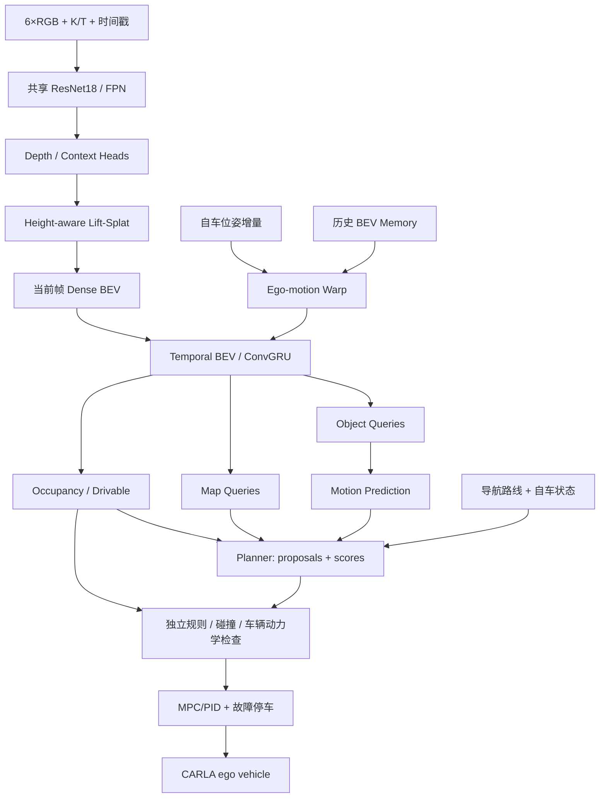

# 执行摘要

**项目名称：** HS-Drive（Hybrid Spatial Driving Network）  
**文档版本：** v1.0（对应此前讨论的网络设计 V1.3）  
**文档日期：** 2026-10-19  
**研发配置：** 单人开发、RTX 4090 24GB、CARLA 先行、六摄环视、纯视觉外部环境感知。  
**当前状态：** 技术决策与实施规划已经形成；此文档**不是**已经完成、验证或实测的系统。

**项目目标：** 在 CARLA 中实现从六路 RGB 视频、局部环境理解、时序预测、多候选轨迹规划、规则与碰撞检查，到车辆控制的完整闭环。首版聚焦中低速城市道路；后续增加复杂路口、变道、泊车、复杂天气和具有行动条件的世界模型研究。**严禁把仿真成绩视为公共道路自动驾驶安全证明。**

**定稿路线：** `6×RGB → 共享视觉编码器 → 深度辅助 Dense BEV → 时序 BEV → Sparse Object/Map Queries + Occupancy → Motion Prediction → 候选轨迹评分 → 独立安全约束 → MPC/PID → CARLA`。先建**真值深度的 Oracle BEV**，再训练 Learned BEV，最后逐级接入 Query、预测和规划。

**最先开始的工作：** 固定 CARLA 0.9.15；跑通前摄 RGB/Depth；完成 12 路同帧同步；验证相机标定、深度值和坐标变换；输出能与 GT Actor Boxes 对齐的 Oracle BEV。未通过该门禁前，不进入网络联合训练。

## 0.1 一页技术决策表

| 领域 | 当前决定 | 状态 |
|---|---|---|
| 感知约束 | 六摄 RGB 外部环境感知，无 LiDAR/Radar 作为模型输入 | 固定 |
| 自车信息 | 允许路线指令、轮速/IMU 级运动量；视觉-only 定位为后续增强 | 固定边界 |
| 仿真 | CARLA 0.9.15；离屏渲染；同步仿真 | 固定基线 |
| 评测 | 自定义几何门禁 + CARLA 闭环；后期接入 Bench2Drive 0.0.4 | 分阶段 |
| 输入 | 6×RGB 640×384、100° HFOV、10Hz | 初始假设 |
| BEV | X∈[-20,60)m，Y∈[-30,30)m；0.5m/格，160×120 | 初始假设 |
| 图像骨干 | 共享 ResNet-18 + 轻量 FPN，stride 16，64ch | 第一版 |
| 深度 | BEVDepth 风格，48 bins，1.5–80m，使用仿真深度监督 | 第一版 |
| BEV 投影 | Lift-Splat；先 PyTorch 参考实现，后高效池化 | 分阶段 |
| 高度维 | 4 个高度层，再压缩到 128ch BEV | 待消融 |
| 稀疏表征 | 128 Object Queries + 64 Map Queries，128d | 第一版 |
| 时间 | 自车运动对齐 + ConvGRU；对象实例独立记忆 | 分阶段 |
| 占用 | 当前 2D Free/Occupied/Unknown；未来 0.5–4.0s | 分阶段 |
| 规划 | 32 条候选，4s/8 点，多头评分 + 硬约束 | 第一版 |
| 执行 | 轨迹规划 5Hz 目标；控制约 20Hz 起步，超时安全处理 | 待实测 |
| 训练平台 | RTX 4090 24GB；BF16、BS=1、梯度累积、分阶段训练 | 固定约束 |

## 0.2 范围、非目标和“纯视觉”的定义

**首期范围：** 仿真六摄、相机标定、Oracle BEV、Learned BEV、对象与地图识别、2D Occupancy、短时运动预测、基本导航、车道跟随、信号灯与停止线、避障、变道、紧急停车、闭环评测、日志回放。自动泊车为独立后续阶段，复用编码器与近场占用，不强行与城市行驶共用完全相同的 Planner。

**不在首期范围：** 真正的 L4/L5 公路运营；实车控制接口；全域高精地图；量产级冗余硬件；从零训练大规模驾驶 VLA；图像生成式世界模型。任何后续实车实验均需合法合规的封闭场地及独立安全论证。

**“纯视觉”定义：** 外部道路、障碍物、车道和交通参与者必须由 RGB 图像推理，允许标定参数和高级导航指令；车辆自身运动补偿可使用轮速/IMU/里程计。CARLA 的深度、Actor 坐标、真实地图、未来轨迹**只用于标注、教师基线、几何调试、评测**，不得在正式 Learned 模式的感知/规划输入中泄漏。若未来决定采用“全部定位也只能摄像头”的严格定义，需要单独引入视觉里程计/SLAM 并更改测试合同。

# 1. 系统需求与性能目标

## 1.1 功能性需求

| ID | 需求 | 验收证据 |
|---|---|---|
| FR-01 | 六路摄像头有固定名称、内外参、时间戳和校验文件 | 相机标定可视化 + 元数据 |
| FR-02 | 12 路 RGB/Depth 与车体位姿同帧采集并可回放 | 同帧完整率统计、重放一致 |
| FR-03 | 图像深度能反投影并统一到项目右手 Ego 坐标 | 合成几何单元测试、Oracle BEV |
| FR-04 | RGB-only Learned BEV 可输出共享时空特征 | Depth/BEV 误差与分割指标 |
| FR-05 | 稀疏对象和矢量化地图输出稳定类型化接口 | GT 匹配指标、跟踪/地图可视化 |
| FR-06 | Occupancy 提供 Occupied、Free、Unknown 区分 | 可见性、障碍漏检、IoU/F1 |
| FR-07 | 时序模型能处理运动补偿、遮挡、丢帧 | 静态对齐测试、时序消融 |
| FR-08 | Planner 在导航条件下产出可追踪的轨迹候选和评分 | 轨迹可视化、规则与碰撞检查 |
| FR-09 | 控制闭环完成一组标准化路段与交互场景 | CARLA 闭环驾驶日志 |
| FR-10 | 实验可从配置、随机种子、Git SHA、权重恢复 | Run Manifest + 可复现实验报告 |

## 1.2 非功能性需求与度量

- **计算：** 单张 RTX 4090 24GB。大规模数据采集、模型训练、闭环评测分时运行；不假定单 GPU 可以同时流畅运行 12 摄渲染和完整训练。
- **接口：** 不在神经网络内部传递 CARLA Actor 对象；通过独立数据契约传递张量/元数据。
- **追踪：** 每条预测轨迹能够回溯到 `run_id`、`frame_id`、网络版本、校准版本和输入完整性。
- **容错：** 任何相机丢帧/过期、网络推理超时、标定失配、规划无有效候选，都必须记录并进入约束化减速/停车分支。该分支也不是绝对安全保证。
- **时延：** 先记录六摄编码、投影、Query、Occupancy、Planner 各模块 P50/P95/P99；仅在测量完成后宣布可达到的 Hz。目标 5Hz 规划只是设计假设，不是安全声明。

# 2. 参考技术、复用策略与边界

| 工作 | 重要思想 | 在 HS-Drive 中的用途 | 复用级别 |
|---|---|---|---|
| BEVDepth | 深度辅助多视角 BEV | Depth Head、相机感知深度、视角变换 | 学习设计、参考实现 |
| BEVDet4D | 多帧 BEV 对齐 | Temporal Warp/Feature Fusion | 参考算法 |
| UniAD | 规划导向的多任务感知/预测/规划 | 模块组织与损失设计 | 论文对照，不直接整套复制 |
| VAD/VADv2 | 向量场景、多模态概率规划 | Map 表达与规划候选 | 独立研究基线 |
| SparseDrive v1 | 稀疏实例表示、记忆、并行预测规划 | Object/Map Query、Instance Memory | 主要结构启发 |
| SparseDriveV2 | 几何路径×速度曲线、粗细两级评分 | 中期 Planner 升级 | 规划参考，不直接拼装 v1 |
| MapTR | 地图要素 Query 与折线匹配 | 矢量化 Map Decoder | 模块参考 |
| Waymo（公开资料） | Driver–Simulator–Critic、安全验证思想 | 工程闭环、失效案例库 | 系统方法论；商业系统不开放 |
| CARLA 0.9.15 | 仿真传感器、交通、物理、道路 | 第一阶段仿真底座 | 直接调用官方 API |
| Bench2Drive 0.0.4 | 44 类场景、标准化闭环评测 | 中期统一比较 | 直接复用评测框架，锁定版本 |

**兼容边界：** BEVDepth 官方实现使用较老 PyTorch / MMDetection3D 依赖。HS-Drive 首版优先参考论文和少量算子，不把 UniAD、VAD、BEVDepth、Bench2Drive 原仓库的 Python/CUDA 依赖强行混入一个环境。所有第三方源码通过 git submodule 或只读参考目录保持独立，并记录 commit SHA 与许可证。

**版本注意：** Bench2Drive 在 2026-08-06 发布 0.0.4，增加更均衡的数据分布、3D Occupancy，并保留 220 条验证路线。早期论文、数据子集和新版本指标未必可直接比较；将数据/协议版本写进每份报告。第一阶段**不下载 7.3TB 深度数据**，优先自产少量 CARLA 数据。

# 3. 总体系统架构与时钟



**分层时钟：** 物理仿真 20Hz（0.05s）→ RGB 采集 10Hz（0.1s）→ 神经感知与规划 5Hz 目标（按实际算力调整）→ 车辆控制约 20Hz 起步。相机回调存在 GPU 渲染延迟，**按仿真帧号同步**，严禁按到达先后同步。各模块须具备固定时间基准、数据年龄 `age_ms` 与最大可接受延迟阈值。

**四条主要路径：** ① Dense 空间理解；② Sparse 对象/地图表示；③ Temporal 历史和多主体预测；④ Planner → 独立检查 → 控制。训练过程中各模块可能共享梯度，但在软件层面必须是可单独替换、测量和回放的组件。

# 4. 六摄安装、相机参数与标定

## 4.1 初始相机方案

CARLA 本地坐标 X 前、Y 右、Z 上；下表的 `yaw/pitch` 也按 CARLA 约定。安装位置属于**仿真初始配置**，需要用选定车型检查遮挡。

| Camera ID | CARLA 位置 (x,y,z)m | yaw ° | pitch ° | HFOV ° |
|---|---|---:|---:|---:|
| front | (1.65, 0.00, 1.65) | 0 | -5 | 100 |
| front_left | (1.10, -0.60, 1.60) | -60 | -7 | 100 |
| front_right | (1.10, +0.60, 1.60) | +60 | -7 | 100 |
| rear_left | (-1.30, -0.60, 1.60) | -120 | -7 | 100 |
| rear_right | (-1.30, +0.60, 1.60) | +120 | -7 | 100 |
| rear | (-1.60, 0.00, 1.60) | 180 | -7 | 100 |

- 图像：640×384；先采用针孔模型、正方形像素，关闭能关闭的畸变；输出存储统一 RGB，CARLA `raw_data` 原始为 BGRA，切勿直接当作 RGB。
- 每路 RGB 对应完全同位姿、同 FOV、同尺寸的 Depth 监督相机。训练使用 Depth，**Learned 推理禁止 Depth 输入**。
- 相邻相机中心方向差 60°，100° HFOV 时理论水平角覆盖有交叠，但实际有效像素、车身遮挡、角度和视差都需实测。

## 4.2 内参与有效成像模型

采用针孔投影，`K=[[fx,0,cx],[0,fy,cy],[0,0,1]]`；理想 HFOV = 100°，宽度 W = 640 时 `fx ≈ 268.51 px`。若方形像素则 `fy = fx`。明确像素中心约定：一种选择是像素索引 `(u,v)` 对应整数像素中心，令 `cx=(W−1)/2`、`cy=(H−1)/2`；如果采用 `(u+0.5,v+0.5)` 约定，`cx=W/2`、`cy=H/2`，**二者只能选一套并全部一致**。镜头畸变为非零时需在反投影前矫正。

深度/Context Head 的输入图像若裁剪、缩放、翻转，其 K 必须同步更新；几何损失和可视化使用相同增广矩阵。

## 4.3 统一三维坐标约定

| 坐标系 | X | Y | Z | 说明 |
|---|---|---|---|---|
| `carla_ego` | 前 | 右 | 上 | CARLA / UE 左手系 |
| `optical` | 右 | 下 | 前 | 相机视觉常用光学坐标 |
| `hs_ego` | 前 | 左 | 上 | 项目统一的右手 Ego 坐标 |
| `world` | 需明确 Handedness | 需明确 | 上 | 仿真原始姿态只经统一转换进入 HS 数据 |
| `bev[i,j]` | 行 i 随 +X 增大 | 列 j 随 +Y 增大 | — | 张量 `[C,160,120]` |

定义 `S = diag(1,-1,1,1)` 将 CARLA Ego 的 Y 转成左正；将 Optical → CARLA Camera 的齐次转换记为 `C_opt_to_carla`，其三维变换是 `(x_opt,y_opt,z_opt) → (z_opt,x_opt,-y_opt)`。安装外参 `T_carla_ego_from_carla_cam` 使用相机**相对车辆**的安装 Transform（不能错用世界 Transform）。则：

```text
T_hs_ego_from_opt = S @ T_carla_ego_from_carla_cam @ C_opt_to_carla
p_opt = Z * K^{-1} @ [u, v, 1]^T
p_hs_ego = T_hs_ego_from_opt @ [p_opt, 1]^T
```

若输入深度是沿射线的 Range 而不是沿光轴的 Z，需要先根据像素射线方向转换；CARLA 文档对深度表述包括 z-buffer/distance，**本项目必须通过已知几何场景实验确认其数值定义**，不允许跳过。

## 4.4 相机几何验收

1. 光轴中心像素经无旋转前摄反投影后应指向项目 +X；左侧目标在 +Y。
2. 合成双精度点 `3D→2D+Z→3D` 平均误差 < `1e-4m`（仅数学单测，不是感知精度）。
3. 使用已知平面/方盒验证深度是 Z 还是 Range；图像角落与中央都要测。
4. 相机 3D Box 重投影，检查角点轮廓与遮挡、左右镜像和 FOV；把不同摄像头重叠区域显示在同一 Ego 视角。
5. 验证相机外参元数据和传感器 `image.transform`（同帧世界位姿）一致。

# 5. CARLA 数据采集与同步

## 5.1 同步策略

- 启用 `world.settings.synchronous_mode=True`、`fixed_delta_seconds=0.05`；Traffic Manager 若开启，也设同步。仅允许**一个**客户端驱动 `world.tick()`。
- RGB/Depth 均设 `sensor_tick=0.1`；每 2 个物理 Tick 采样一次，但以实际收到的 `image.frame` 为准，不用奇偶 Tick 猜帧号。
- 回调函数仅执行入队，不在回调中阻塞写磁盘、推理或绘图；使用 `{frame_id: {sensor_id: sample}}` 的有界缓冲与一致性检查。
- 采集每个 WorldSnapshot 与 `frame_id` 对应的车辆姿态、速度、角速度和仿真时间；对 GPU 相机延迟，以**拍摄帧**快照配准，而不是回调到达时的 `ego.get_transform()`。
- 只有 12 路和 Ego 元数据完整才提交该帧；缺失帧标记 dropped 并保存诊断记录。缓冲上限、处理超时、队列压力、停止重置机制都要实现。
- 停止时先 `sensor.stop()`，再销毁传感器和自车，恢复世界同步配置和 Traffic Manager 状态。

## 5.2 Depth 原始编码

CARLA 0.9.15 深度相机每像素用 R/G/B 三字节编码，从低到高位，图像原始缓冲为 **BGRA**。解码米数：

```python
import numpy as np

def decode_carla_depth(image):
    a = np.frombuffer(image.raw_data, dtype=np.uint8)
    a = a.reshape(image.height, image.width, 4)
    B = a[..., 0].astype(np.uint32)
    G = a[..., 1].astype(np.uint32)
    R = a[..., 2].astype(np.uint32)
    return 1000.0 * (R + 256*G + 65536*B).astype(np.float32) / 16777215.0
```

不得使用深度可视化 PNG 的灰度值替代原始数值。解码后要记录无效深度、截断深度与镜头边界；若训练仅使用 80m 深度范围，应把超界视为无效训练标签，而不是强行贴到 80m Bin。

## 5.3 样本清单和存储契约

推荐 `dataset_version=hsd-frames-v1`，`scene_id` 唯一，`frame_id` 是仿真帧号。每条样本包含：

```json
{
  "schema_version": "hsd-frames-v1",
  "scene_id": "Town03_clear_day_seed0007",
  "frame_id": 1204,
  "timestamp_s": 60.20,
  "carla_version": "0.9.15",
  "calibration_id": "sixcam-pinhole-v1",
  "cameras": {
    "front": {"rgb": "rgb/front/001204.png", "depth": "depth/front/001204.npz", "frame_id": 1204},
    "front_left": {"rgb": "rgb/front_left/001204.png", "depth": "depth/front_left/001204.npz", "frame_id": 1204}
  },
  "ego": {"T_world_from_ego": "stored-4x4-matrix", "speed_mps": 4.0},
  "labels": {"objects": "labels/objects/001204.json", "bev": "labels/bev/001204.npz"},
  "mode": "training-supervision-available"
}
```

上例省略其余四路相机以保持简短；正式 Schema 要求六个固定 Camera ID 均存在，每路独立存储 K、T、曝光/畸变设置或引用不可变的 `calibration_id`。保存 `image.transform`、`frame timestamp`、镜头属性、场景天气、地图版本、车辆蓝图、随机种子和 GT 生成方式。

**推荐结构：**

```text
data/
  raw/Town03_clear_day_seed0007/
    manifest.json
    calibration.json
    rgb/{front,front_left,front_right,rear_left,rear_right,rear}/
    depth/{front,front_left,front_right,rear_left,rear_right,rear}/
    ego/poses.jsonl
    labels/{objects,map,bev}/
  processed/{dataset_version}/
  splits/{train,val,test}.json
```

存储估算：12 个相机传感器 ×640×384×4B ×10fps ≈ **118MB/s**（十进制），即**7.08GB/分钟**的未压缩原始 BGRA 数据；不包括 JSON、GT 和冗余副本。第一批只录几十秒的样本，验证完整后再选择 PNG 压缩 RGB、单精度/量化深度（明确精度与单位）、分块读写与容量预算。不要在内存中缓存整段视频。

**数据分割：** 按 `scene_id`/地图和天气组合划分，保留未见地图；同一连续驾驶片段绝不能随机拆到训练集和测试集。保存场景配置以支持确定性重放；仿真也可能有非确定性，需要报告重复测试波动。

# 6. Oracle BEV 与真值标签设计

**核心区分：** 真实深度反投影形成的是**可见表面几何**，并不等价于完整 Free/Occupied/Unknown，也不等价于交通可行驶区域。建议构造三套独立的表示。

## 6.1 网格规范

```yaml
coordinate_frame: hs_ego
x_range_m: [-20.0, 60.0]
y_range_m: [-30.0, 30.0]
z_range_m: [-2.0, 4.0]
resolution_m: 0.5
bev_shape_hw: [160, 120]
height_bins: 4
index_rule: "i=floor((x+20)/0.5), j=floor((y+30)/0.5)"
```

`x=60` 或 `y=30` 为右开区间，不写入网格。所有数据与可视化统一 `[H=X, W=Y]`，不得随意交换行列。高度网格边界与地平面定义应记录在配置中；坡地/桥下视角要测试相对自车高度是否合适。

## 6.2 三套 Oracle 参考

| 类型 | 生成方式 | 表示什么 | 不能代表什么 |
|---|---|---|---|
| `observed_geometry` | 六路真实深度反投影、点云合并、按高度层点数统计 | 已看见的表面点 | 不代表未观测空间为空 |
| `gt_scene_occupancy` | CARLA Actor/静态几何、地面/立交结构的真值栅格化 | 仿真中真实占用 | 不代表模型已观测到 |
| `visibility_and_free` | 相机射线追踪、深度截断、遮挡计算 | 沿可验证光线的 Free 和未观测 Unknown | 不代表道路可合法行驶 |

`drivable_gt` 独立于 Occupancy，来自路面几何、道路线元素和交通规则；即使路面可行驶，也可能当前被占用。动态 Actor Boxes 可以作为已知类占用监督，静态设施仍应补充网格/语义数据，不能只靠少量 Actor 矩形覆盖所有障碍。

**优先实现顺序：** ① Depth→点云→点密度 Height BEV；② Actor Boxes 叠加；③ 目标车道区域与可行驶区；④ 按射线的 Free/Unknown 掩码；⑤ 当前和未来 GT Occupancy。绝不在 M1 就宣称完成三维 Occupancy。

## 6.3 Oracle 模式与 Learned 模式

- `oracle_geometry`: 可以使用 Depth GT、Actor GT 和 OpenDRIVE 做几何调试/基线；报告必须标注为 **Oracle / Privileged**。
- `learned_vision`: 输入六路 RGB + K/T + 合规自车状态/导航；不得读取 Depth/Actor/GT Map 作为网络预测或轨迹评分输入。
- 数据载入层以 `input_allowlist` 严格约束推理字段，评测代码对非法字段访问触发异常并记录；防止“无意的传感器泄漏”。

# 7. Learned BEV Encoder（HS-Drive V1.3）

## 7.1 张量契约（B=1 示例）

| 节点 | 形状 | 解释 |
|---|---|---|
| `images` | `[1,6,3,384,640]` | 六路 RGB 归一化 |
| `image_feats` | `[1,6,64,24,40]` | ResNet18/FPN stride16 |
| `depth_logits` | `[1,6,48,24,40]` | 每个特征点的深度分布 |
| `depth_probs` | `[1,6,48,24,40]` | D 维 softmax |
| `context` | `[1,6,64,24,40]` | 与深度相乘的语义特征 |
| `height_bev` | `[1,64,4,160,120]` | 高度分层 BEV |
| `bev_current` | `[1,128,160,120]` | 高度压缩后的当前帧 BEV |
| `bev_temporal` | `[1,128,160,120]` | 自车对齐、时间融合 |
| `visible_mask` | `[1,1,160,120]` | 观测证据/有效区辅助掩码 |

采用 48 个深度 Bin 覆盖 1.5–80m；优先实验**近密远疏 LID** 与均匀离散化。每个光学像素中心 `q=(u,v,1)`、光轴深度 `d_k` 对应 `p_opt=d_k K^{-1} q`，经 `T_hs_ego_from_opt` 得到 Ego 点。按 `(x,y,z)` 分配到高度 BEV 网格。约 `6×48×24×40=276,480` 个几何采样点/帧。禁止将完整 `B×N×D×C×H×W` 特征体作为长期实现；先以便于测试的 PyTorch `scatter_add` 参考版验证梯度，再评估 BEVPoolv2/替代池化实现。

**单帧损失：** `L_depth`（有效像素的深度 Bin 监督）+ `L_drivable`（可行驶区）+ `L_occ_current`（当前占用）+ 其他可选辅助项。权重在实验配置中逐一记录，第一版不凭空预先指定“最佳”权重。

## 7.2 Height-aware 表征

先保留 4 层高度分组，再用轻量 3D/2D 卷积投影成 `[128,160,120]`。四层分组是设计候选而非已经验证的最优结构；对桥梁、坡地、悬空物/地面箱体做 1 层 vs 4 层消融。该特征仍不是高精度 3D Occupancy GT。

## 7.3 Temporal BEV

设世界位姿 `T_world_from_ego(t)`，则历史 Ego 坐标到当前 Ego 的变换：

```text
T_ego(t)_from_ego(t-1) = inverse(T_world_from_ego(t)) @ T_world_from_ego(t-1)
```

实现采样时，对每个**当前目标网格**求对应的历史源网格，按逆向坐标用 `grid_sample` 读取。随后以 `H_t=ConvGRU(B_t, warp(H_{t-1}))` 更新隐藏状态。加入 `validity_mask`、历史权重衰减、失效重置，保留上一时刻真实时间戳与位姿；动态目标自身运动由 Instance Memory/Motion 分支处理，不可误把自车对齐等同于全部动态补偿。

**训练顺序：** 单帧 BEV 先收敛；再训练 3–4 帧截断 BPTT；监测 BEV 漂移、静态重影、遮挡期间恢复效果，最后接对象记忆。

# 8. Sparse Object / Map Queries

## 8.1 Object Decoder

- 数量 `N_obj=128`，特征维 `Cq=128`；参考点 `(x,y)` 或 3D Anchor。
- Query 经自注意力、3 层轻量局部可变形 BEV Cross-Attention、FFN 更新；最初每 Query 每层 4 个空间采样点只是实验起点。
- 输出 `[class, score, x,y,z,l,w,h,yaw,vx,vy,embedding]`；坐标统一 `hs_ego`。支持 Hungarian 匹配、正负样本过滤和未匹配 Query 的空类。
- 除跨帧保留的已有 Object Queries，还需要 Discovery Queries 发现新目标；不能全靠前一帧跟踪。

## 8.2 Map Decoder

`N_map=64, Cq=128`；每 Query 输出某一车道线、道路边界或停止线（初始每个元素 `20×2` 控制点、类别、置信度）。使用方向无关/点序排列一致的匹配规则，参考 MapTR。地图元素表征为局部自车坐标，不把 CARLA OpenDRIVE 直接喂入推理。

## 8.3 第二版图像增强（非 M1 必需）

使用对象 3D Anchor 重投影到六路相机，按有效视角采样 FPN 特征，构造 `q_fused = q_bev + g(q,validity)·Wq_img`。此分支仅在 BEV-only 训练稳定并有基线之后添加；以延迟、显存、检测与规划结果的综合改进决定是否保留。直接图像采样是可选增强，不改变标准输出接口。

# 9. Occupancy、预测、交通语义与安全边界

## 9.1 Occupancy 输出

初期 Occupancy 为 `[B,9,3,160,120]`，9 个时片为 `t=0,0.5,...,4.0s`；3 类 `Free/Occupied/Unknown`。使用有效区域掩码，不把缺失数据当成 Free。未来 Occupancy 是**无条件或弱条件的场景预测**，并非已经实现对每条自车动作进行反事实推演。

## 9.2 Object Motion

对每个可靠对象保留最多 3 条未来运动模式，包含 `K=8` 个 0.5 秒步长轨迹点和概率/有效性。与未来占用共同服务 Planner；二者来自共享特征并有误差相关性，不能把它们简单相乘当作独立安全证据。

## 9.3 显式交通语义

增加红绿灯状态、停止线、导航车道级意图、限速与合法车道规则接口。仅靠 Occupancy 不能判断红灯禁止通行。V1 用规则检查与学习型感知结合：视觉识别交通灯/停止线，Planner 候选轨迹必须遵守已知交通规则；未知/低置信语义采用保守策略。

# 10. Planner、硬约束与控制

**目标：** 输出未来轨迹，而非直接输出转向舵角。输入 `Object + Map Tokens`、`Motion`、`Occupancy`、`Drivable`、`route_command` 与自车状态。建议 `N=32` 条候选、`K=8` 点、0.5s 间隔（共 4s），每点 `(x,y,yaw,v)`，即 `[B,32,8,4]`。

**第一版候选生成：** 规则或几何采样（直行、跟车、停车、允许的换道）+ 轻量网络轨迹评分；第二版升级为路径几何和速度曲线组合，以及 SparseDriveV2 风格粗排/精排。模仿学习的专家轨迹与规则条件必须版本化。

候选轨迹的排序可以综合 `S_learned - λ_occ R_occ - λ_rule R_rule - λ_comfort R_jerk`；但**硬约束不应只实现成一个可以被高学习分数抵消的软惩罚**。正式入选前需独立检查：

1. 车辆完整 footprint 与扫掠体对静态/动态障碍和 Unknown 风险的交集。
2. 车道边界、可行驶区和交通灯/停止线约束。
3. 横向加速度、曲率、转向限幅、纵向加减速、制动距离与轨迹连续性。
4. 传感器失效、规划陈旧、地图/时间冲突时拒绝候选并切换保守逻辑。

**控制：** 首期使用纵向 PID + Pure Pursuit/Stanley 横向跟踪，之后用车辆运动学 MPC；控制接口为 `target_trajectory` → `{steer, throttle, brake}`。控制器不得读取 Actor GT 帮助“作弊”避障。安全回退为条件化减速与最小风险停车，**不保证在所有紧急情况下绝对安全**。

# 11. 模块 API 与内存接口

建议项目通过 `TypedDict/dataclass` 或 Pydantic 生成不可变数据契约；以形状、坐标、单位和时间戳作为接口一等公民。

```python
# 伪代码：接口设计，并非已运行的训练模型
Batch = {
    "images":       "float[B,6,3,384,640]",
    "intrinsics":   "float[B,6,3,3]",
    "cam_to_ego":   "float[B,6,4,4]",  # 已统一为 hs_ego<-optical
    "ego_pose":     "float[B,4,4]",    # 规定使用统一右手 world
    "ego_state":    "float[B,E]",      # 速度、角速度等
    "route_command": "int[B]",
    "timestamps_s": "float[B]",
    "valid_cameras": "bool[B,6]",
}
Memory = {
    "bev_hidden":   "float[B,128,160,120]",
    "ego_pose_prev": "float[B,4,4]",
    "timestamp_prev": "float[B]",
    "object_tracks": "object track states and features",
}
Output = {
    "bev_current": "float[B,128,160,120]",
    "bev_temporal": "float[B,128,160,120]",
    "objects": "sparse object predictions",
    "maps": "sparse vectorized map elements",
    "occupancy_logits": "float[B,9,3,160,120]",
    "trajectories": "float[B,32,8,4]",
    "traj_scores": "float[B,32]",
    "memory_next": "Memory",
}
```

必须为这些字段附 `coordinate_frame`、`units`、`timestamp`、`calibration_hash` 和 `schema_version`。API 返回网络预测，不返回 CARLA 对象。**控制/安全/数据采集三个进程的输入白名单互不混用。**

# 12. 代码仓库与部署结构

```text
hs-drive/
├── README.md
├── docs/
│   └── HS-Drive_Technical_Plan_v1.0.md
├── configs/
│   ├── carla.yaml
│   ├── cameras.yaml
│   ├── bev.yaml
│   ├── model.yaml
│   ├── train.yaml
│   └── eval.yaml
├── simulator/
│   ├── session.py
│   ├── camera_rig.py
│   ├── synchronizer.py
│   ├── recorder.py
│   └── closed_loop_runner.py
├── geometry/
│   ├── coordinates.py
│   ├── cameras.py
│   ├── carla_depth.py
│   ├── oracle_bev.py
│   └── warp_bev.py
├── datasets/
│   ├── schema.py
│   ├── carla_dataset.py
│   ├── labels.py
│   └── split.py
├── models/
│   ├── image_encoder.py
│   ├── depth_context_head.py
│   ├── view_transform.py
│   ├── temporal_bev.py
│   ├── sparse_decoders.py
│   ├── occupancy_head.py
│   ├── motion_head.py
│   └── planner.py
├── control/
│   ├── controller.py
│   └── safety_checker.py
├── eval/
│   ├── metrics.py
│   ├── scenarios.py
│   └── replay.py
├── tools/
│   ├── check_carla.py
│   ├── record_dataset.py
│   ├── visualize_oracle_bev.py
│   ├── train_bev.py
│   └── eval_closed_loop.py
├── tests/
│   ├── test_depth_decode.py
│   ├── test_projection.py
│   ├── test_bev_indexing.py
│   ├── test_warp.py
│   ├── test_frame_sync.py
│   └── test_no_gt_leakage.py
├── third_party/       # 独立只读参考，不直接混依赖
└── runs/              # 不提交大数据/模型权重
```

提交规范：`configs` 和 `docs` 入 Git；`data/raw`、`runs/checkpoints`、`.cache` 使用 `.gitignore`；每次训练建立 `{run_id}/config.yaml`、`git_sha.txt`、`env.lock`、`metrics.jsonl`、`calibration.json`。任何超参数变化作为独立 experiment id，禁止覆盖旧结果。

# 13. 服务器环境与部署操作手册

## 13.1 初次登录检查

```bash
uname -a
lsb_release -a || cat /etc/os-release
nvidia-smi
nvidia-smi --query-gpu=name,memory.total,driver_version --format=csv
df -h
free -h
python3 --version
command -v conda || true
command -v git
```

**环境建议：** Linux x86_64、支持 NVIDIA GPU 的驱动及图形渲染组件，优先使用已经验证可运行 CARLA 0.9.15 的 Ubuntu 主机。未确定系统版本前不承诺具体 apt/驱动安装命令；尤其不能默认 Ubuntu 24.04、所有云 GPU 镜像或容器都有可用 Vulkan/UE4 图形栈。若是远程云服务器，还需校验图形渲染权限、共享内存和磁盘 I/O。

## 13.2 目录与环境隔离

```bash
mkdir -p "$HOME/projects/hs-drive" "$HOME/simulators" "$HOME/datasets/hs-drive"
cd "$HOME/projects/hs-drive"
# 将本交接包中的 docs/configs 放入仓库并纳入版本控制

# 示例：已装好 conda/miniconda 的情况下
conda create -y -n hs-sim python=3.10
conda activate hs-sim
python -m pip install --upgrade pip
python -m pip install 'carla==0.9.15' numpy opencv-python-headless pyyaml pytest
python -c 'import carla; print("CARLA Python API import OK")'
python -m pip freeze > requirements-sim.lock.txt
```

PyPI 官方 `carla==0.9.15` 具有 Linux CPython 3.10 wheel；首次安装后必须验证和**正在运行的 CARLA Server 包完全同版本**。不使用来源不明的同名兼容包代替。

训练环境独立于仿真环境：

```bash
conda create -y -n hs-train python=3.10
conda activate hs-train
python -m pip install --upgrade pip
# 从 https://pytorch.org/get-started/locally/ 选择与服务器驱动兼容的 PyTorch/CUDA wheel
# 安装完成后执行：
python -c 'import torch; print(torch.__version__, torch.cuda.is_available()); print(torch.cuda.get_device_name(0) if torch.cuda.is_available() else "NO GPU")'
```

不在此文档中声称某个未来 Torch/CUDA 组合已在该服务器验证。首次跑通后输出 `requirements-train.lock.txt`、`torch.__version__`、CUDA runtime、NVIDIA driver、GPU 可用显存与 `git_sha`。

## 13.3 CARLA 无显示器服务器运行

下载**官方版本 0.9.15** Linux Package，解压到 `~/simulators/CARLA_0.9.15`；实际文件名、路径、安装方式以对应官方 Release 为准。

```bash
cd "$HOME/simulators/CARLA_0.9.15"
./CarlaUE4.sh -RenderOffScreen -quality-level=Low -nosound
```

`-RenderOffScreen` 是**离屏渲染**，GPU 相机仍会生成图像；不要将 `world.settings.no_rendering_mode=True` 用于 RGB/Depth 采集，否则渲染传感器可能返回空数据。CARLA 通常通过 localhost TCP 2000/2001 通信，服务器防火墙不要对公网开放仿真端口；远程开发通过 SSH 隧道或内部网络连接。

开启另一个终端检查：

```bash
conda activate hs-sim
python - <<'PY'
import carla
c = carla.Client('127.0.0.1', 2000)
c.set_timeout(15.0)
w = c.get_world()
print('MAP:', w.get_map().name)
print('CLIENT:', c.get_client_version())
print('SERVER:', c.get_server_version())
PY
```

初期使用低画质测试相机同步与几何；训练正式视觉模型前还要研究低画质对视觉域的影响，不能用无纹理图像证明正常道路泛化。服务器关闭 terminal 时推荐 `tmux` 维持会话、日志重定向和非交互启动；设置独立的日志目录、重启策略及显存监测。

## 13.4 两条运行模式（规划 CLI，尚未实现）

```bash
# 这些是拟定项目 CLI 接口，不是现成可运行命令。
python -m tools.record_dataset --config configs/carla.yaml --frames 300
python -m tools.visualize_oracle_bev --scene Town03_clear_day_seed0007
python -m tools.train_bev --config configs/train.yaml
python -m tools.eval_closed_loop --config configs/eval.yaml
```

实施时每个 CLI 都必须支持 `--help`、输出路径、运行 ID、异常退出码、固定随机种子、失败后可恢复和 Run Manifest；**不要将规划接口误认为已经开发好的程序**。

# 14. 网络训练计划与显存策略

| 阶段 | 训练目标 | 冻结/保护 | 完成证据 |
|---|---|---|---|
| T0 | Oracle 几何和真值投影 | 不使用神经网络 | 3D/BEV 对齐图、单位测试 |
| T1 | Backbone、Depth、Context、BEV、Drivable | Sparse、Temporal、Planner 关闭 | 深度分段误差、BEV 指标 |
| T2 | Object/Map Sparse Decoder | 起步冻结 Backbone，渐进微调 | 检测/地图与可视化 |
| T3 | Temporal BEV + Instance Memory + Motion | 截断 BPTT | 遮挡和静态对齐收益 |
| T4 | Occupancy Future Head | 显式 Unknown mask | Occupancy IoU/F1、碰撞关联 |
| T5 | 32 轨迹 Planner / Scorer | 起步冻结感知与深度梯度 | 离线轨迹指标+闭环 A/B |
| T6 | 选择性联合微调 | 小 LR + 梯度隔离消融 | 闭环泛化与性能 |

**4090 资源计划：** BF16 混合精度、BS=1、必要时梯度累积、checkpointing、半精度激活；先单帧再短时序；预先缓存图像特征仅适用于冻结 Backbone 的实验。CARLA 不与大型训练同时争抢 GPU。第一次训练需报告 `max_memory_allocated/max_memory_reserved` 与各模块耗时，并保留 OOM 降级配置（单帧/减小通道/深度 bins/BEV 范围）。

**基础损失：** 深度 CE/软 Bin 标签、BEV Seg BCE+Dice/CE、对象类别与框回归、矢量地图匹配、轨迹位置/朝向/速度、概率评分、预测 Occupancy CE。各损失有效 mask 和标签来源必须明确；后续用配置扫描损失权重。禁止将 Planner Loss 一开始直接反传到所有 Backbone 层。

# 15. 闭环驾驶、数据闭环与评测

## 15.1 三个基线不可混淆

| Baseline | 传感器/真值 | 能回答什么问题 | 不能用于什么声明 |
|---|---|---|---|
| `Oracle-Rule` | CARLA Actor/地图真值 | 规划/控制/场景能否闭环 | 不能称纯视觉驾驶 |
| `RGB-SingleFrame` | 六摄 RGB | 感知和基础 Planner 最低能力 | 不能证明时序或世界模型优势 |
| `RGB-Temporal-Hybrid` | RGB + 合规 Ego/导航 | 我们真正的目标 | 仍不能证明真实公路 L4 安全 |

**开发顺序：** 先跑通可控的 Oracle 规则驾驶，用来检验 route、控制、交通规则和 scenario runner；随后用 Learned BEV 替换 Actor GT，严格清理输入白名单。

## 15.2 评测指标

- **感知/几何：** depth MAE/AbsRel（按 0–10m、10–30m、30–60m 分段）、3D 定位误差、BEV 可行驶区 IoU、Objects mAP/Recall、Map Chamfer/IoU。
- **占用/预测：** 当前/未来 Occupancy IoU/F1，Unknown 识别，运动预测 ADE/FDE 和多模态覆盖率。
- **规划：** 轨迹 L2、规则违反、碰撞扫掠检查通过率、舒适性/加速度/Jerk。
- **闭环：** 路线成功率、碰撞率（按里程/场景）、红灯和逆行、介入/紧急停车次数、平均驾驶速度和时延。
- **系统：** 输入完整率、时钟延迟、GPU P50/P95/P99、显存峰值、仿真 Crash/Timeout、恢复率、结果可复现性。

**不要只看规划 L2！** 离线轨迹误差不能替代闭环碰撞、规则和场景完成率。把失败分为 `perception / prediction / planner / controller / synchronization / simulator`，一类问题修复后重复回放相同场景。

## 15.3 测试场景矩阵

- 直路跟车与前车急刹；静止障碍/散落货物；合法变道与侧后方快速来车。
- 信号灯、停止线、十字路口无保护左转、行人突然横穿、遮挡后现身。
- 雨/雾/夜晚、新地图、摄像头失效、里程计噪声、推理延迟。
- 中期采用 Bench2Drive 0.0.4 标准协议；报告必须注明场景/路线完整数与数据版本，不能只选择成功路线统计均值。

## 15.4 Driver–Simulator–Critic 闭环

每次路线运行写入：六摄帧、输入合法性标记、BEV/Query/Occ、所有轨迹候选/评分、最终选轨迹、安全拒绝原因、控制量、碰撞/规则事件、场景种子、地图及天气。Critic 自动将失败原因打标签，生成重放任务。训练新模型后，在完全一致的场景集进行 A/B 回放，评价是否真正改善，而不是仅展示少量成功视频。

# 16. 路线图、任务拆分与验收门禁

时间为单人、熟悉 PyTorch/CARLA 的**规划区间**，不构成进度承诺。优先级分 P0 必做、P1 增强、P2 研究。

| 阶段 | 建议用时 | 优先级 | 核心成果 | 通过门禁 |
|---|---|---|---|---|
| M0 服务器与依赖 | 2–4 天 | P0 | CARLA offscreen、API 连接、GPU/磁盘检查 | 服务器/客户端版本一致、RGB 非空 |
| M1 六摄与标定 | 4–7 天 | P0 | 12 摄同帧同步、相机元数据 | 有效录制片段无混帧，异常被记录 |
| M2 Oracle BEV | 5–10 天 | P0 | Depth→Ego 点云→4 层 BEV→Actor GT 可视化 | 合成几何精度达标、场景对齐可解释 |
| M3 Dataset v1 | 3–6 天 | P0 | 可重放、场景切分、可复现数据读取 | 标定/版本/种子齐全，无 GT 泄漏 |
| M4 Learned BEV | 2–4 周 | P0 | Depth/Context、BEV、Drivable | 可靠分段误差与未见地图测试 |
| M5 Sparse + Occ | 3–5 周 | P1 | Object/Map Query、当前占用 | 基准指标和未知障碍消融 |
| M6 时序与运动 | 2–4 周 | P1 | Warp+Memory、运动预测 | 遮挡/低速交通交互提升 |
| M7 Planner+闭环 | 3–6 周 | P1 | 轨迹候选、安全约束、控制 | 多场景完成并报告失败分布 |
| M8 高级研究 | 持续 | P2 | Flow/Diffusion 规划、World Model、泊车 | 与冻结基线的可重复消融 |

**里程碑原则：** 每个阶段必须提供 `代码 + 运行命令 + 配置 + 原始日志 + 可视化 + 验收测试`，缺任何一项不得标记完成。性能未达标时先缩小变量，避免不断引入复杂模型掩盖基础错误。

## 16.1 服务器首两周执行清单

| 顺序 | 任务 | 产物 | 验收 |
|---|---|---|---|
| D1 | `nvidia-smi`、驱动、磁盘/网络、CARLA 版本核对 | `docs/server_env.md` | 能正常启动 CARLA |
| D2 | CARLA 0.9.15 离屏渲染、Python client smoke test | `logs/smoke.json` | 前摄 RGB/Depth 非空 |
| D3–4 | 单摄标定、内参/外参、深度解码和单测 | `geometry/`、测试结果 | 合成投影精度、前后左右正确 |
| D5–6 | 六摄成对安装、仿真同步/队列 | `simulator/camera_rig.py`/`synchronizer.py` | 12 路同帧、镜头无混帧 |
| D7 | 保存 30–60s 数据，统计丢帧/磁盘吞吐 | `data/raw/*` + manifest | 可回放且不丢标定信息 |
| D8–9 | 反投影、点云融合、高度分层 BEV | `geometry/oracle_bev.py` | 点位置符合 GT |
| D10–11 | Actor 3D Boxes 投影/GT BEV 叠加 | 诊断四宫格截图 | 左右、距离和遮挡正确 |
| D12 | 发现/修复 Range vs Z、畸变与坐标问题 | `docs/geometry_decisions.md` | 深度几何类型已明确 |
| D13 | 统一 Dataset Schema、用例与未见地图拆分 | `datasets/schema.py` | 测试脚本可批量读写 |
| D14 | M1/M2 门禁复盘、锁定首版配置 | `reports/milestone_01.md` | 进入训练阶段的证据齐全 |

若 CARLA/渲染不稳，D2–D14 顺序允许后移，**不可跳过 Oracle BEV 验收而直接训练网络**。

# 17. 风险登记与应对

| 风险 | 影响 | 预防/应对 |
|---|---|---|
| CARLA 0.9.15 驱动/图形库不兼容 | 无法采集 12 摄 | 固定镜像/驱动版本、先单摄离屏 Smoke Test |
| GPU 相机延迟和帧混合 | 训练标签空间错位 | 按 frame_id 同步、快照缓存、丢帧统计 |
| CARLA LH / Optical / HS RH 坐标错误 | BEV 左右翻转或位置漂移 | 坐标模块唯一、合成点投影、可视化双验证 |
| Depth Z/Range 定义误解 | 边缘物体距离偏差 | 已知几何平面/像素中心+边缘对照实验 |
| 相机遮挡与远距离分辨率不足 | 远距离感知失败 | 近远距离分段评测、高分辨率前视升级研究 |
| GT 泄漏到推理 | 假的纯视觉性能 | input allowlist、审计测试、Oracle 与 Learned 分离 |
| Unknown 被错误作为 Free | 遮挡场景碰撞 | 保留可观测性/遮挡标签、独立碰撞检查 |
| 4090 显存/渲染竞争 | OOM、低速、难复现 | 分时任务、混合精度、BS=1、分阶段训练 |
| 论文代码与 CUDA/MMCV 冲突 | 环境脆弱 | 参考仓库隔离、锁依赖、先纯 PyTorch |
| 规划指标离线好闭环差 | 系统功能不可靠 | Oracle-Rule/视觉基线/闭环按阶段对照 |
| 天气或地图过拟合 | 泛化失败 | 分场景/地图切分、留出测试镇、鲁棒性组 |
| 新增模块过多导致研发失控 | 迟迟不出闭环 | 每个阶段单一 DoD，禁止前阶段未过门禁抢跑 |

# 18. 消融实验与研究路线

初始实验建议按资源依赖排序：

| 实验 ID | 对照 | 研究问题 |
|---|---|---|
| A1 | Oracle depth / learned depth | 深度误差造成多大 BEV 与最终规划损失？ |
| A2 | 均匀 depth bins / LID | 哪种离散化更适合近场与远场？ |
| A3 | 2D BEV / 4 层 Height-aware BEV | 桥梁、坡地、异形障碍是否受益？ |
| A4 | BEV-only Sparse / BEV+Image Sampling | 双流是否值得显存和延迟代价？ |
| A5 | 无 Temporal / BEV ConvGRU / BEV+Instance Memory | 时序在哪类场景有效？ |
| A6 | Sparse-only / Occupancy-only / Hybrid | 是否减少未知物体相关碰撞？ |
| A7 | 单轨迹回归 / 多候选评分 | 多解驾驶决策是否改善？ |
| A8 | 无安全检查 / 有硬约束 | 闭环违规、碰撞和保守性有何变化？ |

每组仅改变一个主要变量；保持同一测试场景、种子集合、算力记录和相机设置，报告均值及失败案例。对于没有通过预定义验收标准的新组件，回退到上一个已验证版本。

# 19. 交接状态、待办与决策日志

## 19.1 本文档确认的事项

- [x] 六摄纯视觉外部感知，单张 4090，CARLA 优先。
- [x] BEV-Centric 第一版，Sparse+Occupancy 并行，未来增加直接图像采样。
- [x] Oracle 深度几何先于 Learned BEV。
- [x] 时序使用 Ego Warp + ConvGRU，随后实例记忆。
- [x] Planner 输出轨迹，独立安全检查，底层控制执行。
- [x] CARLA 0.9.15 基线，Bench2Drive 0.0.4 作为中期评测参考。

## 19.2 尚未验证 / 需要服务器确认

- [ ] 实际服务器 OS、GPU 驱动、图形栈、存储空间、CARLA 包来源。
- [ ] 12 相机渲染的吞吐量、显存与帧同步完整率。
- [ ] CARLA Depth 数据与光轴深度的数值关系。
- [ ] 相机选定车型的遮挡，100° HFOV 在远距离的有效分辨率。
- [ ] `ResNet18+FPN + 48bins + Height4 + ConvGRU` 的真实训练/推理性能。
- [ ] BEVPoolv2 CUDA 算子是否可与服务器 Torch 版本稳定编译。
- [ ] Occupancy 的静态障碍标签覆盖和 Unknown 监督方法。
- [ ] Closed-loop 前置控制策略、紧急制动阈值和速度上限。
- [ ] 独立评测的地图拆分、场景种子、指标协议。

## 19.3 下一次研发会话的起始指令

> 继续 HS-Drive 项目实施。以 `HS-Drive_Technical_Plan_v1.0.md` 为唯一当前技术基线，先推进 M0–M2，不要直接开始训练 SparseDrive。请检查服务器环境并实现 CARLA 0.9.15 六摄 RGB/Depth 同步采集、相机几何、深度解码、Oracle BEV、同帧 3D Box 叠加和 pytest 验收。每完成一个模块，给出具体文件、可运行命令、运行日志和未解决风险。任何 CARLA GT 都只能用于监督/调试，不能进入 Learned 视觉推理输入。

# 20. 官方资料与参考仓库

以下链接为可直接打开的源页面；关键事实以对应固定版本、固定 Git commit 的本地副本为准。整理时间：2026-10-19。

1. **CARLA 0.9.15 Sensors Reference**（深度编码、BGRA、坐标、传感器参数）：https://carla.readthedocs.io/en/0.9.15/ref_sensors/
2. **CARLA 0.9.15 Synchrony & Time Step**：https://carla.readthedocs.io/en/0.9.15/adv_synchrony_timestep/
3. **CARLA 0.9.15 Bounding Boxes**：https://carla.readthedocs.io/en/0.9.15/tuto_G_bounding_boxes/
4. **CARLA Off-screen Rendering**：https://carla.readthedocs.io/en/0.9.15/adv_rendering_options/
5. **CARLA 0.9.15 PyPI wheel**：https://pypi.org/project/carla/0.9.15/
6. **CARLA 0.9.15 Traffic Manager**：https://carla.readthedocs.io/en/0.9.15/adv_traffic_manager/
7. **Bench2Drive 官方仓库**（含 2026 0.0.4 更新）：https://github.com/Thinklab-SJTU/Bench2Drive
8. **BEVDepth**：https://github.com/Megvii-BaseDetection/BEVDepth
9. **BEVDet**：https://github.com/HuangJunJie2017/BEVDet
10. **BEVFormer**：https://github.com/fundamentalvision/BEVFormer
11. **UniAD**：https://github.com/OpenDriveLab/UniAD
12. **VAD/VADv2**：https://github.com/hustvl/VAD
13. **SparseDrive v1**：https://github.com/swc-17/SparseDrive
14. **SparseDriveV2**：https://github.com/swc-17/SparseDriveV2
15. **MapTR**：https://github.com/hustvl/MapTR
16. **MatrixVT**：https://github.com/ZRandomize/MatrixVT
17. **PyTorch 安装选型**：https://pytorch.org/get-started/locally/
18. **Waymo AI 安全与模型体系公开介绍**：https://waymo.com/blog/2025/12/demonstrably-safe-ai-for-autonomous-driving/

---

**交付说明：** 本文档是技术设计基线和实施计划，不代表其中所有代码或性能已被执行验证。服务器首次成功运行后，应生成 `docs/HS-Drive_Technical_Plan_v1.1.md`，记录实际 OS/GPU/驱动、依赖 lockfile、首轮采集结果、已通过的 pytest，以及所有与本版不一致的决策。
