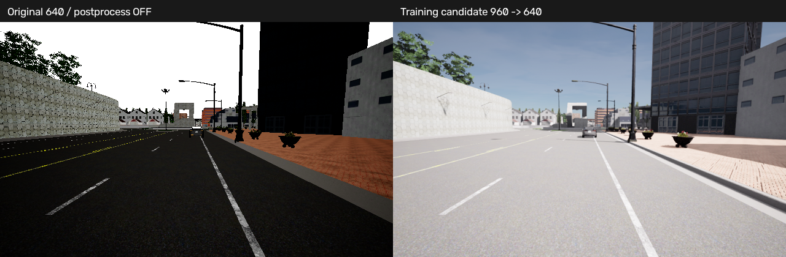

# 训练前成像验证结果

2026-10-19，实际RTX 4090 / CARLA 0.9.15 / Town03 / Epic。继承HS-Drive V1.3；这是M3数据标准化之前的成像工程验证。M2历史门禁未改写，M3数据划分/训练loader/M4网络训练尚未完成。

**日间采集默认选定 `training-960-v4`，最终成像门禁15项全部通过。** 机器结果 [imaging_gate.json](imaging_gate.json) 含证据SHA256。正式采集仍逐场景检查完整性；有限测试不保证未来零丢帧。

## 选择与代价

- Epic，六摄960×576 RGB+Depth，原六摄外参/FOV与数据集10Hz输出不变；传感器逐0.05秒物理步渲染，按统一帧号选择每两步的一帧。
- RGB开启后处理，gamma2.2，histogram曝光[10,12]、−0.5EV；关闭运动模糊、bloom、lens flare，fstop16。
- 计划训练输入仍为640×384；已有RGB缩放/内参更新辅助函数。Depth保留原尺寸供监督采样，尚未实现完整训练loader。
- 调用 [configs/data_capture.yaml](../configs/data_capture.yaml)；40tick预热、每tick等待0.5秒，不改变0.05秒物理步长。
- 最终301帧耗时480.91秒（含等待、PNG/NPZ写盘），0.626完整帧/墙钟秒；总过程501.09秒。
- 整卡约0.5秒采样显存最大值4719MiB，非精确峰值、非训练显存；原始文件2.545GiB，约8.66MiB/完整六摄帧。



画面改善同时包含后处理和采集分辨率的变化，不能把全部差异归因于分辨率。固定曝光v3的三档原生分辨率对照在 [imaging_resolution/report.json](imaging_resolution/report.json) 与 [目标裁剪](imaging_resolution/native_target_comparison.png)；25m目标的原生框高约27.77/41.66/55.54像素，缩至共同640后额外信息会减少。

## 实测门禁

| 检查 | 结果 |
|---|---|
| 正午301帧 | 六摄最大近黑1.335%、近白0.00000%、相邻RGB MAE0.513 |
| 日落11帧 | 六摄最大近黑2.964%、近白0.01137%、相邻RGB MAE0.737 |
| 连续采集 | 301帧/30.00仿真秒、12路同帧、完整率100%、零cadence gap |
| 静态六摄重叠 | 6组/12方向通过，301帧全量完整性校验，7帧几何采样 |
| 低速自车运动 | 61帧，位移7.271m，最高1.976m/s |
| 运动中重叠 | 12方向通过，最大P95绝对深度误差0.003779m |
| 运动补偿 | 六摄通过，最大P95误差0.000237m |
| 后处理与Depth | 同分辨率、同车/目标位姿、同K/外参；六摄P95差值0m；少数变化叶片/边缘保留为差异 |
| 工程回归 | 51项pytest通过；pip check及compileall通过 |

近黑/近白是640×384诊断图中灰度≤5/≥250，在1.5–80m有效深度表面统计；每摄比例是该片段均值，不是物理过曝测量。阈值近黑/近白各≤5%、静态相邻帧MAE≤2。几何只检查2–40m平滑可见表面，遮挡/不连续边缘独立处理。

## 失败记录与适用范围

- 首次geometry640短测暴露了延迟预热回调边界问题。同步器现在显式声明采集起点，旧回调只计作预热诊断，不改帧号。独立基准重测通过。
- 曝光v2大范围直方图导致白天大面积泛白，拒绝；v3日落后右摄近黑5.29%，超过预先5%阈值，拒绝作为日间统一默认。
- 1280v3短测有同步丢帧；其吞吐不能当作可靠性能，未选为默认。其他1280短测成功也不等于通过长期门禁。
- 960v4首次301帧在0.3秒/tick下出现部分传感器相邻帧错位，写满301但完整性失败；保留 [失败门禁](imaging_gate_v4_unpaced_failed.json) 与 `stability_960_v4` 原数据。0.5秒/tick独立重测也失败，保留stability_960_v4_paced。最终改为每物理tick渲染并显式统一选10Hz帧后重测通过，无阈值放宽、无错帧拼接。源码和历史问题支持独立TickInterval调度这一怀疑，但尚未证明UE4内部根因；详见执行说明。
- 当前只验证Town03固定安装在太阳高度50°/8°的静态成像，加低速直行几何；不外推到所有白天天气/位置。夜间白天参数退化明显，且本轮未专门启动车头灯；夜雨、雾与多场景还需独立采集验收。
- 画面可读性不等于模型精度。没有训练过网络，960相对640的学习收益需要控制数据量/划分/曝光的消融验证。
- 后摄保留原安装的车身遮挡；Low模式Town03 Vulkan问题依旧只是通过Epic规避，没有宣称修复UE4底层问题。

完整汇总 [metrics.md](imaging_accepted_comparison/metrics.md)、[六摄图](imaging_accepted_comparison/six_cameras.png)、[执行说明](../docs/IMAGING_VALIDATION.md)。原始成像数据在 `/root/gpufree-data/hs-drive-data/imaging/`，运动数据在 `/root/gpufree-data/hs-drive-data/raw/imaging_motion_v4_everytick/`。原始实验参数、标定、文件校验和及运行时源码hash均保留。

## 服务器执行

```bash
cd /root/gpufree-data/hs-drive/HS-Drive_Server_Handoff_v1.0
source .venv/bin/activate
# 在单独终端保持服务端运行：
runuser -u ubuntu -- bash scripts/start_carla.sh /root/gpufree-data/simulators/CARLA_0.9.15 2000 Epic
```

在另一个终端执行：

```bash
cd /root/gpufree-data/hs-drive/HS-Drive_Server_Handoff_v1.0
source .venv/bin/activate
python -m tools.record_dataset --capture-config configs/data_capture.yaml --load-map \
  --frames 301 --output /root/gpufree-data/hs-drive-data/raw --run-id training_day_001
python -m tools.validate_recording \
  --scene /root/gpufree-data/hs-drive-data/raw/training_day_001 \
  --output reports/training_day_001_integrity.json
```

run-id不可覆盖已有目录。该命令仍是当前无交通管理器的静止几何采集器，不是完整自动驾驶训练数据生成；世界实际天气写入manifest，配置不会自动更改天气。

收尾确认：测试后Town03世界恢复异步，剩余sensor/vehicle均为0；本轮CARLA服务端已主动停止，释放GPU供后续工作。
