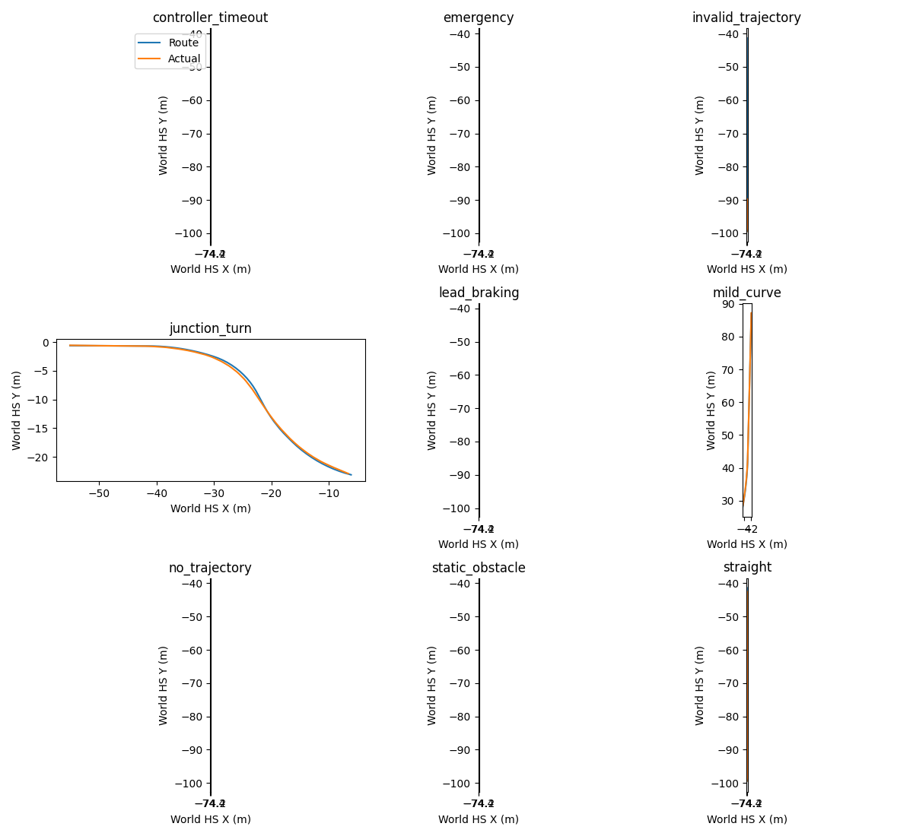

# M4.5 Oracle 闭环

CARLA 0.9.15 Town03、Epic、同步0.05s，实际执行9个低速场景。输入是 privileged ego/map/actor state，未调用神经网络或 autopilot；这是后续视觉系统的控制评测底座，不是纯视觉自动驾驶结果。

路线规划复用安装包官方 GlobalRoutePlanner（文件哈希在JSON）。局部轨迹为 ego [T,4]=(x,y,yaw,v)，T=8，dt=.5s；最高4m/s=14.4km/h。曲率/终点/前车距离限速，Pure Pursuit横向、PID纵向。独立 safety 检查时效、非法轨迹、速度、路面及车身 footprint、障碍和紧急指令。

| 场景 | 判据结果 | Route完成 | 碰撞/压线 | 真正横向误差均值m | 规划+safety p95 ms |
|---|---|---:|---:|---:|---:|
| straight | Passed，到达并停稳 | 98.28% | 0/0 | .037 | 29.38 |
| mild_curve | Passed，到达并停稳 | 100% | 0/0 | .026 | 48.09 |
| junction_turn | Passed，到达并停稳 | 100% | 0/0 | .145 | 48.93 |
| static_obstacle | Passed，障碍前停稳 | 10.34% | 0/0 | .108 | 28.99 |
| lead_braking | Passed，前车制动后停稳 | 22.41% | 0/0 | .151 | 29.00 |
| emergency | Passed，注入紧急命令后停稳 | 17.24% | 0/0 | .141 | 26.04 |
| controller_timeout | Passed，输入轨迹过期后停稳 | 17.24% | 0/0 | .139 | 26.48 |
| invalid_trajectory | Passed，NaN轨迹后停稳 | 17.24% | 0/0 | .139 | 25.36 |
| no_trajectory | Passed，无轨迹后停稳 | 17.24% | 0/0 | .139 | 27.05 |

原报告字段 lateral_error 实际是最近 waypoint 的欧氏距离，包含离散点的纵向误差。未覆盖原数据；[m45_oracle_replay.json](m45_oracle_replay.json) 追加投影到路线线段的 cross-track 指标，上表使用修正定义。全量控制日志含轨迹、位姿、速度、制动原因、时间和路线；重跑版本增加 obstacle 状态。controller_timeout 场景测的是控制输入（轨迹）过期；控制调用间隔>.25s的分支由单元测试覆盖，不冒充CARLA线程冻结测试。

仿真更新20Hz；墙钟控制循环约22–32Hz，但没有六摄渲染/网络串联，不能据此宣称完整系统实时20Hz。直线/弯道/转弯速度MAE约 .418/.365/.382m/s。静态障碍停距14.11m、前车场景7.48m；对应速度MAE3.10/2.00m/s，表明安全层常在规划仍要求前进时硬制动，跟车/舒适性质量明显不足。停车 Passed 只表示受控场景无碰撞停稳，非优质驾驶评分。

9个录制状态的控制器回放输出完全相同。另在重启后的 CARLA 实际重跑保存的 invalid_trajectory 路线，89tick、24tick非法轨迹制动、无碰撞/压线、相同完成率；见 [live replay](m45_oracle_live_replay.json)。复现命令可以指定任一已记录路线，包括失败场景，但跨机器/物理/交通配置不保证逐比特仿真一致。

限制：footprint以<=.25m间距检查并预测障碍恒速度，**没有精确连续 swept volume**；道路只检查车身角点处属于Driving lane，不处理车道方向、实线、路权/让行/交通灯停止线完整性；复杂障碍意图、行人、横穿/逆向、交通流和误检未覆盖；地图接口是Oracle；没有把 Occupancy/视觉输出接入 safety。单次固定路线不代表安全统计。

下一步先让速度规划与碰撞预览使用一致的停止目标和安全距离，减少远端硬刹；扩展多actor及traffic rule测例，并保持真实轨迹/footprint日志。当前可作为受限低速控制底座，不能关闭完整驾驶安全或纯视觉闭环门禁。
