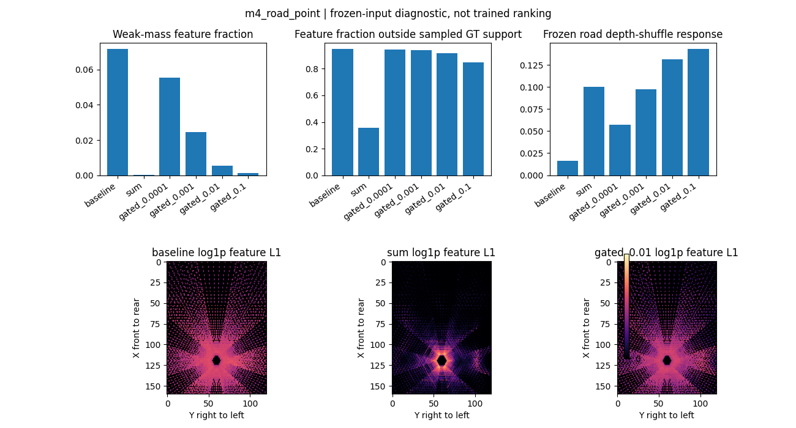
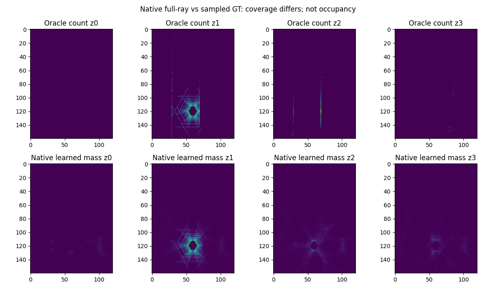

# M4.5 Splat 置信度传递实验

结论：当前归一化确实能将极弱质量的 Context 恢复到明显幅度；Sum 和 Gated 可以压低这部分特征，但固定概率的空间落点完全没有改善。本轮保持原 HeightSplat 为默认，不按冻结旧 Drivable Head 的 IoU 排名选择新架构。

## 实验控制与证据

三个原始 checkpoint，各222帧共同验证集、867467个有效深度采样点；相同 RGB、Context、概率、标定、四层网格和旧 v1 道路 Mask。没有训练、改 Bin、改 Loss、改旧文件。baseline 直接调用原类；运行时逐帧验证默认输出及 Mass 不变，结束核对参数未变化。深度 MAE 复现最大误差 Joint=1.61e-7m，Far=4.10e-8m，Road=5.48e-8m。

完整结果 [m45_splat_comparison.json](m45_splat_comparison.json)，便于使用的聚合 [m45_analysis_metrics.json](m45_analysis_metrics.json)。每帧记录 z×GT support×Mass bucket 共40组；汇总 feature L1/norm 使用求和，连续变化指标使用帧平均，IoU/precision/recall 汇总 confusion matrix。GT support 为采样表面支持，缺少 GT 点不等于真实空体素。

tau={1e-4,1e-3,1e-2,0.1} 在推理前预声明；实际 Mass 分位数于整轮推理后计算，没有据验证 IoU 调参。此顺序偏离“先测分位数再定候选”的建议，明确保留。z1 正质量体素中位数在两个场景分别为 Joint .045/.058、Far .055/.074、Road .062/.074；其他层分位数详见 JSON。M 的尺度依赖采样和场景，不是 occupancy probability，tau 不是物理置信度。

## 幅度与冻结下游

弱质量定义 1e-6 < M <= 1e-3，以下比例为全部验证帧的 pooled feature L1。

| 模型 | Baseline | Sum | Gated 1e-4 | Gated 1e-3 | Gated .01 | Gated .1 |
|---|---:|---:|---:|---:|---:|---:|
| Joint 弱质量幅度占比 | 21.995% | .026% | 15.080% | 6.139% | 1.254% | .263% |
| Far | 5.245% | .011% | 4.025% | 1.745% | .368% | .085% |
| Road | 7.165% | .016% | 5.545% | 2.455% | .531% | .123% |
| Joint 冻结道路 IoU | .5109 | .1471 | .5104 | .5067 | .4945 | .4686 |
| Far 冻结道路 IoU | .4936 | .1487 | .4936 | .4896 | .4701 | .4117 |
| Road 冻结道路 IoU | .5415 | .1606 | .5419 | .5390 | .5345 | .5152 |

单射线 S=p*f 且 p>eps 时，Baseline=f；门控=f*p/(p+tau)，这一幅度效应同时有合成测试和真实推理支持。不能因此断言弱概率一律无用，尤其多相机覆盖、稀疏远端和缺少 GT 的位置。

Road 在 tau=.01 时，BEV relative L1=.338，cosine=.947；native 深度概率 shuffle 引发的道路概率平均变化从 .0166 增至 .1311。其 shuffle IoU 甚至从 .5345 增到 .5849；这不是几何改善，反而说明冻结下游对输入幅度分布、道路先验和错误几何的响应复杂。Baseline 原始/打乱深度 IoU=.54146/.54131，仍接近；Context 依赖由旧 M4 干预实验证实，不能用这些结果断言 Depth 分支毫无作用。

## 几何与 Oracle

A/B/C 的 probability、rank、Mass 都保持相同。因此以下单射线指标完全相同，不能把幅度削弱解释为正确体素概率提高。

| 模型 | BEV内 exact GT voxel 概率 | XY<=1m且同高度概率 | BEV外GT泄入范围的质量/帧 |
|---|---:|---:|---:|
| Joint | .47294 | .77912 | 206.97 |
| Far | .44538 | .72798 | 204.13 |
| Road | .44428 | .74029 | 151.49 |

这些 matched-valid-ray 指标复用原始逐射线诊断，输入报告 SHA 和相同 sample IDs 已核对。旧 matched mass 与 native 全射线 mass 覆盖不同，不能混算。新 native mass 对采样 Oracle 的 TV 为 .4582/.4401/.4356，GT support 质量占比 .5810/.6052/.6129。聚合指标看起来改善而单射线 exact 概率下降，正是错误质量相互补偿、覆盖变化和 bin/voxel量化影响的警示。

新增 [Oracle probe](m45_splat_oracle_probe.json) 对每个模型固定两个场景首帧，共6帧，使用完全相同有效射线与 Context，分别比较固定 Oracle mean 和同聚合 Oracle。Road 第一帧 relative L1 从13.276降到 Gated .01的8.166、Sum的3.087；共同支持上的 cosine 均为 .91708。正标量缩放不能改变单体素特征方向，L1下降不能证明定位更准。无 Oracle 支持的 z0 归一化分母被原函数 clamp 到1e-9，产生巨大 relative L1，这种字段无有效相对误差含义，应结合 common_cells=0 排除，不用于比较。

## 性能与限制

单独 Splat CUDA 同步计时 p50 约1.39–1.50ms；分块可微，FP32几何，BF16 autocast测试通过。全诊断 live tensor 环境中 allocated peak约211–238MiB；不是完整系统显存预算，也不是无其他 tensor 的独立公平显存排序。reserved字段同时保存。旧全量脚本按容器 PID 查 NVML，因 host PID不同得到 null，不能称为已测完整进程峰值。

补充隔离 probe 以启动前后唯一新增 host PID识别进程，实测848–942MiB；allocated peak296–341MiB，reserved380–474MiB。这是6帧匹配射线诊断的进程采样值，不是全量实验的追溯峰值。几何、模拟与GPU诊断分阶段运行，没有训练。

## 决策与下一轮短消融（仅计划）

保留 baseline；优先考虑 tau=.01 的受控训练候选，因为明显降低弱质量幅度且比 Sum 更平滑。当前证据不足以将其升级默认；不宣称该 tau 最优。

拟固定同一个旧 checkpoint 初始化、同一现有 train/val 分组、同一采样顺序和种子7/17、相同 optimizer/Loss/学习率、相同200步预算，三组 Baseline/Sum/Gated .01，共6×200 optimizer steps，单次绝不是1200步。每组最后一步 checkpoint 为主要比较，全部组另报相同固定快照，禁止择优挑步。先跑单种子三组，若出现几何退化则停止第二种子；不会自动执行。

主要验收是单射线 exact/同高度1m概率、BEV内误差、配对场景障碍位置和 masked Occupancy 空间指标；近距 MAE 相对共同初始化退化>0.1m或 exact 概率下降>.01则不接受。道路 IoU、全局MAE为次要指标；比较 Camera/Pixel Prior 与 Position Prior。若 Occupancy GT质量未通过，只能称 Splat消融，不能声称下游障碍识别收益。Batch=1、BF16、FP32几何，不与CARLA同跑，先记录10步运行显存再决定完整预算。
