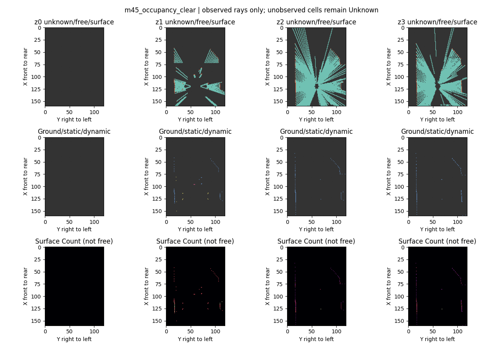

# M4.5 研发交付：工程基础可用，质量门禁保持开放

已在 feat/m45-geometry-foundation 实施并实际运行 Splat固定模型诊断、Observed Occupancy生成、Temporal几何验证、CARLA Oracle闭环和天气配对采集。没有训练新模型，没有替换原HeightSplat，没有修改原模型/报告/数据。总体状态 **Partial**，M4质量门禁和M4.5完整质量门禁均不关闭。

| 工作包 | 已完成证据 | 当前门禁 |
|---|---|---|
| 0 基线冻结 | 813项SHA、5170 index JSON、26 raw manifest和65657原文件元数据复核一致 | Passed |
| A Splat | 3模型×222帧×6方案；默认、Mass、权重不变，CPU/GPU几何/梯度测试 | 工程Passed；架构替换未获支持 |
| B Occupancy | 四层三态、语义/障碍隔离、9帧真实标签、墙后Unknown等测试 | 工程Passed；训练质量Partial |
| C Temporal | 平移/90°/混合/小数位移/Mask/Memory；5个实际场景对；补充表面配准 | 平面几何Passed；特征/动态质量Partial |
| D Oracle | Town03实际9场景，9日志精确控制回放，1场景重启重跑 | 受控低速工程Passed；完整驾驶安全Partial |
| E 配对数据 | 同位姿晴/雾各8帧、18同步sensor流；分组协议 | 天气小样本Passed；运动配对未完成 |

完整证据索引与状态见 [m45_acceptance.json](m45_acceptance.json)。代码入口和可执行命令见 [M45_IMPLEMENTATION](../docs/M45_IMPLEMENTATION.md)。GPU全仓133项通过、5项因无CARLA跳过；CPU/CARLA全仓98项通过、12项因无torch跳过；最终M45模块29项通过，无跳过。报告中的测试数量存在重叠，不相加。

## 1. Splat是否放大低质量特征，是否值得继续

**是，概率幅度被均值归一化消除这一机制得到验证；是否“不合理”取决于下游任务，不能仅凭数值幅度下结论。** Joint弱Mass体素(1e-6,1e-3]贡献21.995%的Context L1，Gated tau=.01降到1.254%，Sum降到.026%。Road相应7.165%→.531%→.016%。

A/B/C没有改变概率、坐标和Mass：正确GT体素概率、GT附近质量、BEV外泄漏完全一样。门控只削弱幅度，不能修复错误深度。匹配Oracle特征的L1可下降，但共同支持cosine不变；这是缩放效应，不是定位变准。冻结道路头产生OOD，不能用其IoU排名选架构。**保留原默认；tau=.01值得一次严格受控短消融，但本轮不训练。** 细节、每层/场景/Mass统计与候选预算见 [Splat分析](m45_splat_analysis.md)。

## 2. Depth MAE与BEV质量为什么不一致

Joint→Road全局MAE4.151→4.028m，而BEV内MAE1.728→2.134m；BEV内 exact voxel概率 .47294→.44428，同高度1m概率 .77912→.74029。远距误差降低可以压低整体MAE，但近处体素定位反而恶化；概率分布不仅由期望值决定，0.5m栅格对近处偏移敏感。

60–80m约31m误差仍主要是系统性低估（bias约-31.45m），分布较散，换mode/median不解决；该段GT均在本BEV范围外，但错误概率会泄入范围。新增门控没有改变此事实。近距退化与旧实验远距均衡权重、loss/道路标签/选checkpoint变化同时发生，不能严格归因于某一项。

已支持的限制同时包括深度分布偏差、Context/位置捷径、概率幅度归一化和有限数据覆盖，**没有证据为四者排出唯一因果主次**。旧RGB/feature干预表明模型使用视觉信号，但BEV内性能没有稳定超过Camera/Pixel Prior（1.655m）；因此不能回答“已可靠学到超越简单空间先验的空间理解”。道路原始/深度shuffle近似不变、Context扰动敏感，反映现道路任务没有充分约束深度几何。旧三模型不是单变量消融。

## 3. Occupancy能否训练

**能够按观测合同生成三态；还没有足够质量的数据支持通用Occupancy训练。** 真实9帧完成校验；6帧有同步语义。UNKNOWN不作负类，ground表面与障碍分离，多摄像头可靠surface优先、free到surface即停止。clear示例15269 Free/269 surface/61262 Unknown，42个ray冲突；覆盖20.23%。Town04三帧覆盖15.2%–19.0%，无语义不制造障碍负类。

主要短板是self包围盒过保守：clear有效深度4098条中2543条被挡；ground只有14个体素。新语义数据来自一个静态位置，不能形成泛化训练集。四层粗高度还会混合地面与上方障碍。**可以做masked管线smoke test，但应先审查self-mask、语义冲突与多场景覆盖，再训练轻量Occupancy Head。** 详见 [监督合同](../docs/M45_OCCUPANCY_CONTRACT.md)。

## 4. Temporal是否可接入

**SE2 Warp及Memory几何接口可接入，不能声称时序网络质量已验证。** forward=inverse(current_pose)@prev_pose；grid_sample用其inverse，从输出中心反查输入；无效区域独立Mask，不是Free。支持batch/FP32、scene/time/定位重置；相对大倾斜或高差拒绝。

解析场测试最大误差<0.1毫米；合成90°旋转、平移和混合测试通过。实际Town01前进2.448m后，非ground/非actor表面最近邻中位误差 .445→.047m；Town02平移.475m+旋转4.86°后 .274→.061m，P90 1.975→.223m；静止场景维持零。没有语义一一对应，所以此为表面配准支持证据，不是精确物体追踪GT。

Town04未改善（.017→.042m），地面/重复结构与可见性使最近邻指标也不唯一。整个Oracle surface-count图按格比较时多场景Warp后MAE上升，单纯计数图不具备刚体不变性。Learned特征也不是普遍改善：Town04 relative L1 .153→.460，Town02转弯 .434→.362。**轻量ConvGRU的接口基础已具备；需先明确静态支持/动态遮挡与特征一致性验收，不能假设memory修复系统深度偏差。**

证据：[五场景](m45_temporal_validation_v2.json)、[实际表面配准](m45_temporal_static_surfaces.json)、[转弯图](m45_temporal_figures_v2/m4drive_town02_20.png)。

## 5. Oracle闭环能做什么，缺口在哪里

**已有实际Planner→Safety→Controller→CARLA闭环。** 直线98.28%、弯道100%、路口转弯100%路线完成；另完成静态障碍停、前车制动停、紧急停、输入超时、非法轨迹、无轨迹。9场景均0碰撞/0压线，仿真20Hz，最高约3.95m/s。

车身footprint已查，不仅中心线；但采用离散0.25m加密，**没有完整swept volume**。静态障碍停距14.11m、前车7.48m过保守，安全层与速度计划不一致；无完整路权/停止线/动态意图和多交通参与者验证。控制延迟未包含六摄和网络，因此不是完整视觉系统实时性能。9日志在记录状态上的控制回放完全一致；重启CARLA重跑非法轨迹89tick结果一致。详见 [闭环分析](m45_oracle_driving_analysis.md)。

## 6. 下一阶段投入顺序

1. **Occupancy监督质量与空间验收**：优先修self-mask、近场ground/障碍区分，补墙/路口/遮挡/坡道多route sidecar；保留Unknown，设计按距离/高度/场景的masked occupancy与障碍定位指标。标签审查通过后训练轻量Head。
2. **Planner与闭环评测**：统一停止目标、碰撞预览和速度计划，改善过早硬停；增加交通规则和多actor。用Oracle与未来视觉估计分别接同一接口，衡量误差对驾驶的影响。
3. **BEV聚合短消融**：同数据/初始化/Loss/种子/固定步数只改聚合，先3组×200步单种子，空间指标未退化再第二种子；不按全局MAE或冻结IoU挑赢家。
4. **Temporal Encoder**：在可靠masked空间监督上接轻量ConvGRU；增加动态遮挡、缺帧和坡道验证，比较单帧与时序同预算结果。
5. **Sparse Query**：接口保留，等基础空间监督与闭环误差可衡量后再进入，当前不是优先网络扩容点。

所有后续训练均为计划，本轮未执行。单4090上继续分开仿真/推理/训练。当前最有价值的推进是让空间误差能被可靠监督并在驾驶任务中测量，而不是延长Depth训练。

## 配对数据与未完成项

同地图/固定姿态/固定前车/六摄640×384 Epic，fog_density2→40，其余记录参数固定；clear/fog各8帧。位姿逐项相同，RGB平均变化明显；但个别相机语义变动最高.198%，depth含极大远端/边缘差值。不能将其视为完全相同GT的因果实验，需joint-valid、语义不变与稳定深度Mask；新图说明仅为渲染诊断，没有宣称模型天气泛化改善。采样间的动态植被/渲染时序可能影响，但未验证具体来源。

静止/低速/运动相近位姿配对尚未采集；坡道/复杂路权/精确swept volume/动态memory未完成。configs/m45_pairing.yaml明确group split和盲测约束；这些新数据全为diagnostic val，Town05/Town10不重新称盲测。完整新数据留在服务器，代表标签和图随Git提交。
