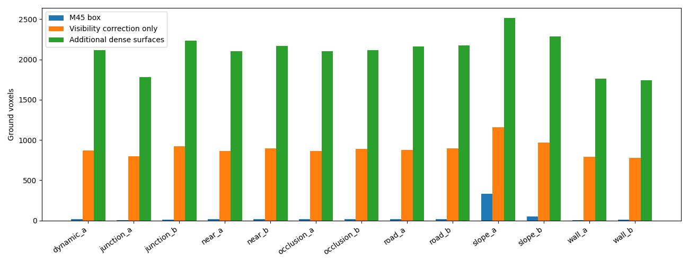
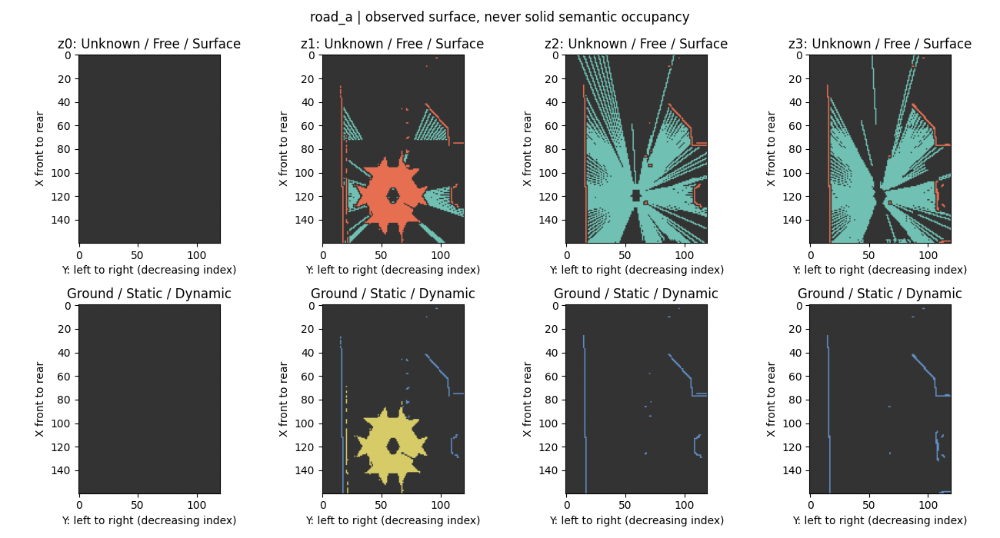
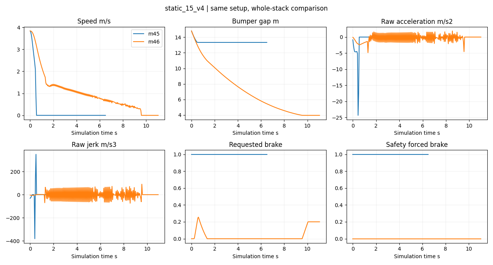

# M4.6：Occupancy Quality & Motion-Consistent Closed-Loop

**实际代码、标签采集、测试和 CARLA 闭环已完成一轮交付，总体为 Partial，M4/M4.5/M4.6 质量门禁均保持开放。没有启动网络训练。** 基于提交 `129a413`，全部新增在 `feat/m46-occupancy-motion-quality`，没有合并 main。

三个问题的直接回答：

1. **Occupancy 标签还未通过小规模正式训练的质量验收。** 已具备读取、监督隔离、masked loss 和有限拟合研究的工程条件，但仍有非零 False Free，不能将它包装成合格训练真值。
2. **Oracle Planner 的零速位置前移已修复，障碍前过早 Safety 硬刹明显减少；自然、舒适减速停车尚未通过。** 实际减速度/Jerk 仍超限，路口有短暂边界制动。
3. **已有 M5 Occupancy Head 的数据/监督接口基础，尚不批准进入正式训练阶段。** 应先补齐独立空间真值审查、残余 False Free 和跨场景数据质量；目前没有把 Occupancy 接为闭环的障碍输入，闭环仍使用 Oracle actor。

完整机器判据见 [m46_acceptance.json](m46_acceptance.json)，代码与全部复现命令见 [实施文档](../docs/M46_IMPLEMENTATION.md)。

## 基线审查与保护

审查了 M4.5 Summary、Splat/Oracle 分析、验收 JSON、Occupancy/Temporal/Splat/闭环实现及合同。保留四层 BEV、坐标、网络接口和原默认 Splat。主要定位：

- `build_observed` 对只要穿过粗自车盒的整条射线一律丢弃，盒内空气和实际车体没有区分；地面覆盖严重损失。
- `local_trajectory` 用 `max(speed,0.5)` 推进位置，即使速度标签为0；固定几何预览让 Safety 提前看到碰撞并硬停。
- Warp 的几何支持不能代替当前可见性/动态判断；Unknown 零值不能当 Free。

[资产复核](m46_asset_integrity.json)：655个基线已跟踪文件、14个 checkpoint 的 SHA 全部一致；43,504个旧数据文件的 size/mtime 一致（未重算所有旧原始数据内容 SHA）。所有旧报告原样保留。M4.5 既有单变量限制、视觉先验问题、Gated Splat 候选状态没有因本轮被解除。

## Occupancy：修正自车过滤，保留未通过证据

新增13个 Town03/ClearNoon 场景：道路、墙、近障碍、路口、坡道、遮挡各2个，动态诊断1个。共39个ego-present帧、13组移除自车参考，六摄 RGB/Depth/Instance 同步640×384、Epic。坡道实际pitch约+20.50°/-5.32°。12个静态场景各3帧不等于36个独立场景；动态仅是固定ego下Actor每帧移动2m的可见性诊断。

选择实例轮廓与同相机移除自车参考相结合：利用可见车体实例与2px膨胀拒绝自身像素；穿过粗盒的射线必须在有车/无车渲染中具有相同外部首个深度命中、语义及实例，才恢复。深度稳定阈值0.05m并要求局部支持。**没有简单关闭过滤，也没有使用移除自车后露出的地面来穿透自车标 Free。** 车体相交粗体素仍为 Unknown。

39帧合计恢复99,428条经认证的粗盒相交射线，拒绝156条采样自车射线，accepted self pixels=0，uncertified crossing accepted=0，自车体素 Free=0。这证明了当前采集条件下被识别自车射线不会参与雕刻，不能推广为所有场景、车型和像素都无 False Free。全局自车阴影中的体素可由另一相机独立看到，不能要求全局阴影一律 Unknown。

| road_a首帧，同样4093条有效深度射线 | 原M4.5粗盒 | 只改可见性过滤 |
|---|---:|---:|
| 接受射线 | 1551 | 4089 |
| Ground | 14 | 873 |
| Surface Occupied | 265 | 1128 |
| Free | 15236 | 15102 |
| Unknown | 61299 | 60570 |

恢复射线并未机械增加 Free；更多真实表面截断了原 Free 路径。只改过滤后各场景 Ground=774–1159。另一个明确分开的改动是 dense surface refinement：stride2表面支持覆盖稀疏Free，同高度一格XY边缘置Unknown，不额外雕刻Free。最终 Ground=1739–2514；39帧平均 Free=10292、Surface=2922、Unknown=63586、Ground=2095、Obstacle=796。Ground与Obstacle是表面语义，不是与三态并列的五个互斥类别。

逐场景/相机/层计数和源SHA：[过滤对照](m46_occupancy_validation.json)、[dense标签](m46_occupancy_dense.json)。[六摄可见性证据](m46_visibility_figures/road_a.png) 展示红色拒绝轮廓和黄色恢复射线。

**质量未通过的实际证据：** stride1留出交错像素审核中，104 / 120,434个去重后逐帧表面体素被标 Free，约0.086354%。地面/障碍语义在有效、无冲突支持上有740 / 22,532,455个像素不一致，但同一渲染器的密集相关像素不能用来声称泛化精度。留出像素没有作为dense endpoint使用；局部深度稳定筛选仍使用邻域，所以它也不是完全独立的数据集。详见 [标签验收](m46_label_verified.json)。

残余误差与0.5m×粗高度层中的部分占据、稀疏射线穿过其他子区域、深度边界有关，这是待独立几何审查的解释，尚未逐个证明归因。没有用扩大 Unknown 至全部区域、提高容忍阈值或合并留出像素来关闭门禁。当前 Free 表示观测射线自由证据，不保证体素内部每一点为空；Surface不填物体内部；Ground也占据物理表面；Unknown/冲突不作负类；Surface Count仍只是命中计数。

替代路线评估：精确可渲染车体mesh有望提供稳定ray/mesh首交，但碰撞盒/碰撞网格不能默认等于渲染车体，当前Python API流程没有验证逐车型mesh的一致性。仅实例分割可拒绝可见车身，却不足以单独认证跨粗盒外部射线。本轮采用可见性参考作为有限条件的实验证据；以后需要固定相机rig的可复验遮罩或同步mesh证据，不能对任意运动序列直接复用此参考。[CARLA0.9.15相机文档](https://carla.readthedocs.io/en/0.9.15/ref_sensors/#instance-segmentation-camera) 提供实例/语义编码接口；其存在并不等于我们的自车识别已获得全场景证明。

## 监督隔离与 M5 接口

新增独立 `OccupancyDataset` 和 `observed_occupancy_loss`，不修改旧M4网络与loss。训练27帧、验证9帧；同路线/位姿的障碍变体严格同组，spawn45全部val，动态3帧排除。新的 RGB 输入JSON仅包含图像、标定、位姿和时间；标签以独立路径和SHA保存，`supervision=False` 不开标签NPZ。

[实际加载验收](m46_loader_release.json) 完成全部36帧六摄读取与Free/Surface两类CE梯度检查：Unknown梯度为0，观测类梯度非0；没有网络、没有optimizer。仅静态数据的ego_state填零，不能直接冒充驾驶序列状态；M5需扩展时保持合同并记录真实运动状态。这些数据均已用于开发诊断，验证不再是盲测。

## Planner / Safety / Controller

新增独立 `simulator/motion_oracle.py`，旧实现保留作对照。通过速度梯形积分生成位置，不再给零速轨迹强行前移；规划加速/减速/Jerk分别限制1.5/1.8/2.5，保留急停独立通道。路线弧长bumper gap、3m停车目标和remaining_m在Planner/Controller间统一；Safety检查对应时间的真实轨迹与同尺寸footprint，不再使用不相容的恒速几何预览。3m站停目标与0.2m碰撞纵向裕量分别有不同意义，未混为同一个距离。

最终固定源码复测共13对：6组障碍、4种故障、3条路线，均到达各自“停稳/无碰撞”工程判据，0碰撞/0压线。每次启动保存源码与SHA，最终结果 `source_unchanged_during_run=true`。整个控制栈改变，不是单变量消融。

| 障碍场景 | 旧→新最终间距m | 旧→新Safety强制帧 | 旧→新最大原始减速度m/s² | 旧→新原始Jerk绝对P95 m/s³ |
|---|---:|---:|---:|---:|
| 8m / 2m/s | 7.65→3.98 | 131→0 | 26.14→22.52 | 0.06→66.15 |
| 15m / 4m/s | 13.33→3.96 | 131→0 | 24.33→4.85 | 9.61→65.13 |
| 30m / 5m/s | 17.85→3.95 | 88→0 | 24.20→23.39 | 16.08→73.55 |
| 45m / 4m/s | 14.12→3.23 | 42→0 | 26.42→19.06 | 2.89→61.70 |
| 前车制动 | 5.92→3.94 | 40→0 | 22.61→7.17 | 11.38→66.83 |
| 多Actor | 14.48→3.96 | 81→0 | 23.27→7.30 | 12.87→67.28 |

起速经过旧控制器相同暖机，实际约2.015/3.837/4.756m/s。故障包括emergency_command、过期轨迹、NaN、无轨迹，均保留全制动停稳能力；控制调用间隔超时另有单元测试，不冒充CARLA线程冻结测试。

原始Jerk的全轨迹P95受旧版迅速停车后静止尾段影响，不能据该列单独排序舒适性。因此另报 [运动段Jerk、首次停稳行驶距离及制动间距](m46_motion_supplement_verified.json)，同时保留全部峰值和250ms平滑值。新15m场景行驶约10.85m停稳，相比旧1.47m更接近目标；但新运动段Jerk P95仍约61.8–73.8m/s³。250ms最大减速度约2.03–7.73m/s²，仍超过规划1.8，不能靠平滑关闭门禁。

低速制动附近存在明显速度突降及控制振荡。探针表明很小service brake也可能伴随突降，Ackermann探针也未给出可靠舒适改善；轮胎/传动/制动stiction是待验证原因，未完成物理根因归因。**规划约束不是实际车辆约束，当前不能称自然停车。**

路线采用M4.5已保存的固定路径、固定绿灯：新直线/缓弯/路口完成率96.55%/96.49%/96.49%；平均横向误差0.053/0.050/0.213m。路口仍有1次共7帧road_boundary强制制动；其p95 Planner+Safety约72.77ms，高于20Hz的50ms周期。红灯等待/自由灯态早期失败和80m自动路线边界失败均保留，没有替换成成功结果；固定绿灯只用于控制变量的路线回归，不是交通规则通过。早期终点remaining未传Controller、横向修正过慢的问题已经修复。

最终证据：[障碍和故障](m46_closedloop_verified.json)、[固定路线](m46_routes_verified.json)、[路口图](m46_final_figures/junction_turn_driving.png)。工程Passed仅表示该场景无碰撞停稳，舒适性、实时性、复杂安全仍Partial。所有输入是Oracle map/actor/ego，不是六摄视觉闭环。

## 离散碰撞检查与 Temporal

独立采样诊断使用静止ego和细小线性横穿footprint，1ms离散参考也不称精确真值。旧方法24例漏17，新≤0.1m/0.05s采样漏4；残余位于80/160m/s的刻意压力场景。现实运行速度范围内该小样本改善，不能据此证明连续安全。下一步需要相对速度/角速度驱动的自适应步长、保守swept polygon或连续分离轴界，并覆盖旋转、道路区域和预测不确定性。[采样结果](m46_safety_verified.json)。

Temporal新增每高度独立current_observed及历史/当前dynamic veto，13场景对中未经门控的history在当前Unknown共329格，门控后0；dynamic_a为118→0，无效区域非零输出0。动态图只是Actor离散位移的Oracle mask验证，不能说已经学会动态补偿。真实ego运动继续由M4.5几何回归支持；新接口不处理任意SE3、斜坡高度变化或学习mask质量，也未训练复杂时序网络。[Temporal结果](m46_temporal_verified.json)。

## 完整测试、验收与后续

| 验证 | 实际结果 | 证据 |
|---|---|---|
| GPU环境全仓 | 162 passed / 5 skipped（无CARLA模块） | [JUnit](m46_full_gpu_tests.xml) |
| CARLA环境全仓 | 121 passed / 14 skipped（无torch模块） | [JUnit](m46_full_sim_tests.xml) |
| M4.6专项 | 21 passed，无skip | [JUnit](m46_module_tests_release.xml) |
| 标签字段与自车证据合同 | Passed，39帧 | [JSON](m46_label_verified.json) |
| 标签零False-Free质量 | 未通过，Partial | 同上 |
| 低速受控闭环 | 13对，工程Passed | verified driving JSON |
| 自然停车/连续碰撞/实时性 | Partial | 原始日志与峰值保留 |

这些测试数有重叠，不相加。[执行日志](m46_execution_logs/) 包含真实运行结果。早期pilot/source snapshot为诊断留档，个别旧脚本运行结束时才取源码SHA，不能将其视为完整版本锁定；正式结论只采用启动时快照的verified实验。

下一阶段按优先级：

1. 对104个冲突体素逐个生成原生像素/射线/多视角/高度层可解释审计；用独立mesh首交或语义射线检查补充真值，建立明确的部分占据/未知证据合同。跨Town、天气、车型和真实驾驶序列重新验证，保护场景分组。
2. 在标签质量验收后，接现有四层BEV的轻量两类observed Head及独立Ground/Obstacle mask；先小样本拟合和Camera/Pixel/Position Prior对照，再短受控训练。不更改Depth Bin，不做大型联合训练。当前暂停正式训练是质量结论，不是环境阻塞。
3. 对真实动力学做定速/滑行/制动分段标定，解决低速振荡与stop hold切换；再验证减速度/Jerk、目标停车误差、路口横向误差和p95延迟。保留Emergency硬制动。
4. Occupancy可靠后才把它作为闭环障碍来源，与Oracle actor版本用相同路线比较；将误占据、False Free和时序延迟对碰撞/停车的影响作为最终指标。Gated Splat继续候选，Temporal继续几何和可见性验证。
