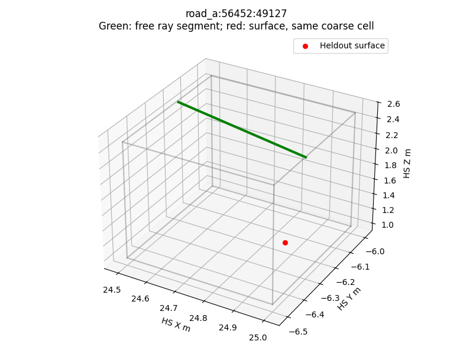
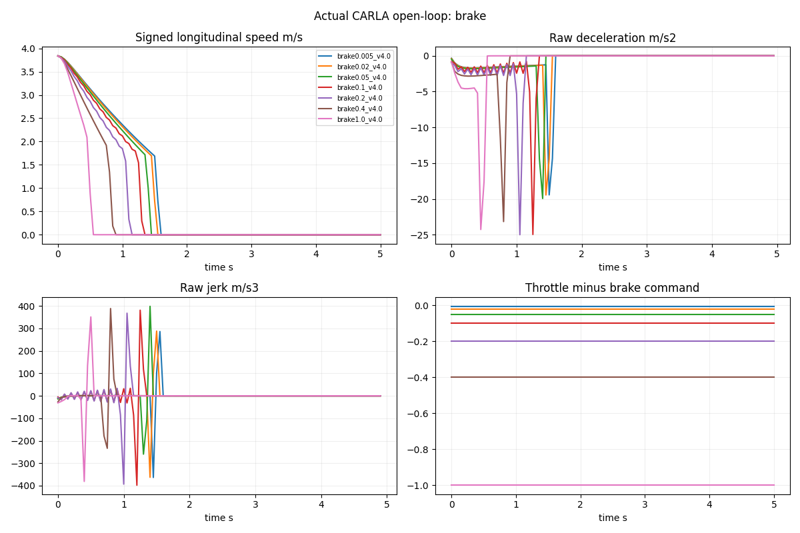
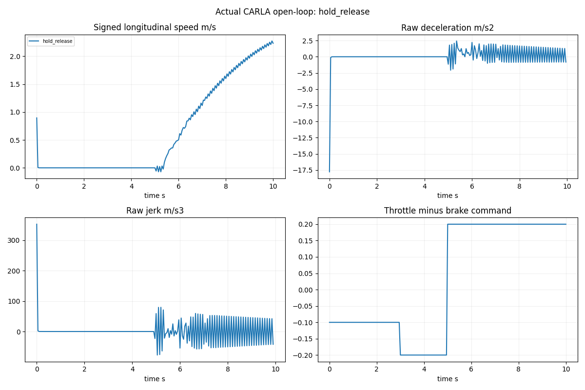
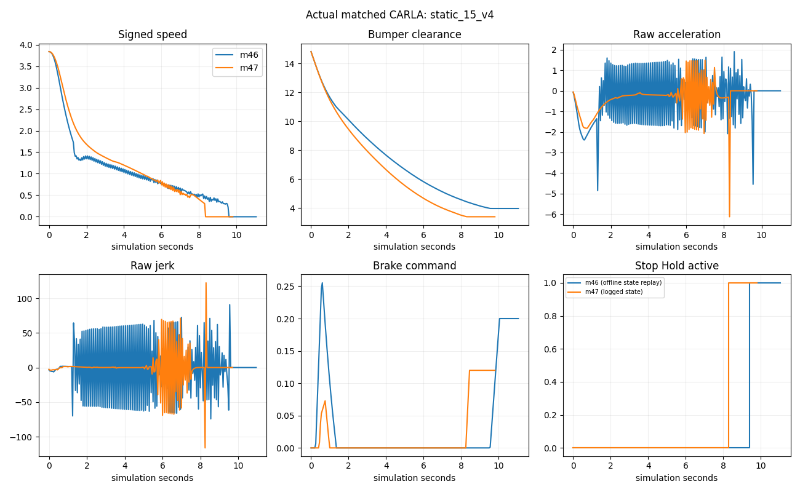

# M4.7：Occupancy Label Assurance & Vehicle Dynamics Calibration

**本轮已实际完成逐体素审计、CARLA补充几何评测、46组车辆动力学实验、M46/M47受控闭环、CUDA监督合同检查和完整回归。总体Partial；不关闭质量门禁、不启动M5正式训练、不替换M4.6默认行为。**

基于 `e9e2e02`，新分支 `feat/m47-label-assurance-dynamics`。机器验收见 [m47_acceptance.json](m47_acceptance.json)，全部可执行命令与接口见 [M47_IMPLEMENTATION](../docs/M47_IMPLEMENTATION.md)。

## 六个问题的明确回答

1. **104个冲突都不支持“整个体素为空”的解释，但尚不能确认其中哪些是实际驾驶危险错误。** 已找到每一格的Free雕刻射线与表面观测；45个Ground、59个Obstacle，跨帧对应36个场景网格位置。射线与留出表面最小间距0.254m，所有格均可同时容纳局部自由射线与表面。补充碰撞查询没有在这些格内发现Free雕刻线上的提前碰撞命中；这不证明整格安全。104格全部有针对性隔离为Unknown。
2. **正式训练所需空间可靠性仍不具备。** Town02新场景、不同车型的冻结规则评测仍存在Free冲突，Obstacle/Ground支持有限；碰撞几何也不是精确渲染Mesh。
3. **Jerk超限同时有物理响应和控制切换证据，不能归因于测量口径。** 恒定0.005 Brake在约1.4m/s就产生17.57m/s²减速度，API加速度与速度差分高度一致。M46低速禁制动、残余effort和HOLD切换进一步放大；没有证据给出二者唯一贡献比例或断言PhysX内部根因。
4. **保持碰撞保护的目标停车间距已改善；自然停车仍未通过。** 最终6组障碍停距3.374–3.389m、无碰撞、无Safety强制制动，但Hold进入速度0.267–0.818m/s，原始减速度5.34–16.36m/s²，仍不舒适。新控制器路口回归失败，保持研究候选。
5. **20Hz全场景规划延迟未满足。** 最终路口Planner+Safety P95约65.95ms；profile显示主要是道路查询，轨迹生成约2.4ms。未通过审查的快速走廊候选不启用，也未假装实现多频率调度。
6. **M5工程接口已有基础，正式训练条件仍不足。** RGB-only CUDA前向、临时Head backward、Unknown/语义mask隔离通过；由于标签质量前提未满足，按任务条件暂不做overfit及位置先验训练比较。

## A：104格逐体素归因

类型：**旧CARLA真实记录的离线重建 + 新CARLA碰撞几何回放**。

[原始逐体素审计](m47_false_free_audit.json) 含全部104条记录：场景/frame、rank/ZXY和三维范围；Free相机/像素/起终点；留出观测相机/像素/深度/语义/实例；原始首表面截断后确实参与雕刻的射线及体素入口/出口；局部平面残差、自车/高度边界/多摄像头关系；邻帧同格复现列表。不是仅列冲突中心或随机示例。

[联结归因](m47_false_free_attribution_verified.json) 与 [CARLA补充查询](m47_collision_audit.json) 保留每个冲突的证据。结论：

| 观察 | 数量/结果 |
|---|---:|
| Ground / Obstacle | 45 / 59 |
| 独立“场景—网格位置” | 36（104包含邻帧重复） |
| 距高度层边界<0.1m | 56 |
| 多相机证据格 | 16 |
| 最近自车盒距离 | 12.91m |
| 表面点至Free线段最小距离 | 0.254m |
| Free线段在该冲突格内的提前碰撞命中 | 0（有限查询，不是安全证明） |
| 相同射线在其他位置存在提前碰撞命中 | 58 |

58条的提前命中发生在冲突格外，不能称为“58个危险格”。64条审计记录至少有一个留出表面与碰撞命中距离<0.15m；另一些不一致提示碰撞表示、植被/边缘与渲染表面差异。同实例并不标识同一Mesh面，JSON明确记录“是否相同物理表面未证明”。仅凭局部平面拟合也不推断完整障碍形状。

全部104张3D图及记录对应关系见 [图索引](m47_figures/manifest.json)。可见1.5m高度层内，上部空气与下部表面混在同一标签格。Free=“至少有一条可靠自由射线穿过体素一部分”；whole-cell Free=“整个体素皆为空”，后者没有建立。这是监督合同缺口，不能通过把两者同名处理消除。

仅将这104个有直接表面冲突且未证安全的Free格置Unknown，未扩大邻域：总空间有效覆盖损失 **0.003472个百分点**，原Free计数损失 **0.02591%**。这是审计集修复，不把修复后冲突消失当独立验收成功。旧标签未改，新标签在数据盘 `processed/m47_quarantined`。

**归因强度：** 高置信度支持“粗格部分占据/高度量化混合”；不支持全部归为噪声，更不能证明没有危险False Free。真实危险性仍需要体积几何/规划footprint与独立可见性支持，当前一律保守忽略。

## B：补充空间评测与未见场景

类型：**实际CARLA新采集 + 离线评价冻结M46标签生成器**。

新增Town03 spawn100 Tesla开发场景、Town02 spawn10 Audi A2和spawn35 Tesla留出场景，每处2帧，六摄640×384/Epic，前方2个Actor形成障碍/遮挡。生成规则没有依据新场景结果调参；Town02在本轮规则开发中留出，但项目过去使用过该地图，因此叫“未见位姿/场景”，不声称项目全新盲测地图。车型和场景同时变化，不能单独归因于车型。

每帧600条固定随机像素方向的cast_ray，加77条与像素格无关的垂直查询；共4062次查询。Actor保存真实位姿，ego-visible标签仍经原可见性检查。查询来自CARLA碰撞几何，与渲染深度不同，但仍共享模拟资产，**是补充几何证据，不是精确独立3D GT**。没有把Actor/静态物体Bounding Box当作Mesh填充。

冻结规则、隔离前的结果（两帧近似相同，列首帧）：

| 场景 | 条件Free Precision | 冲突格 / 已探测预测Free格 | Ground表面召回 | Obstacle表面召回 | Unknown / Valid |
|---|---:|---:|---:|---:|---:|
| Town03_100 Tesla | 99.266% | 17 / 2315 | 37.77% | 79.82% | 86.67% / 13.33% |
| Town02_10 Audi A2 | 98.892% | 14 / 1263 | 70.26% | 37.85% | 89.90% / 10.10% |
| Town02_35 Tesla | 98.472% | 35 / 2291 | 75.19% | 36.32% | 87.67% / 12.33% |

Free Precision只在被碰撞查询覆盖的格上定义，分母不是所有Free体素；无法从这些数值外推完整体积精度。Recall以补充查询命中的表面点为分母，Unknown计为未召回；表中Ground/Obstacle是几何Surface检出率，不冒充语义分类召回。各距离、4个高度层、近车体和障碍表面统计见 [m47_occupancy_quality.json](m47_occupancy_quality.json)；7×7原生语义patch边缘的局部指标及Ground/Obstacle语义召回另见 [m47_local_quality.json](m47_local_quality.json)。像素语义边缘不是精确道路多边形边缘距离，样本不足字段为null。

补充查询/留出渲染产生直接冲突后，仅隔离每帧20/16/37格，覆盖损失分别0.0260/0.0208/0.0482个百分点；这些是评测后的修正数据，不再可用来声称独立测试零错误。**新场景仍未通过空间可靠性门禁。**

CARLA官方API明确提供cast_ray及物体包围盒查询；并没有由此保证碰撞表示与渲染Mesh一致。[CARLA0.9.15 World API](https://carla.readthedocs.io/en/0.9.15/python_api/#carlaworld)。未导出完整渲染mesh/物体内部体积，也未完成精确道路边缘几何证据，是本轮保留的限制。

## C：46组纵向动力学系统辨识

类型：**实际CARLA开环实验**，Town03、Tesla Model3、原Physics Control、dt=0.05s/substep=0.01s。未设置目标速度强行初始化、未调整轮胎/质量/刹车扭矩。记录完整physics、每帧仿真时间、位姿、velocity、API acceleration、实际上一周期控制与下一周期命令，暖机日志单独保存。

6档初速滑行、Brake=0.005–1.0多强度、0–2m/s低速、5档Throttle阶跃、小幅油门变化、3档制动斜率、Hold/Release，共46组。初速实际约0.443/0.895/1.425/2.008/3.836/4.759m/s。两个早期暖机协议未完成全部实验，失败与中间数据保留，正式辨识只用完整v3记录。[m47_vehicle_dynamics.json](m47_vehicle_dynamics.json)。

关键可辨识证据：

- 恒定0.005 Brake、初速1.406m/s：原始最大减速度17.57m/s²，运动段Jerk P95=207.35m/s³；此时没有Planner或HOLD切换。
- 恒定0.02 Brake、约3.836m/s起步：最终进入低速出现19.45m/s²原始减速度。改变制动变化率未消除低速突变。
- 同车零油门滑行在4m/s附近最大减速度约1.58，5m/s约1.98m/s²；大速度段较平滑，低速可能滚动/反向，不能假设滑行必在目标位置停稳。
- API加速度与有符号纵向速度差分的各实验MAE最大约0.000432m/s²。原来的3D速度模长会隐藏反向滚动，但不能解释这些减速尖峰。
- 小幅油门变化仍有高频加速度变化，HOLD恢复实验出现短暂反向速度。传动/低速物理非线性已有证据，具体PhysX内部机制尚未定位。

标定表按速度/Throttle/Brake分桶保留样本数、P05/中位数/P95；高速度区间[2,5.5]m/s拟合：
`a ≈ -0.575 - 0.282v + 7.162 throttle - 5.220 brake`，训练观测MAE约0.380m/s²。只是实测近似、未通过独立系统辨识泛化，不用于声称低速制动线性。见 [m47_dynamics_calibration.json](m47_dynamics_calibration.json)。

## D：受控停车对照与独立门禁

类型：**实际CARLA闭环**。M46与M47物理配置逐项一致；相同起速暖机、路线、障碍放置协议，全部对照自车实测初速度一致，静态/多Actor初始间距一致。前车制动组存在启动一帧偏差：M46前车首帧已约2.5m/s、M47仍为0，初始间距差0.125m；该组不是严格同初态受控对照，不用于因果归因。Planner仍复用M46积分轨迹；只在独立M47栈接标定控制器与新Safety。不把整栈比较称单变量消融。前车先脚本恒速4s再物理刹车，静态障碍固定。

检查M46发现：低于1.5m/s只将目标effort截至非负，但命令限速可能留下前一帧残余Brake；HOLD直接目标负effort，进入速度可达1.5m/s；均可能跨入测得的低速制动突变区。M47新增显式状态与feedforward，低速去除残余普通Brake；试验曾因等不到零速而长时间滑行并只剩0.38m间距，失败完整保留。

最终候选为保持安全间距提前进入HOLD，结果：

| 场景 | 最终间距m | 原始最大减速度m/s² | 运动Jerk P95 / 峰值m/s³ | 首次Hold速度m/s |
|---|---:|---:|---:|---:|
| 8m/2m/s | 3.389 | 5.34 | 68.16 / 106.69 | 0.267 |
| 15m/4m/s | 3.388 | 6.12 | 66.84 / 122.37 | 0.306 |
| 30m/5m/s | 3.385 | 13.51 | 32.86 / 270.00 | 0.676 |
| 45m/4m/s | 3.384 | 16.36 | 2.90 / 326.95 | 0.818 |
| 前车制动 | 3.379 | 9.71 | 31.53 / 194.13 | 0.486 |
| 多Actor | 3.374 | 10.14 | 36.89 / 202.65 | 0.507 |

以上6组0碰撞/0压线，Safety强制制动0，最终误差在目标3m的+0.5m范围。低速运动2.65–5.8秒，无超过0.05m/s反向；但Hold进入速度全部高于0.12m/s门禁，实际减速度/Jerk仍超限。**舒适性没有通过，不能把更准停车当自然停车。**

受控M46→M47对照补充（有符号纵向速度原始差分，非滤波值）：

| 场景 | 最大实际减速度 m/s² | 运动Jerk P95 m/s³ | 最终间距 m |
|---|---:|---:|---:|
| 8m/2m/s | 22.52 → 5.34 | 66.47 → 68.16 | 3.985 → 3.389 |
| 15m/4m/s | 4.85 → 6.12 | 65.48 → 66.84 | 3.959 → 3.388 |
| 30m/5m/s | 23.39 → 13.51 | 73.78 → 32.86 | 3.947 → 3.385 |
| 45m/4m/s | 19.06 → 16.36 | 61.83 → 2.90 | 3.232 → 3.384 |
| 前车制动（初态偏差，仅描述） | 7.17 → 9.71 | 67.13 → 31.53 | 3.943 → 3.379 |
| 多Actor | 7.30 → 10.14 | 67.50 → 36.89 | 3.958 → 3.374 |

两版本以上场景均0碰撞、0压线、0 Safety强制制动。新版本并非全面改善：15m、前车和多Actor场景的减速度峰值变差；45m的间距误差也略变大，但仍在预定门限内。日志包含轨迹和横向误差，不能用舒适性单一统计替代完整门禁。

**可视化复核修正：** M46命令没有`mode`字段，原始`m47_figures/*_stopping.png`把缺失字段绘制为HOLD=False，该面板无效，保留作为失败记录。上图及`m47_figures_reviewed`通过冻结M46源码与已记录输入离线重放内部Holding状态；M47仍用实际记录的mode。对应[m47_hold_replay.json](m47_hold_replay.json)明确区分证据来源：6组M46首次Holding速度为0.282–0.409m/s。初始暖机effort未保存，不用重放猜测控制命令；所有速度、制动、加速度曲线仍来自真实CARLA日志。

emergency/过期轨迹/NaN/无轨迹全部保留强制停车。完整结果：[正式障碍/故障复测](m47_stopping_verified.json)、[独立运动指标与门禁](m47_stopping_metrics_verified.json)。首次较宽松Hold版本的45m失败在 `m47_stopping_validation_first.json`，后续正式结果通过间距门禁但仍失败舒适门禁，未删除任何失败。

固定绿灯路线只用于控制变量，非交通规则验证。直线、缓弯停稳；**路口失败，完成率64.91%，636帧road_boundary制动，0碰撞/0压线**。速度/横向轨迹变化仍会影响边界检查，新栈不能升级默认。[路线结果](m47_routes_verified.json)。

## E：性能与连续碰撞

类型：**实际闭环计时 + 保存状态离线profile调用真实map接口 + 合成压力测试**，三种证据分开。

完整闭环新直线/缓弯/路口P95约28.17/30.48/65.95ms；路口仍不满足50ms。带cProfile、稀疏抽帧的重放中，M46总P95约130.27ms，M47约118.24ms，Planner仅约2.4ms；道路接口调用约101.7ms占主要部分。profile带开销、抽帧缓存不等同闭环，不能直接混算改善比例。[m47_latency_profile.json](m47_latency_profile.json) 保留首轮，[最终源码profile](m47_latency_verified.json) 对应交付版本。

已优化footprint计算的Python循环为批量计算；Map.get_waypoint是解析地图查询，不因API名字就算网络RPC。预编译走廊候选13,200点与map对照未出现假接受，batch P95约19.85ms，但没有证明道路孔洞/路口拓扑/反向车道全域一致，因此**未采用**。[候选审计](m47_road_profile.json)。20Hz保持目标，不声称实现5–10Hz Planner/20Hz Controller解耦；现有0.2s轨迹有效期和控制超时降级保留。

连续碰撞改进：分段线性、固定朝向矩形用SAT时间区间，旋转用半间隔角点位移上界padding。8组平移高相对速度/窄障碍压力测试中M46漏4、M47均检出；3组旋转窄障碍也检出。它不是精确旋转Mesh swept volume，仍受恒速/角速预测、离散道路边界及未建模加速度限制。

## F：GPU合同检查与暂缓训练

类型：**实际RTX4090 CUDA前向与一次backward，无optimizer**。

复用 `m4_expanded_joint` 原checkpoint和RGB-only LearnedInputs，读取1帧审计隔离后的独立标签：临时Occupancy Head Free/Surface loss=0.6843，梯度有限，Unknown梯度0；Ground和Obstacle无效区域梯度0。峰值allocated约259.56MiB，不含全部CARLA进程显存。[GPU验证](m47_gpu_contract_verified.json)。原checkpoint SHA未变。

标签质量和独立空间合同仍Partial，所以**没有执行以质量通过为前提的1–4帧overfit、类别坍缩训练诊断或位置先验拟合比较**。不将一次backward包装成可学习性或泛化通过。后续需先定义可训练的观测证据目标与风险边界，再决定微型拟合，正式M5继续暂停。

## 测试、资产与下一阶段

| 验证 | 实际结果 |
|---|---|
| 最终CARLA环境全仓 | 131 passed，14 skipped（无torch模块） |
| 最终GPU环境全仓 | 172 passed，5 skipped（无CARLA模块） |
| 最终M4.7模块 | 10 passed，无skip |
| 原资产 | 1302个已跟踪文件与14个checkpoint SHA一致；44795个旧数据size/mtime一致 |

最终JUnit：[CPU/CARLA](m47_release_sim_tests.xml)、[GPU](m47_release_gpu_tests.xml)、[模块](m47_review_module_tests.xml)。原始验收时的130/171/9测试报告一并保留；新增HOLD重放测试后全仓再通过。测试数有重叠，不相加。资产复核：[m47_asset_integrity.json](m47_asset_integrity.json)，交付与控制变量复核：[m47_delivery_integrity.json](m47_delivery_integrity.json)。未更改旧默认、旧报告、Depth Bin或Splat；未改车型Physics Control。已有报告中的合成/离线/实际仿真类型均标注。

下一步应先做两件事：

1. **监督定义收敛**：不要训练“整格Free”却只用单射线证据。保留四层输出，可在标签生成内部使用细分可见性/表面证据与部分占据mask；用新的未见场景评价，不能拿这批隔离后样本再次称盲测。补充render/collision差异和完整道路/障碍边界几何。
2. **纵向与道路回归**：把已辨识的低速非线性和终端滚动纳入预测/可达停车距离；以相同Physics做独立标定验证，避免从滑行直接跳HOLD。先修路口轨迹/道路边界失败和查询延迟，再评价自然停车。Emergency保护保留，不用降低舒适/间距/实时门槛换“Passed”。

M4.7的价值是将问题定位到具体可检验的证据与失败条件；目前尚不足以批准M5正式训练或替换默认控制栈。
