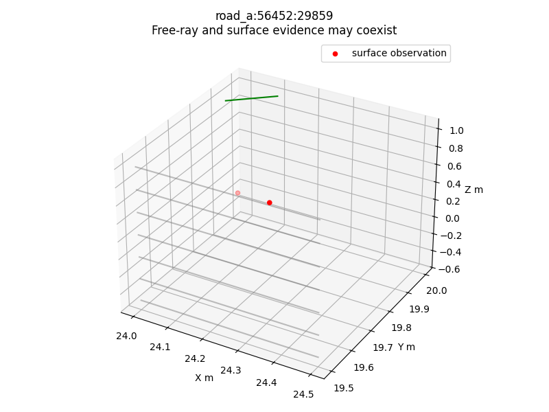
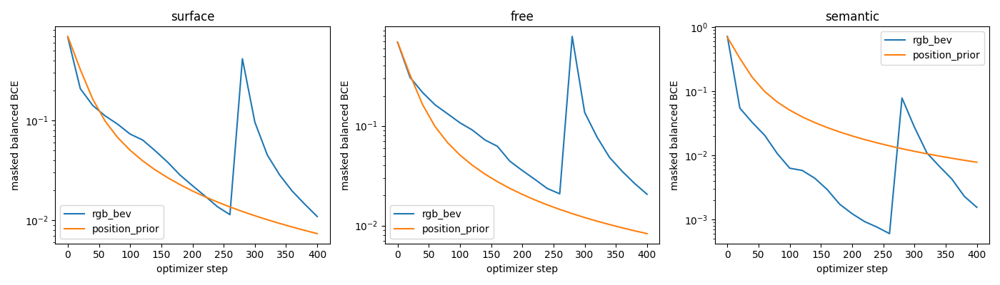
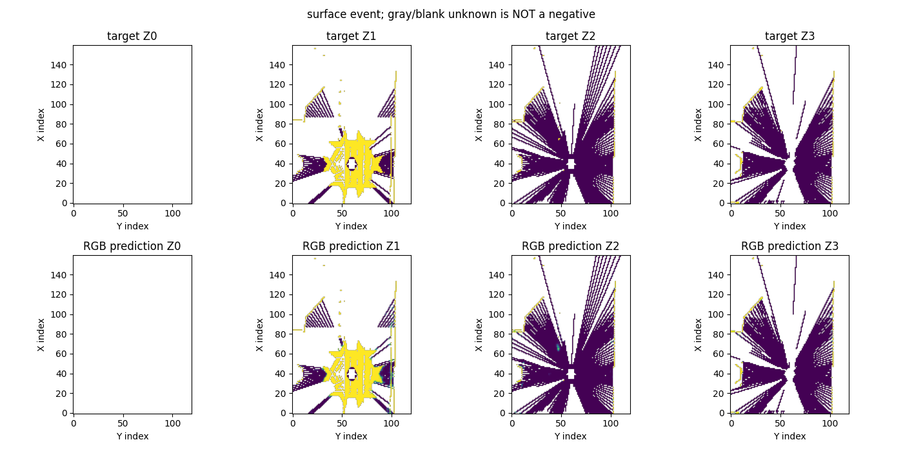
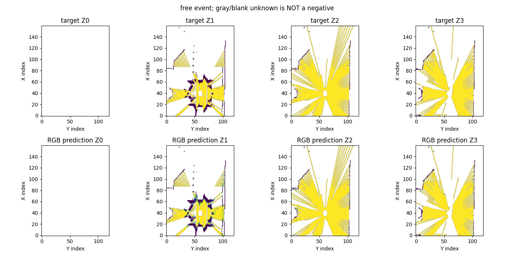
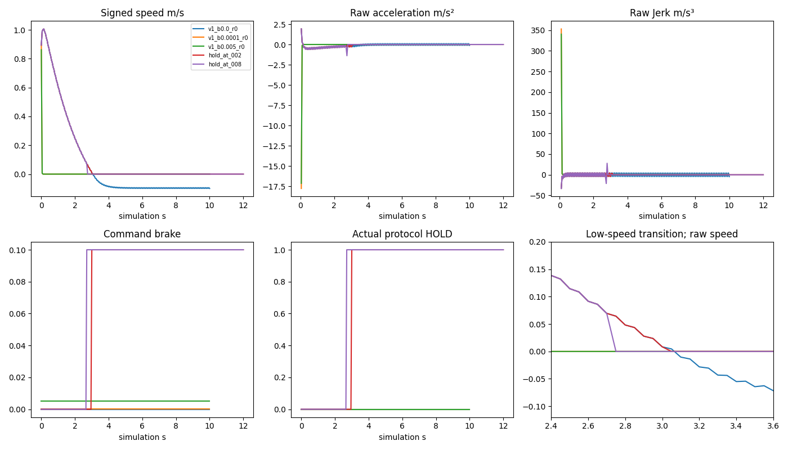
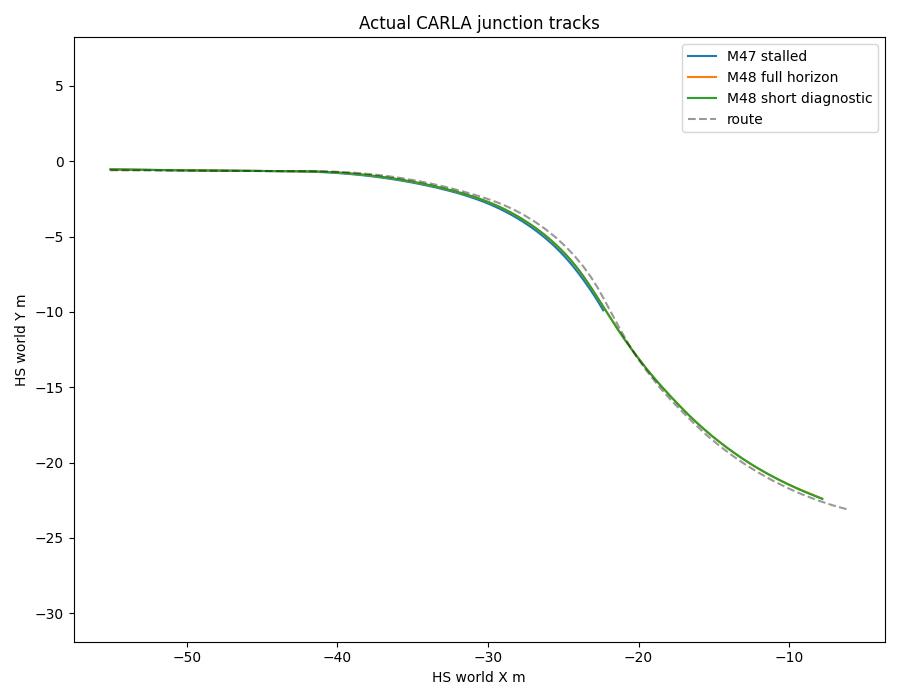

# M4.8 — Spatial Evidence Representation & Control Feasibility

**总体 Partial。V2非互斥事件合同与两帧M5-Pilot通过工程/有限拟合检查；正式空间泛化、舒适停车和完整实时安全闭环未通过。** 保留旧资产、默认Encoder/Splat、Depth Bin、控制器及车型物理；独立分支 `feat/m48-spatial-evidence-control`，基线 `d8393bc`。

## 四个独立状态

| 状态 | 本轮结论 | 证据边界 |
|---|---|---|
| 工程接口 | Passed | 固定四层坐标、非互斥目标、监督隔离、Unknown零梯度、合成测试 |
| 研究性训练 | Passed，限两帧 | RGB-only冻结Encoder + 小Head，400步；不是泛化 |
| 泛化质量 | Partial | 新位姿留出已评价，但碰撞/渲染几何差异与未知空间仍大 |
| 安全闭环 | Partial | 三路线恢复；舒适性、完整20Hz与异步执行未通过 |

机器门禁：[m48_acceptance.json](m48_acceptance.json)；完整接口和复现：[M48_IMPLEMENTATION](../docs/M48_IMPLEMENTATION.md)。

## 1. 旧互斥标签的数学语义问题是否解决？

**表征层面解决，物理占据证明没有被替代。** `surface_evidence` 和 `free_ray_evidence` 分别表示端点/穿越事件，可以同时为1；独立sigmoid和BCE。`observability` 表示至少一种事件支持，不能解释为全部体积可见。负类只表示固定测量配方在已观测格中没有记录该事件，不是证明物理无表面；Unknown不参与损失。

内部0.25m高度细格、XY0.5m；粗四层使用逻辑OR聚合。细格表面截断射线，未解决的细格交会单独Mask；不把少量细格Free推广为整格Free。Ground/Obstacle/Other为独立语义通道；不同细高度的Ground和Obstacle可以共存，同细格不一致则屏蔽语义监督。

旧104格的**局部审计证据重放**全部可以同时保留Surface和Free-Ray（104/104）。这是使用已知审计表面重放的合同检查，不是独立质量通过。[逐格结果](m48_audit104_representation.json)

正常冻结生成器仍保留独立交错像素：104格中91格生成Surface、94格有Free事件、91格标mixed。剩余表面未恢复不能因新名字消失。旧三态生成器及历史结果未修改。

## 2. 监督覆盖和障碍召回是否改善？

类型：**45帧旧CARLA记录离线配对 + 4帧新CARLA记录评测**。新 Town01 spawn20 Audi A2、Town03 spawn180 Model3 在规则SHA冻结后采集，没有根据结果调规则。只是本轮新位姿，非项目从未见过地图；天气均ClearNoon，泛化范围很有限。

每场景首帧，召回参考为CARLA碰撞查询表面（不是精确Mesh）：

| 场景 | V1→V2 Valid Coverage | V1→V2 Obstacle Surface Recall | V1→V2 Ground Surface Recall |
|---|---:|---:|---:|
| Town03_100 Tesla，历史开发 | 13.33%→14.62% | 79.82%→80.73% | 37.77%→38.02% |
| Town02_10 Audi，历史开发 | 10.10%→10.92% | 37.85%→39.01% | 70.26%→71.15% |
| Town02_35 Tesla，历史开发 | 12.33%→13.93% | 36.32%→37.67% | 75.19%→75.93% |
| Town01_20 Audi，本轮留出 | 8.87%→9.45% | 24.42%→25.00% | 76.87%→77.32% |
| Town03_180 Tesla，本轮留出 | 20.46%→21.65% | 38.10%→42.86% | 39.54%→39.81% |

**同采样V2与V1的Surface Recall相同**；上表小幅召回收益来自更密端点采样，不是取消互斥就推断出了新表面。覆盖提高来自保留自由穿越/混合证据而非扩大Unknown。Mixed占观测格约10.8%–23.4%；仍存在约2.9%–12.1%的细格交会疑点（因粗XY、表面回退或几何差异，不自动等同危险物理冲突），相应Free损失Mask独立屏蔽。Mask覆盖率、未知比例、距离/高度层/车型与名义Footprint走廊均在JSON中，不能只看覆盖总数。

[开发配对](m48_spatial_evidence.json)、[冻结规则留出](m48_spatial_heldout.json)。留出渲染像素的障碍表面召回约99.96%，但它们共享渲染器且同一可见表面被邻近像素重复采样，不能当独立3D可靠性。

为什么Town02碰撞参考召回低：额外几何对照显示，Audi的687个障碍命中点中，125个与任一相机渲染深度误差≤0.15m，这部分召回92.8%；463个与所有相机不对齐，这部分22.25%。Tesla为30个对齐点、召回93.33%，169个不对齐点、召回23.67%。**分母混入不可见、碰撞/渲染差异及投影误差，不能把整体低召回全归为视觉漏检，也不能把不对齐点全部删掉宣称安全。** 可见性分桶仅用于解释，未据此选训练样本。[分桶证据](m48_visibility_analysis.json)

未来Footprint风险：有表面证据的障碍可以提供正监督；未观测/未召回障碍区域必须保持风险未知，Free-Ray禁止成为规划可通行掩码。没有完整体积或遮挡后真值，正式空间安全质量仍Partial。

## 3. 小Head能否拟合？

类型：**实际RTX4090 CUDA训练**。road_a、near_a各首帧，都是旧train split、同位姿不同障碍；选择在训练前固定。整个RGB-only Encoder冻结，FP32几何、BF16视觉/Head；未知、ego、细格交会和语义歧义不参与Pilot损失。无GT进入输入，无Actor推理特征，未改Depth Bin或Splat。

| 400步固定两帧 | RGB BEV轻量Head | 每格位置先验 |
|---|---:|---:|
| 总Loss 初始→最终 | 0.69264→0.01103 | 0.69315→0.00783 |
| Surface IoU | 97.77% | 99.90% |
| Free-Ray IoU | 98.81% | 99.93% |
| Ground IoU | 99.97% | 99.95% |
| Obstacle IoU | 99.60% | 99.52% |

梯度有限，Unknown/无效区域梯度严格为0；正负类均检出，无Surface/Free/Ground/Obstacle类别坍缩。**Other没有正样本，不声称其学习通过。** 位置先验也很好，不能据此证明视觉优于空间记忆。模型仅拟合“固定观测事件”，不是学习整格物理Free。

真实峰值allocated约200.63MiB（缓存BEV、冻结主干），全部脚本约5.61秒，其中Head训练2.78秒、位置先验1.61秒；不包含CARLA进程显存。没有开启大训练。训练权重位于独立`runs/m48_pilot`，SHA及数据记录见[训练报告](m48_occupancy_pilot.json)、[分类指标](m48_pilot_metrics.json)。交付脚本只增加可复跑的artifacts参数，实际训练版本保留于source快照。

## 4. 现有物理能否满足舒适停车？

类型：**复用M47的46组实测 + 24组新CARLA探针 + 6组低速滑行交叉探针**。同Tesla Model3、原Physics Control、dt=.05/substep=.01；没有修改物理、强行设速度或滤波隐藏峰值。逐帧速度、API加速度、位姿、gear和控制全部保留。

- 3次重复：约0.895m/s时`Brake=.0001`产生17.77m/s²减速、353.06m/s³原始Jerk；.001/.005/1.0在约.862m/s均出现17.14m/s²突变。中立挡、固定1挡、小油门叠加没有消除此响应。
- 零油门10秒后约−0.10m/s反向滚动，不能可靠驻停。
- 原始目标.1/.2m/s起步探针实际跳至.695m/s：这些是失败的初态控制，不能冒充.1/.2m/s实验。随后用真实滑行下降穿越来补测，保留全部预热记录。
- 约.0893m/s微刹车：1.79m/s²减速、35.72m/s³ Jerk；约.01565m/s微刹车：0.314m/s²、6.28m/s³，后者仍高于峰值门禁5。
- 一个滑行到.00838m/s后HOLD的局部窗口Jerk=4.58、减速=.322，说明**HOLD不必然导致超限**；但整个操作Jerk峰值33.20来自起始控制切换，且没有证明指定停车距离内可实现。局部窗口不能替代全程门禁。

[主实验](m48_dynamics_feasibility.json)、[低速补测](m48_low_speed_followup.json)、[局部与全程口径](m48_hold_feasibility_analysis.json)。原始加速度/API与差分对照保留；运动Jerk P95在<.2m/s样本可为空/零，不能拿它忽略低速峰值。

**结论：尚未展示同时满足停车距离、减速度≤1.8、运动Jerk P95≤2.5和峰值≤5的完整轨迹；有限探针也不能证明数学上不可能。** 胎接触力、滑移、UE内部低速机制未直接观测，因此不能唯一归因到某一物理参数。未采用新物理配置，历史成绩可保留。

官方仓库亦存在Tesla微小Brake低速突变记录，但它只是背景证据，本报告结论来自上述实测：[CARLA issue 3906](https://github.com/carla-simulator/carla/issues/3906)。

## 5. 路口与实时性是否恢复？

类型：**保存状态离线几何审计 + 真实CARLA闭环 + 合成接口测试**。

根因定位：M47第214帧起，真实车型+原裕量的当前Footprint角进入路口Shoulder，停车后仍在边界外，636帧持续阻止行驶。默认窄车宽重放会漏掉该问题；两个版本的诊断均保留，不能把窄车宽结果当正确。[真实尺寸定位](m48_road_diagnosis_actual_size.json)

M48路线目标速度2.5m/s、缩短横向lookahead，保持真实尺寸和完整6秒Safety。三路线均到达原完成条件（弧段完成率约96.5%、终点前停车），0碰撞/0压线/0 Safety强制制动；全地图重审当前Footprint，三路线均0越界帧。**实测速度仍超调到约3.5–3.7m/s，纵向质量未修好。** 速度与横向同时改动，不称单变量消融。固定绿灯只验证路线，不验证交通规则。

完整20Hz、6秒预测的Planner+Safety P95：直路69.82、缓弯115.93、路口113.16ms，**未满足50ms**。精确坐标cache比旧厘米量化更严格也更慢，没有通过边界放行改善数字。

道路预计算候选：只解析非路口常宽直线内缩矩形，其他区域回退地图。初版符号错误出现假接受，失败保留；修正版Town01/02/03/04共18,020点与完整map对照0假接受，但高度重叠、路权/反向车道、孔洞拓扑的全域保证不足，所以没有启用快速接受。[失败审计](m48_road_audit.json)、[修正版](m48_road_audit_v2.json)

2秒短预测诊断的三路线P95约25.53/40.37/41.00ms；有最大值超过50ms，且缩短障碍预测范围未完成风险验收，**不作为正式安全方案**。

5Hz完整Planner+20Hz Controller接口已有时间戳、插值、有效期、故障停车测试；最终三路线成功及emergency/timeout/invalid/missing制动通过。路口规划帧P95=115.39ms，控制帧P95=1.41ms。但执行器是串行，规划帧阻塞控制；直路规划最大值392.77ms超过200ms周期。**仅仿真频率接口成立，真实硬实时未通过。** 初版把跟踪偏差当运动学非法而不动、后续故障注入崩溃均保留；修正后仍不能称安全全面通过。

完整P50/P95/max、每类Safety及运动数据：[m48_junction_validation.json](m48_junction_validation.json)。连续障碍SAT沿用M47边界，未新增精确旋转Mesh/连续道路扫掠声明。

## 6. 是否扩大为正式M5？

**不批准自动扩大。** 现在可以继续受控的空间证据研究，但正式M5需要新的决策门禁：

1. 明确训练目标是可见事件还是完整占据，固定采样与可见性支持；补充近Footprint遮挡、边界和动态障碍遗漏评价。
2. 用新的路线/时序数据检查RGB相对位置先验的收益；当前两帧同位姿过拟合不够，Other和部分高度层无正支持。
3. Planner与Controller真实并发执行、独立截止时间和故障降级，保留6秒预见及碰撞保护；不能把5Hz串行模拟称20Hz实时控制。
4. 建立终端停车可达范围，进一步隔离控制切换与内部低速响应；未证明物理不可行之前不反复经验调PID，不直接换物理后混比旧成绩。

## 复现、测试与资产

最终完整测试：CARLA环境 **140 passed / 16 skipped**；GPU环境 **183 passed / 5 skipped**；M48模块 **11 passed**。两环境互补、测试数不相加。跳过是缺Torch/CARLA的环境边界，具体原因见[CARLA JUnit](m48_delivery_sim_tests.xml)、[GPU JUnit](m48_delivery_gpu_tests.xml)、[模块JUnit](m48_delivery_module_tests.xml)。

所有新实验用m48前缀，原数据与14个checkpoint、旧跟踪文件、M47外部数据SHA最终复核。原始数据在数据盘、Head权重在runs，仓库保存SHA/清单；报告、source快照、失败记录、图、日志与代码提交独立分支。门禁不因Pilot成功或路线Passed而连带关闭。

交付复核补充：[m48_delivery.json](m48_delivery.json)。调度器最终保存不可变生成快照，防止调用方故障注入修改原时间戳；新增回归测试和真实CARLA四故障复测全部通过。旧运行快照、首次验收及修正前结果均保留；路线未因快照复制改变。
