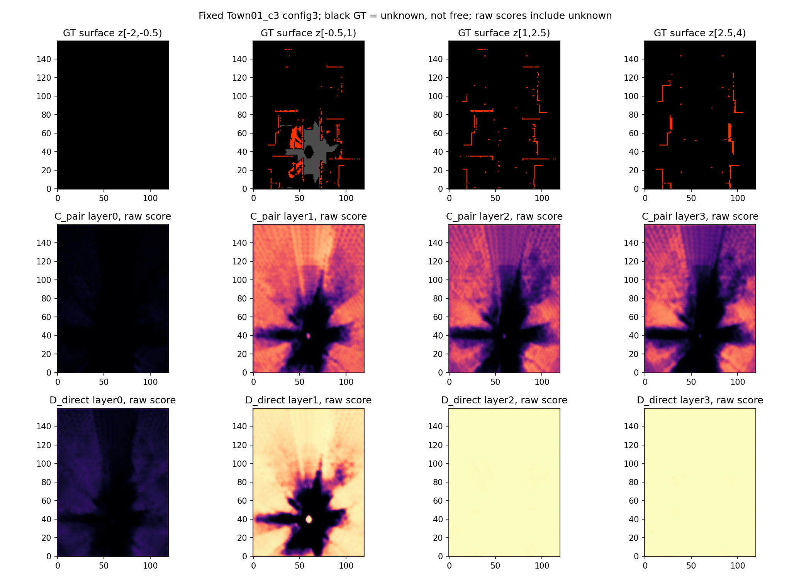
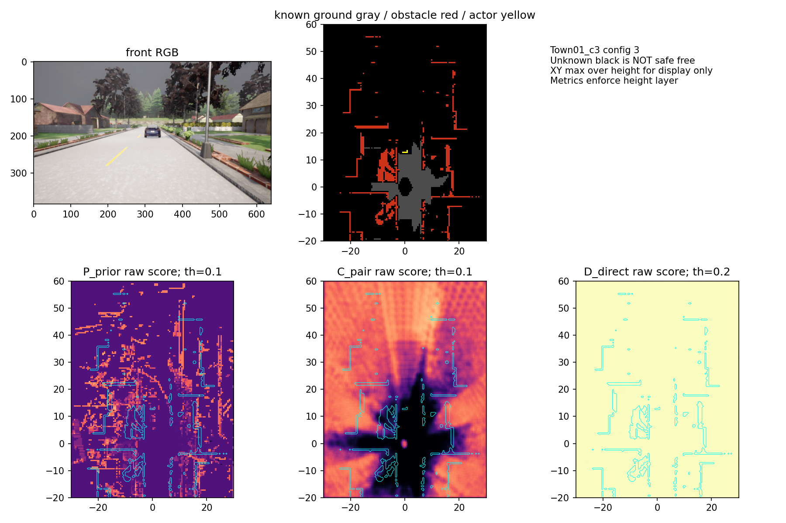
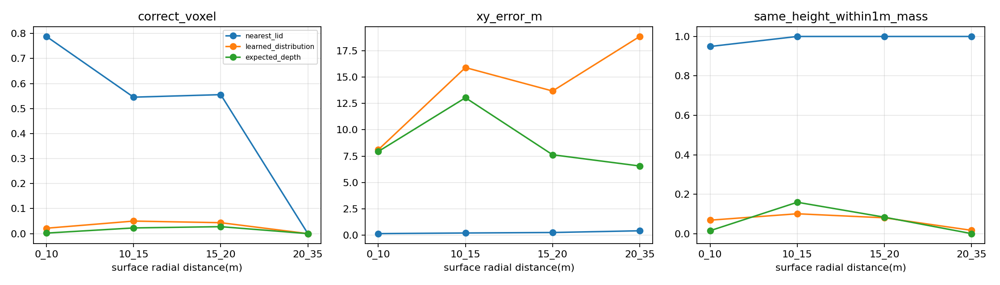
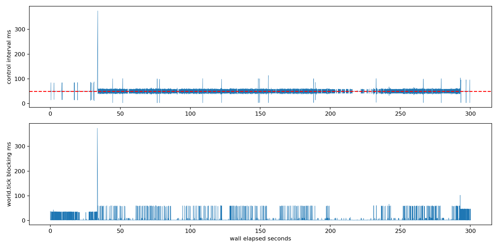

# M5-C — Reliable Single-Frame Obstacle Localization & Spatial Geometry Resolution

**总状态 Partial。完成新数据、双种子轻量训练、首次封存测试、几何诊断及24次CARLA场景运行。独立Obstacle Head提高已知表面分类，但未获得可靠障碍存在性定位；不扩大正式M5训练，不接入Temporal/Sparse Query来掩盖单帧问题。**

基础 `dbb70ed`，独立分支 `feat/m5c-obstacle-localization`。原48 LID Bin、HeightSplat、V2生成器、主干、默认Controller和车辆Physics均未改。未合并main。完整命令见 [M5C_IMPLEMENTATION](../docs/M5C_IMPLEMENTATION.md)，资产哈希见 `m5c_assets.json`。原始数据、Checkpoint和预测数组保存在服务器，Git提交源码、报告、图、测试和日志。

## 七个结论

1. **能否在新位置准确定位单帧障碍？仍不能。** D_direct在4个新位置的已知表面域平均IoU为81.03%/80.44%，但同点障碍消失后72.5%–80.2%仍超过冻结阈值。高分布满未监督区域，不能把已知表面分类性能解释为全BEV定位。该二级诊断针对可确认物理点，不将粗格宣称全空闲。仍有目标漏检和行人失败。
2. **Stride16还是Depth/BEV？两类瓶颈同时存在，不能唯一归因。** 新validation的30m轿车、15m/25m行人在Stride16没有可靠目标中心射线；Stride8假设采样可分别得到6/10/3条。15–20m已有36条目标射线中，学习分布同高度1m概率质量约8.02%，而最近GT Bin为100%。Context替换、Oracle投影改变局部结果，但分布变化禁止把冻结Head成绩当重新训练上限。
3. **48 LID与0.5m网格有明显离散化代价。** 相同可靠整数UV下，最近GT Bin在10–15/15–20/20–35m的正确体素比例54.55%/55.56%/0%，XY误差0.213/0.259/0.422m；样本分别44/36/6条，最后仅3个位置。20–35m学习分布正确体素质量也为0，不能把这部分全归Depth训练；但其同层1m质量仅1.67%、概率期望XY绝对误差18.85m，又远大于量化误差。
4. **独立Obstacle Evidence优于组合分数吗？只在可靠表面分类范围内。** D较C在两个种子的场景均值上提高绝对表面IoU；种子72在Town01退化约2.94个百分点、Town04基本持平，并减少已知Ground误检、增加Actor表面召回；但成对变化下降、消失残留很高、Unknown大量高分。独立Head仅有表面BCE，没有可见性/无表面点证据的直接约束；原配对Loss仍约束旧组合输出。不能部署为完整障碍占据预测。
5. **Context/配对收益是否复现？不稳定。** B相对A场景均值IoU为−2.79/+1.30个百分点；C相对B为−0.04/−1.38个百分点。C的变化IoU高于B，但仅9.75%/4.43%，远低于历史M5B；本轮按绝对表面而非变化指标选Checkpoint，数据/天气/目标支持也不同，因此不能作为严格跨轮单变量退化结论。
6. **Runtime长时间/负载下达标？没有。** 6000tick压力运行P99=61.60ms、Max=375.03ms、deadline miss=4.63%；无额外实验负载的一轮路口仍Max=131.94ms。第二轮隔离六场景Max≤54.57ms，不能覆盖先前失败。过期规划正常控制0，六秒Safety和故障停车保持。
7. **下一阶段选择：继续单帧空间感知与几何。** 先研究对目标存在/缺失有区分力的局部监督与组级模型选择，保留Unknown语义；其次以匹配射线实验研究低成本更高分辨率特征与空间投影。没有证据支持直接大型Occupancy训练，也不建议立即用Temporal BEV或Sparse Query叠加复杂度。子Bin/软投影只能另立受控候选，不能改默认Splat。

## 独立门禁

|门禁|状态|实际证据和限制|
|---|---|---|
|工程接口|Passed（已测范围）|新增Head、Mask梯度隔离、同层定位、RGB-only与缓存路径；保留旧协议|
|训练可学习性|Passed（研究性）|RTX4090，5组×2种子×400步，有限梯度，冻结模块无梯度|
|空间泛化质量|Partial|表面分类改善，但消失残留、Unknown高分、小目标和跨位置变化不足|
|运行时稳定性|Partial|隔离重复与负载测试均保留长尾，预声明逐周期门槛未通过|
|Oracle驾驶安全|Partial|24运行0碰撞/压线/当前道路越界；一条负载路口路线可用性失败，动态交通未覆盖|
|纯视觉驾驶安全|NotValidated|闭环仍用Oracle路线/Actor/状态，视觉输出未驱动控制|

## 数据与实验控制

16新位置、4地图、每组16布局，共256帧（每帧六摄RGB/Depth/Instance，另有匹配去自车参考）。Train128帧/8组，Val64/4组，Test64/4组。新组距旧组及同地图其他新组≥45m。地图Town01/03/04/05；三种天气/光照。每组包含空场景、5–30m轿车、左右移位、货车、遮挡、小型目标、升高行人和return-empty。封存测试在所有模型和阈值冻结后才采集和处理。

**测试是新位置，不是新地图或未见布局类别认证。** 组内16布局、同一Actor重复出现和像素事件都不独立。训练240对1906变化事件，test120对960变化事件；这些不是独立障碍数量。test共60个摆放Actor实例，8个无有效留出表面格，仅44个满足≥3格弱检测统计。20–35m仅28个Actor表面格，来自4组；不能由其高召回推断远场可靠。

参考由同源CARLA渲染器的可靠首命中端点构造，按像素交错留出，每格≥3点、语义冲突/自车排除。AABB只关联可见点，不当精确Mesh或实体体积。Free-Ray不当安全Free；Unknown不当负类。混合格另列。交通锥以manifest的Dynamic21归Obstacle，主训练/评价一直正确；最初几何诊断硬编码遗漏它，已保留原结果并新增修正版。

## 单帧结果与存在性风险

以下为**4个位置场景均值IoU**；P/R为全test已知表面域合并统计，不能当全BEV检测P/R。Actor栏只在Actor可见正表面计算Recall，其子域没有负样本，因此JSON中的Precision=1是定义上空泛的值，不能作为检测质量。

|模型|种子|场景IoU|表面P / R|Actor exact Recall|变化IoU|
|---|---:|---:|---:|---:|---:|
|PositionPrior|71|40.35%|70.9 / 48.5%|66.4%|0%|
|A Frozen|71|61.04%|77.5 / 85.3%|19.2%|6.01%|
|B Context|71|58.25%|93.4 / 70.6%|17.3%|2.79%|
|C Pair|71|58.22%|91.7 / 71.3%|24.7%|9.75%|
|D Direct|71|81.03%|94.7 / 84.7%|80.3%|2.19%|
|PositionPrior|72|41.05%|75.5 / 47.0%|57.8%|0%|
|A Frozen|72|68.27%|85.8 / 84.1%|7.2%|2.92%|
|B Context|72|69.57%|89.0 / 84.1%|8.4%|1.76%|
|C Pair|72|68.19%|86.1 / 85.7%|15.8%|4.43%|
|D Direct|72|80.44%|94.6 / 85.1%|81.5%|1.94%|

D全域已知表面FP=2220/2290、FN=7243/7041；Actor表面FN=82/77（417个正格）。可确认走廊召回80.5%/82.7%，仍漏71/63个表面格。D对4个可评行人的弱检测仅0/4和1/4；15/25m及升高小目标很多支持不足。PositionPrior也可满足全部弱Actor检测，进一步证明“Actor候选区域内有高分”并不证明视觉存在性定位。

冻结单帧阈值在成对物理点上的测试：D的absence残留为72.5%–80.2%，同点“存在高于阈值且消失低于阈值”仅0%–4.9%。PositionPrior此项始终0。D并非只预测全负，训练也未数值坍缩；它学到可靠表面上的Ground/Obstacle分布，而未知域不受约束，容易把高层先验当成普遍Obstacle。不能为修正此问题把整个Unknown体素涂成负类。

## 采样、量化与模块隔离

权威诊断为 `m5c_corrected_feature_sampling.json` / `m5c_corrected_geometry_resolution.json`，只使用新validation。原诊断保留在无corrected前缀文件，差异说明见 `m5c_diagnostic_corrections.json`。

|名义目标|可靠原生像素（4组）|Stride16射线|Stride8假设射线|
|---|---:|---:|---:|
|15m轿车|2767|4|59|
|20m轿车|1006|8|12|
|25m轿车|469|6|6|
|30m轿车|198|0|6|
|15m行人|446|0|10|
|25m行人|33|0|3|
|10m交通锥|2068|4|48|

可靠像素减少部分来自目标成像尺寸及遮挡边界/稳定性过滤；Stride16网格相位进一步丢掉小目标。Stride8也不能保证每个距离支持足够。原生像素/AABB候选、实例像素、可靠像素和各相机计数均保留。AABB候选像素面积不是精确实例分割面积。

四种投影严格使用相同整数UV、相机、深度、有效Mask。原模型分布仍关联原半像素中心，量化对照的四路一起舍入，不能混同于原生Splat更改。连续GT投影正确体素100%是自一致检查，不是独立真值验证。15–20m nearest-bin体素命中55.6%、XY MAE0.259m；learned分布正确体素质量4.37%、期望XY绝对误差13.68m。Expected-depth点投影误差7.63m，不等于完整分布投影误差。

20–35m只有6条射线/3组；最近Bin0%精确格但100%同层1m内，说明0.5m定位与1m容差结论不同。补充合成均匀深度扫描：15–35m的Bin宽约1.34–2.14m，最近中心误差可达约1.05m；这是固定前向相机相位的合成测试，不是额外CARLA场景统计。未修改Depth Bin，也未训练Depth。

验证集C_pair种子71的固定干预：原目标表面Recall32.85%；固定空场景Context为23.72%；固定空场景Depth为32.12%；局部RGB遮蔽为30.29%；Oracle最近Bin为46.35%。Oracle同时增加已知表面FP（3825→8762），整体IoU下降；输入分布变化和概率/Context归一化混杂仍在，不能宣称Oracle结果是可训练上限。重建同一BEV Encoder只验证接口恒等，不能证明BEV Encoder是否压制稀疏变化。

投影微基准使用插值的假想Stride8张量：Splat P95 3.37→4.20ms、增量峰值47.2→73.2MiB、点数4倍。不是Stride8视觉Encoder/训练显存测量，不能据此宣布低成本候选已通过质量门禁。

## 训练与模型选择

全部从相同M4预训练Encoder和同种子随机Head出发，两个种子、同400步、同配对顺序，冻结ResNet/FPN/Depth/BEV Encoder，B/C/D只解冻Context。D相对C新增直接Head和辅助Masked BCE，原输出保留。几何FP32、缓存BF16，峰值allocated约3040MiB。冻结特征预计算26.84s，单模型训练3.2–10.3s；不是完整端到端训练吞吐。

主Checkpoint按val绝对表面IoU选择，因此背景占比主导。D表面语义任务的成功没有转化为存在性变化成功。旧M5B C_pair Checkpoint在新val的变化IoU仍为23.05%/27.34%（旧阈值，不是匹配重训对照）；不应把本轮主模型选取目标变化误解释为Context本身失效。下一轮应预声明目标存在性/背景/空间定位联合模型选择，并重新封存新test，不能再用本次4组调参后称盲测。

直接RGB-only推理与缓存路径BF16最大score差约0.00575、平均差最大1.73e−5、单帧最多4格跨阈值；FP32等价与冻结梯度测试通过。近阈值差异存在，不能保证逐bit复现。所有选择只来自validation，test后未改模型、Loss、阈值或主评测代码。

## Runtime独立结论

24次场景运行、16622tick，0碰撞、0压线、0当前道路边界违规、0过期规划正常控制。保留5Hz Planner、20Hz Controller、六秒预测、唯一tick owner。原Controller/Physics未改，舒适性没有自动升级Passed。

|运行条件|P99/Max代表值|状态|
|---|---|---|
|首轮CPU标签处理负载直线|64.25 / 227.97ms|失败|
|约5分钟GPU推理+CPU处理压力|61.60 / 375.03ms，deadline miss4.63%|失败|
|首次真正隔离路口|51.07 / 131.94ms，miss0.152%|失败|
|第二次真正隔离6场景|各P99≤51.20ms，Max≤54.57ms，miss0|该次通过，不能覆盖其他失败|

压力进程实际RGB Encoder推理3383次、340.06s、9.95Hz；未将视觉预测接入驾驶器。6000tick运行到达路线终点后驻车，不能称五分钟连续运动。每分钟P99约61–84ms，无单调漂移证据，但长尾持续存在。最坏周期`world.tick()`耗时373.53ms，占375.34ms周期主要部分；该压力同时含CPU处理和GPU推理，不能唯一归因GPU。

故障到主进程制动命令：Worker崩溃约50.9–51.5ms、坏输入165–201ms、Worker滞后约301ms、Emergency约1.2–1.5ms。保留原始时间戳并在过期时停车；陈旧计划age统计包含被拒绝/降级帧，不能误称被正常使用。一个CPU处理负载路口路线仅完成6.57%并停住，提示可用性失败；不能因零碰撞把驾驶任务标Passed。

## 验证、失败记录与交付

- GPU环境全量：219 passed、5 skipped；5项因无CARLA模块跳过，CARLA环境对应集合14 passed，另接口集合18 passed。XML和日志均保留。
- 源码编译、差异空白检查通过；原资产哈希复核见acceptance/assets，新增依赖只增加SciPy1.15.3。
- 首次切图退出、临时Actor停放碰撞、资源探针错误调用签名、初次历史index无test记录（保存为m5c_spatial_localization_initial.json，主交付已修正）及几何语义遗漏均保留日志或原报告，并给出修正文件。没有删除失败来改善结论。
- 二级point-absence审计在test评价前声明，测试只执行一次；绘图引用后来修正为正确的validation几何报告，训练/标签/主评价源码与冻结哈希一致。
- 旧报告、模型、数据不覆盖。大型raw/Checkpoint/预测数组保留服务器并列SHA；它们不作为Git大文件推送。日志、关键图、源码、协议、报告与测试记录提交独立分支。

下一轮应首先解决“高表面IoU但障碍消失后高分仍在”的监督与模型选择问题，再做匹配射线的图像采样/几何实验。安全Free、精确Occupied体积、动态时序与纯视觉闭环均未由本轮自动验证。
