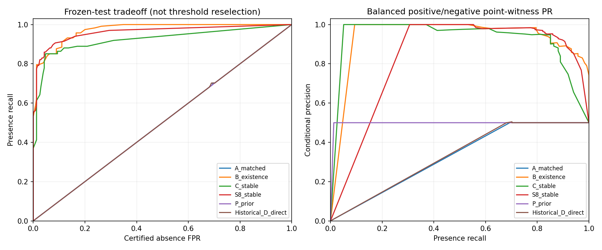
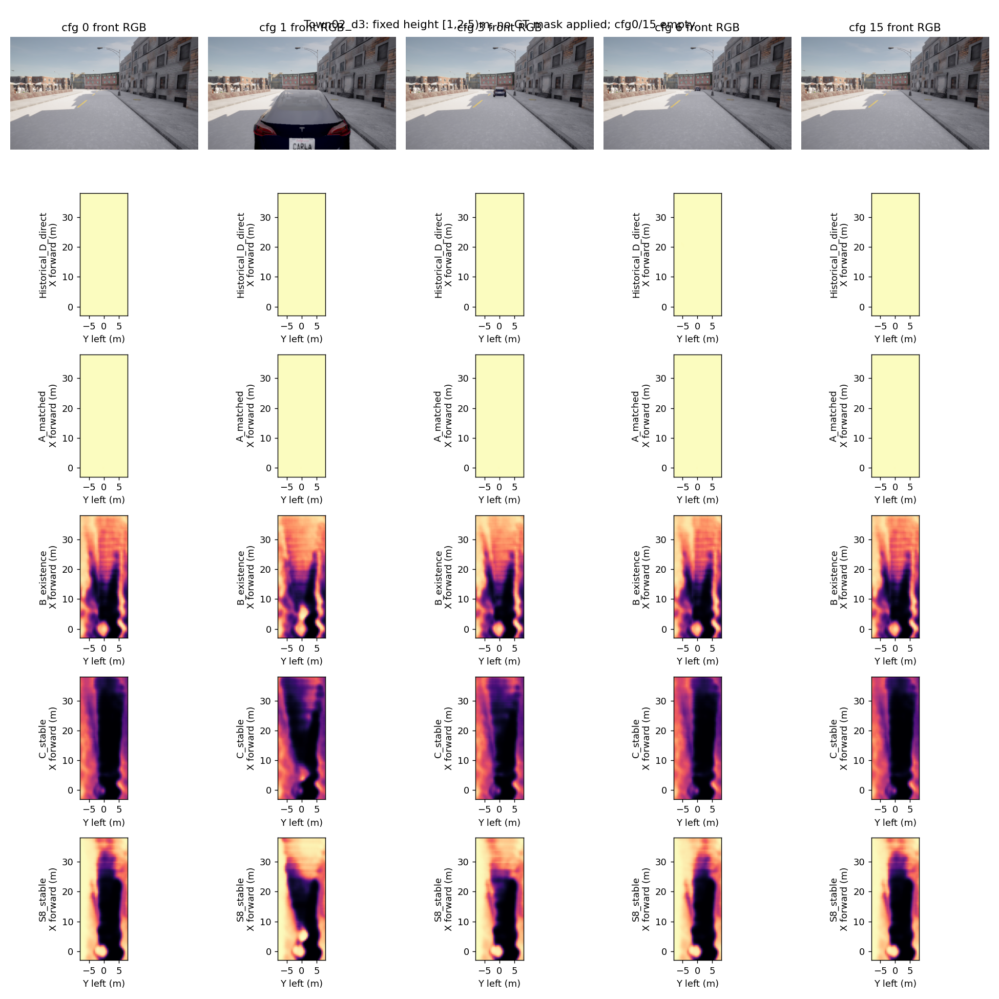
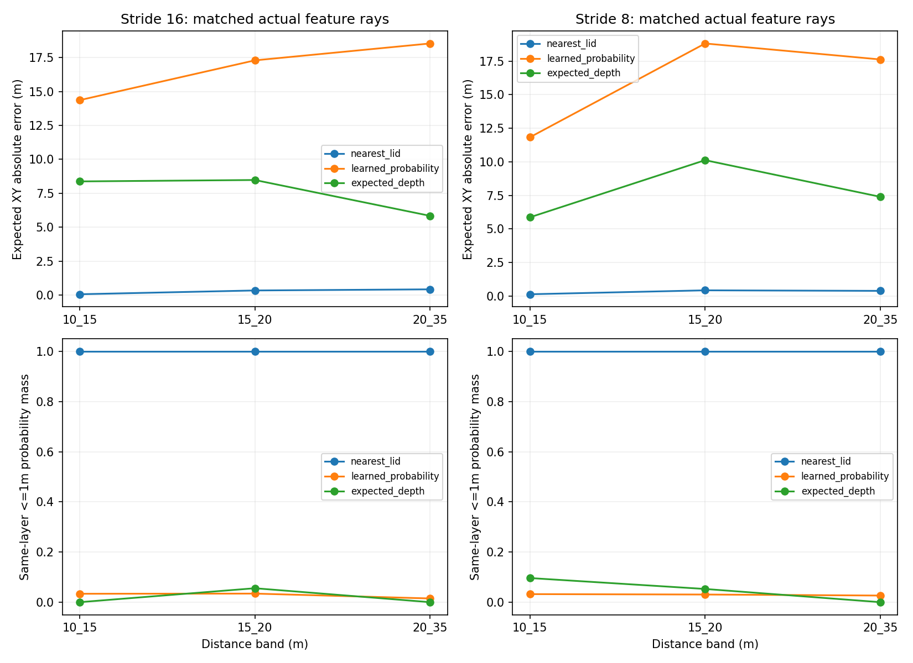
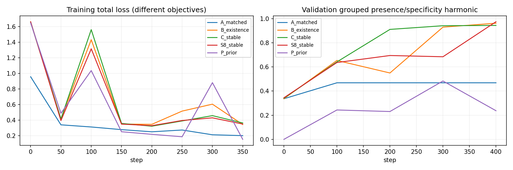
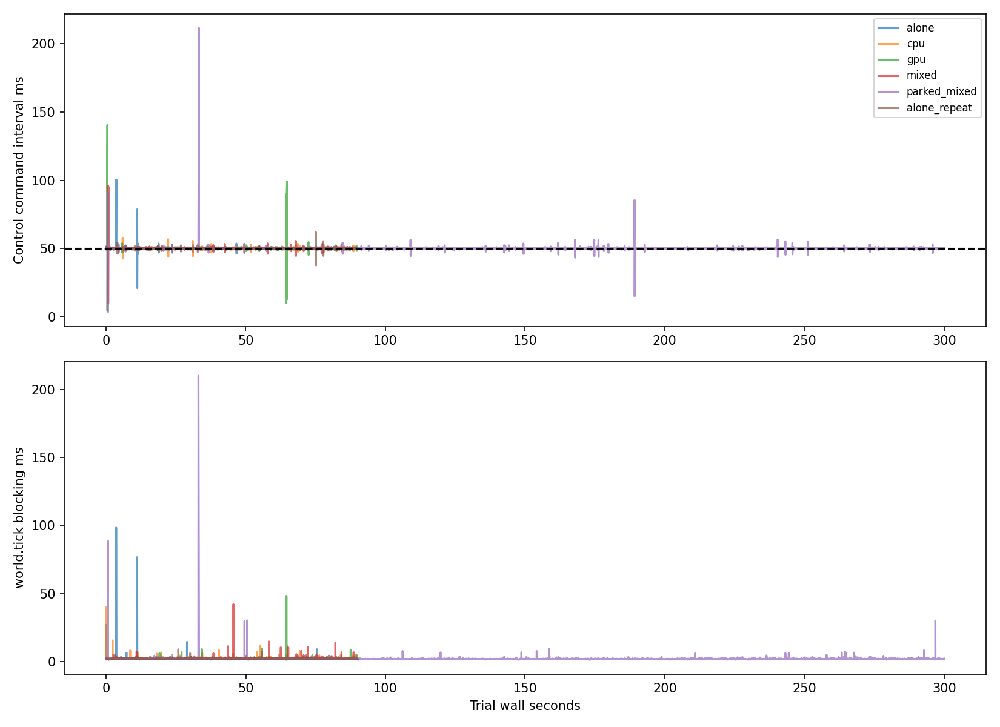

# M5-D — Visibility-Conditioned Obstacle Existence & Single-Frame Geometry

**总状态 Partial。实际完成监督审计、12个新位置/192帧采集、双种子10组400步RTX4090训练、首次封存测试、真实P8和投影诊断、分组CARLA压力与故障回归。直接存在/消失监督有近场收益，但远场/小目标、绝对定位、Unknown未认证高分和运行时长尾仍未通过。不得扩大正式Occupancy训练或宣称纯视觉驾驶安全。**

基础 `2aa91f6`，独立分支 `feat/m5d-visible-existence`，实现提交 `8f7521c098325acc9914e40810ea8c34b0c38fb7`（报告交付提交在其后；Git HEAD为最终交付）。旧资产哈希检查通过：True。未合并main，未改48LID、默认HeightSplat/主干/Controller/Physics。命令和Mask数学定义见 [M5D_IMPLEMENTATION](../docs/M5D_IMPLEMENTATION.md)，完整外部资产哈希见 `m5d_assets.json`。

## 七个回答

1. **M5-C残留确实存在Direct Head负监督缺口；不能说只有这一原因。** 实际autograd确认旧pair loss不更新独立输出层，仍会更新共享trunk。旧train/val的2840个absence点探针只有355个直接Ground负监督，2485个无endpoint。匹配A/B新实验支持新增直接监督改善点存在性。旧模型还受特征采样、Depth分布和表面任务选步影响。

2. **新认证Witness上的Presence/Absence总体同时改善，跨场景可靠性仍未通过。** B相对匹配A，两个种子Presence由70.21/54.47%变为89.36/75.74%，Absence FPR由70.21/51.49%降至11.06/5.96%。但种子82在Town02 Presence不足，种子81在Town02 FPR14.58%。这些是235个相关点事件、3位置条件指标，主要近场；不是完整体积泛化。已知Actor表面召回也没有同步普遍改善。

3. **真实Stride8有局部收益，不能认定可靠升级已通过。** S8对C的Actor exact recall两种子从62.78/58.58%增至74.11/71.84%，弱Actor检测从18/23增至27/26（33可评）。15m轿车feature rays 3→44，30m车0→6，15m行人0→8。S8种子82 Town02 Presence仍64.58%，行人只检测1/3；一个种子的absence更差。冻结Depth在P8上有分布迁移，仍保留候选，不替换默认。

4. **LID量化与学习深度都有代价，当前学习概率投影误差大得多；不能给可加的因果百分比。** Stride16同射线15–20m：最近GT Bin XY误差0.340m，完整学习分布期望XY绝对误差17.290m，Expected Depth点8.477m；20–35m分别0.422/18.534/5.838m，但仅6条特征射线。补充657条原生远处可靠射线，量化XY误差0.350m、精确格命中7.31%、同层1m覆盖100%；这些是同3位置相关像素。该结果不支持简单宣判48Bin失败，更不支持用Expected Depth MAE代替分布空间质量。

5. **尚未获得稳定可靠的单帧出现/消失与绝对定位。** B/C/S8条件变化IoU约9–18%，远场认证训练事件0，test远场仅6；B种子81在15–20m的absence FPR51.72%，C的较低FPR伴随Presence降至27.59%。B/C的Unknown高分约91–95%，不能当已认证FP，但绝不能给规划器当安全证据。位置先验同位置输出不变，both-correct为0；视觉模型在受支持近场已超越先验。

6. **Runtime长尾同时包括CARLA tick阻塞和控制进程调度/唤醒迟延。** alone首轮最坏100.56ms对应前周期tick98.49ms；GPU负载最坏140.62ms对应tick仅2.24ms、循环间约136.45ms。不能全部归因于Planner或GPU争用。下面保留全部负载、运动/驻车及故障结果；未获得Unreal内部render profiler。

7. **不扩大正式Occupancy训练。** 继续受控单帧研究：先以独立协议验证远处斜面背景/遮挡边缘的counterfactual可见性，补足中远场正负支持，再研究已有Depth分布定位和P8收益。不能在本次test上调规则；不能用Temporal/Sparse Query掩盖单帧监督不足。本轮没有训练新几何辅助D、子BinHead或更改Splat。

## 独立门禁

|门禁|状态|
|---|---|
|工程接口|Passed|
|研究性训练|Passed|
|Presence识别质量|Partial|
|Absence识别质量|Partial|
|绝对空间定位|Partial|
|几何泛化|Partial|
|运行时稳定性|Partial|
|Oracle闭环|Partial|
|纯视觉闭环|NotValidated|

## 封存测试

6 train/3 val/3 test位置，各16固定布局，共192帧；train96/val48/test48。45个test摆放Actor中6个零留出表面支持，33满足弱检测资格；零支持者不删除。测试为新位置、既有地图和预声明布局，不是未见地图/类别盲测。test采集发生在模型/阈值冻结后，科学评测代码哈希不变。

认证事件train366/val188/test235；test距离分布0–10m:183，10–15m:17，15–20m:29，20–35m:6。出现和消失方向可重复同一物理配置，不作为独立样本置信区间。可靠首命中来自同源渲染器，AABB只关联表面，不作精确Mesh。

|模型|种子|Presence Recall|Absence FPR|同点两态正确|Actor exact Recall|弱Actor检测|Unknown高分|变化IoU场景均值|
|---|---:|---:|---:|---:|---:|---:|---:|---:|
|A_matched|81|70.21%|70.21%|0.00%|89.97%|33/33|99.53%|0.00%|
|B_existence|81|89.36%|11.06%|78.30%|67.31%|21/33|93.23%|18.49%|
|C_stable|81|81.28%|4.26%|77.02%|62.78%|18/33|90.80%|11.98%|
|S8_stable|81|88.09%|6.38%|81.70%|74.11%|27/33|95.65%|15.56%|
|P_prior|81|65.53%|65.53%|0.00%|70.23%|33/33|5.21%|0.00%|
|A_matched|82|54.47%|51.49%|8.09%|55.34%|25/33|46.51%|0.00%|
|B_existence|82|75.74%|5.96%|69.79%|55.99%|19/33|94.55%|9.30%|
|C_stable|82|78.30%|5.96%|72.34%|58.58%|23/33|94.92%|9.19%|
|S8_stable|82|81.28%|5.53%|75.74%|71.84%|26/33|95.09%|10.41%|
|P_prior|82|60.85%|60.85%|0.00%|68.61%|33/33|5.19%|0.00%|
|Historical_D_direct|71|70.21%|70.21%|0.00%|81.55%|31/33|72.81%|0.00%|
|Historical_D_direct|72|70.21%|70.21%|0.00%|81.88%|30/33|74.37%|0.00%|

上表微平均仅补充逐场景结果，不能掩盖门禁失败。Actor exact只在已观测目标表面；弱检测为≥3格且≥20%表面同层1m覆盖，不代表完整实例定位。Unknown高分不是已认证False Positive。完整逐相机采样、逐Actor、层/距离、ground/background/corridor、3D粗格中心误差、双向匹配未匹配数量均在JSON。

旧M5-C完全相同原帧和旧Mask回归：历史D两个种子的场景残留72.54%–80.16%重现；总体77.08/76.35%。新B为16.35/10.63%，新C10.83/13.33%，但Presence分别68.33/62.29%和62.29/67.50%，旧D76.98/77.92%。这是跨轮回归，不是匹配消融；不能把残留下降描述为无代价整体提升。原M5-B C_pair历史参照仍保存在 `m5c_summary.md` 及其关联报告，不混入本轮单变量表。

## 监督覆盖与几何限制

M5-C审计72帧子集55301个Direct正格中，仅663格（约1.20%）关联摆放Actor，背景/未关联表面占绝大多数。类别raw semantic分布另存；同粗格可跨类别，不能简单相加当独立格占比。没有将背景表面IoU当最终障碍检测。

认证规则收缩必须透明：train旧Witness1425→366，val724→188，test695→235；新旧Mask并列，不用覆盖变化伪装性能改善。20–35m val目标663可靠射线中638能见更远首命中，局部深度spread≤0.5m后只剩6，最终每格≥3支持使认证事件为0。规则可能把远处斜面过滤掉，尚需独立几何验证，不能直接放松边缘保护。

P8使用真实未pool layer2，特征[1,6,64,48,80]，Splat点数276480→1105920。原图/标定相同；原48bins、默认Splat保持。两路投影采用原均匀格中心约定，不声称精确感受野中心。验证资源测量S16中位约7.42ms、P8约7.48ms，但S16P95约34.71ms受抖动影响，不能称P8更快。基准不是长期独占GPU时延认证；训练峰值更可靠地反映额外缓存开销。

## 实际训练与测试

RTX4090真实运行10组×400步；全部有限梯度、冻结模块无梯度。冻结特征预计算18.02s，单组训练14.22–20.66s，峰值allocated最高2592.4MiB。**缓存Head/Context训练，不能称完整端到端吞吐。** 所有科学模型/阈值/训练索引冻结检查通过。A种子82选中step0（val目标更优），其他模型步数详列JSON，不能暗示选中Checkpoint训练步数相同。

BF16直接单帧推理与缓存路径最大分数差0.00342，特权Witness输入被拒；近阈值差异保留，不保证bitwise同一。未知位置额外loss梯度为零、方向正负梯度、替代障碍veto、坏可见性、3D未匹配、真实P8非插值等合成单测通过。主pytest226 passed/5 skipped；CARLA API环境补测14 passed。合成单测、真实GPU和CARLA闭环证据严格区分。

## Runtime：实际CARLA独立验收

|负载|实际移动距离m|移动tick|平均Hz|间隔P95/P99/Max ms|Deadline Miss|过期正常控制|
|---|---:|---:|---:|---|---:|---:|
|alone|203.82|1720|19.989|50.52/50.95/100.56|0.11%|0|
|cpu|210.23|1748|20.000|50.61/51.34/57.61|0.00%|0|
|gpu|203.33|1709|19.988|50.55/51.03/140.62|0.11%|0|
|mixed|209.73|1752|19.989|50.58/51.14/95.90|0.11%|0|
|parked_mixed|57.14|550|19.989|50.54/51.14/211.78|0.05%|0|
|alone_repeat|211.09|1752|20.000|50.62/51.01/61.99|0.00%|0|

250m长路线试验每组固定90s，实际完成约200m，预算耗尽未到终点，不能按route_passed宣称全程完成；五分钟驻车试验另分运动/静止统计，不能算五分钟持续驾驶。负载进程退出码、实际GPU调用Hz和CPU处理帧数在独立报告；device利用率不等于CARLA专属占用。

|故障/路线|完成率|碰撞/压线/道路越界|过期正常控制|控制间隔Max ms|故障至制动s|
|---|---:|---|---:|---:|---:|
|mild_curve|97.91%|0/0/0|0|54.77|N/A|
|junction_turn|97.69%|0/0/0|0|52.95|N/A|
|slow_worker|0.00%|0/0/0|0|51.28|N/A|
|worker_crash|5.06%|0/0/0|0|53.96|0.0511|
|emergency|4.41%|0/0/0|0|51.04|0.0013|
|static_obstacle|21.34%|0/0/0|0|53.25|N/A|
|stalled_worker|6.06%|0/0/0|0|55.74|0.3011|
|invalid_input|5.96%|0/0/0|0|52.48|0.2010|

Oracle仍使用特权路线/状态/Actor，视觉输出没有驱动车辆。保留6秒Safety、原始规划时间戳0.35s过期判定、慢/崩溃/停滞worker、坏输入、紧急停车与静态Actor保护。碰撞零不代表舒适制动或连续碰撞泛化通过；原动力学jerk和反向tick如实保留。

进程资源隔离建议：重负载标签生成与CARLA闭环分时运行；CPU affinity应在独立版本化试验中为tick owner/Planner/Server留核，GPU推理保持限频并以原始双时钟拒绝过期。单卡共享渲染与网络时必须继续记录尾部；不能只按平均20Hz缩小安全预测。此建议未做affinity因果验证，不能标为已修复。

## 交付与保留的失败

主要交付：`m5d_supervision_audit.json`、`m5d_presence_absence.json`、`m5d_model_ablation.json`、`m5d_stride8_analysis.json`、`m5d_geometry_resolution.json`、`m5d_dataset_quality.json`、`m5d_runtime_stress.json`、`m5d_acceptance.json`及源码/测试/可视化。辅助digest便于读数，原始逐帧结果保留。Checkpoint、预测NPZ、RGB/Depth/Instance在服务器，路径及SHA逐文件列于assets；Git包含源码、报告、图和运行日志。

保留首次Witness合成fixture整数dtype失败、首次Runtime smoke未初始化日志字段失败、其重试与全部门禁失败。失败修复未改历史资产。新报告不会把研究训练、工程接口、泛化和安全状态相互传播。
