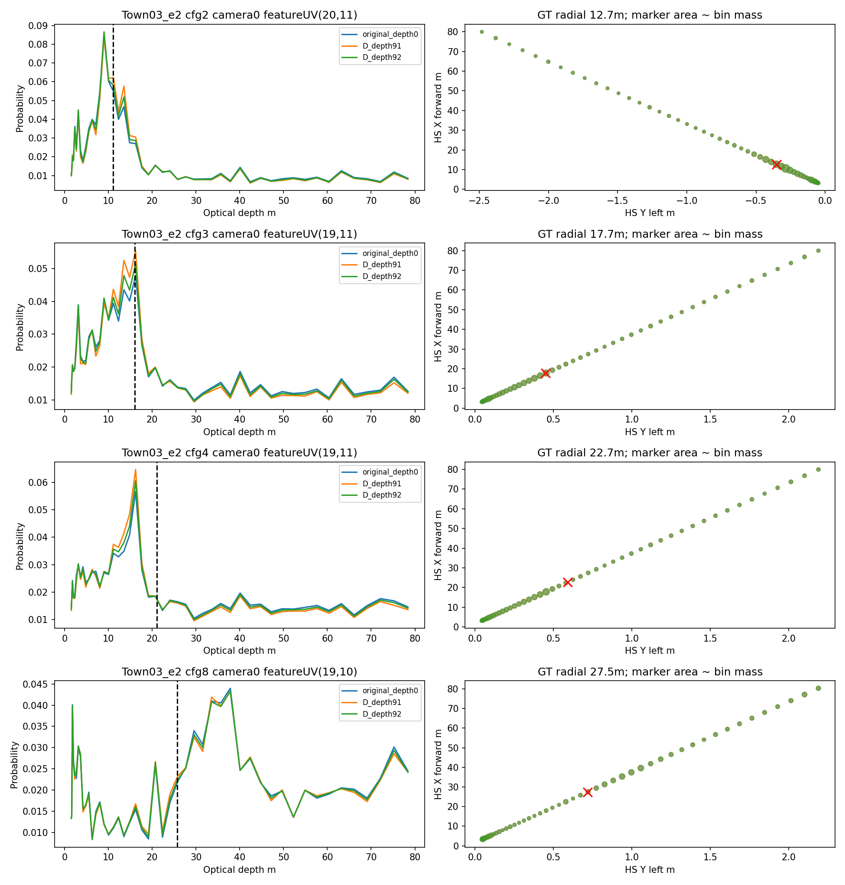
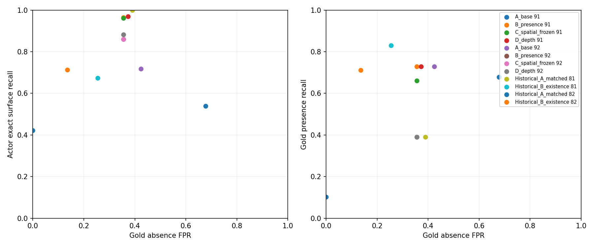
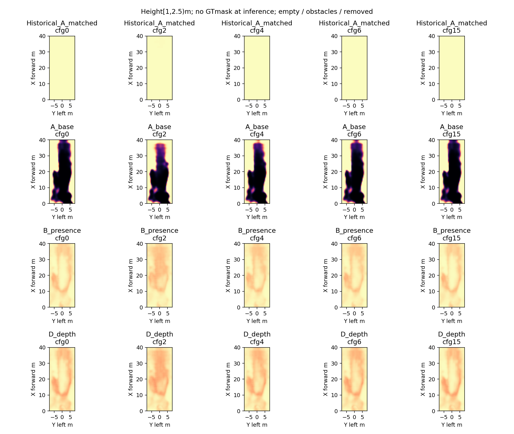
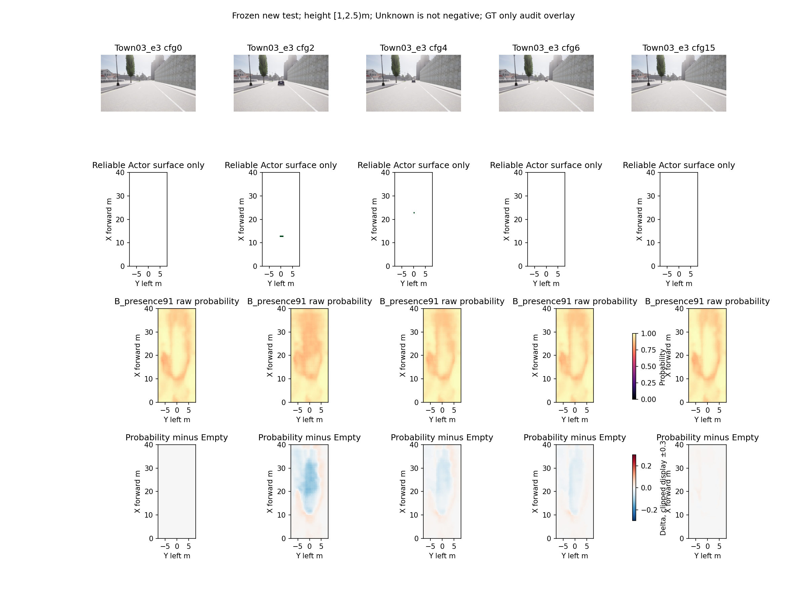
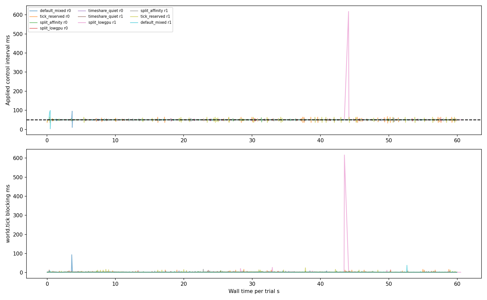

# M5-E — Far-Field Visibility Supervision & Depth Spatial Probability

**状态：Partial。没有扩大正式 Occupancy 训练，未关闭纯视觉安全门禁。**
基础 `33005efa8ad01397fff7b45da5b9b1fb06af403f`；分支 `feat/m5e-far-visibility-depth`；实现提交 `f9ea4e7f404152916552045ab370be94ec6c8d66`（在最终报告提交之前，最终Git提交包含本报告）。逐文件源码/Checkpoint/数据SHA见 `m5e_assets.json`，test前冻结见 `m5e_pretest_decision.json`。所有旧tracked文件及Checkpoint逐文件校验结果：True。

## 证据类型与范围

- **实际 CARLA 0.9.15**：Town03/04/05、12新位置×16布局=192帧，六RGB/Depth/Instance同步；每布局去自车参考；300条碰撞几何查询；两轮资源隔离及故障/动态前车验证。
- **实际 RTX4090**：A/B/C/D×两种子×200步，共1600步；原ResNet18/FPN、48LID、HeightSplat、S16、四层BEV保留；BF16视觉、FP32几何。冻结后新test一次评测，无test阈值调整。
- **离线诊断**：逐射线筛选、可靠正/负覆盖、概率质量与空间定位、真实P8机制干预、运行时逐周期归因。
- **合成测试**：斜面、遮挡/身份边界、细杆、噪声、未知Mask梯度、冻结常数Loss无梯度改变。不能替代完整独立Mesh真值或自然交通安全验证。

## 1. Witness 为什么失败

旧M5-D验证663条20–35m目标射线，638条通过稳定/范围与背景更远检查；632条被旧局部规则拒绝，剩6条。632条中221条符合倒数深度平面候选（34.97%），365条涉及实例/语义边界（57.75%），46条非平面/噪声未决（7.28%）。不是全部真实遮挡，也不是全部规则过严；边界不能直接等同危险遮挡，非平面不能唯一归因渲染噪声。
6条幸存射线落入5个配置内粗格，支持数仅1或2；每格≥3票未满足，部分同时不满足legacy事件认证。无对侧密集障碍veto，但仍不得降低票数。`m5e_gold_funnel_review.json`含六条UV、三维点、网格、票数、混合层及最终拒绝；完整逐射线原始patch见`m5e_witness_attrition_rays/`。
Candidate采用5×5同实例/语义倒数深度平面、最大重建残差≤5cm。合成坡面深度极差4.92m仍能通过；跳变/细杆/行人轮廓/相邻身份/噪声拒绝。Candidate全部留在离线诊断，未改变Gold生成器。
补充300条新val碰撞查询：164条背景与渲染深度在25cm内一致，50条碰撞首命中反而早于原目标；Town03/04/05匹配分别100/60/4，提前首命中0/0/50。碰撞形状与渲染Mesh不等价，且采样为每组每段前50条，非随机全面审计；不能据此升级Candidate。没有完整独立精确Mesh。
同步/标定由采集timestamp与矩阵及同pose索引校验支持；尚无多视图三角测量的独立误差分解。0.5m粗格混合与射线级可靠性单独保留，沿某点缺失不是整格Free。

## 2. 中远场监督覆盖

6train位置96帧、3val位置48帧、3test位置48帧，距历史及其他新位置≥45m；test在模型/阈值冻结后采集。此前M5-D test不再作为新盲测。本轮测试是新位置、同地图/布局家族，不能宣称跨地图泛化。
| 集合 | 距离m | Presence-only格事件 | Gold配对事件 | Gold位置数 | 正表面位置数 |
|---|---|---:|---:|---:|---:|
|train|0_10|66|68|6|6|
|train|10_15|85|28|6|6|
|train|15_20|163|13|3|6|
|train|20_25|54|2|1|6|
|train|25_35|102|8|1|6|
|val|0_10|36|20|3|3|
|val|10_15|43|8|2|3|
|val|15_20|79|0|0|3|
|val|20_25|27|0|0|3|
|val|25_35|49|0|0|3|
|test|0_10|36|28|3|3|
|test|10_15|42|12|3|3|
|test|15_20|83|5|1|3|
|test|20_25|26|0|0|3|
|test|25_35|51|14|1|3|

Presence-only保留≥3可靠非留出Actor端点、可靠V2纯Obstacle、无Ground/Other/self/语义冲突；没有对侧Absence也可训练正表面。Gold/可靠Ground负监督继续保留，Candidate/Unknown不是负类。计数为配置内格事件而非独立物体/体素样本；完整像素、层、车型、混合、Unknown数量见`m5e_dataset_quality.json`。
15–35m可靠正监督通过预声明最小门槛（各段≥12格、≥3train位置），因此许可小预算Presence/Depth研究；20–35m Gold仅一个train位置，val零支持，test25–35m也仅一个位置。**没有获得足够可信远场负监督，不宣称完整存在性通过。** 实景不同尺寸交通锥、完整坡道/车型/天气覆盖未完成；合成坡面不冒充实景。

## 3. 受控学习与真实Actor权衡

A原损失；B额外0.5 Presence-only；C=B+0.1空间损失但Depth冻结；D在C目标下有限解冻Depth lr1e-5。Context lr3e-4、Head lr1e-3；主干/BEV冻结，同初始化/样本顺序/总步数。空间目标为同高度层、BEV内、XY≤2m的高斯软目标，不能支持的射线不监督。
8次实际训练耗时合计138.7s，预计算19.2s；PyTorch峰值allocated 2026–2128MiB（不含CARLA与驱动显存），参数A/B/C 116440、D 156616。梯度均有限，非授权模块无梯度。没有1200步或大型联合训练。
每组Actor≥70%、Gold Presence≥80%、AbsenceFPR≤10%、GroundFPR≤5%、近场误差≤初始1.1倍的预声明联合约束，**8个模型均不可行**。minimax违反量/Actor优先仅选择研究样本，不授予Passed。每50步完整Pareto记录保留。
| 模型/seed | 选择步 | 阈值 | Gold Presence | Gold Absence FPR | 同点两态正确 | Actor exact recall | 弱Actor检出 | Unknown高分 |
|---|---:|---:|---:|---:|---:|---:|---:|---:|
|A_base/91|100|0.4|10.17%|0.00%|10.17%|42.17%|17/33|87.97%|
|B_presence/91|100|0.6|72.88%|35.59%|37.29%|96.52%|33/33|94.15%|
|C_spatial_frozen/91|100|0.6|66.10%|35.59%|30.51%|96.09%|33/33|92.20%|
|D_depth/91|100|0.5|72.88%|37.29%|35.59%|96.96%|33/33|94.96%|
|A_base/92|100|0.4|72.88%|42.37%|30.51%|71.74%|22/33|95.43%|
|B_presence/92|50|0.8|38.98%|35.59%|3.39%|86.09%|30/33|67.30%|
|C_spatial_frozen/92|50|0.8|38.98%|35.59%|3.39%|86.09%|30/33|67.31%|
|D_depth/92|50|0.8|38.98%|35.59%|3.39%|88.26%|31/33|67.60%|
|Historical_A_matched/81|历史|0.1|38.98%|38.98%|0.00%|100.00%|33/33|99.46%|
|Historical_B_existence/81|历史|0.4|83.05%|25.42%|57.63%|67.39%|23/33|91.36%|
|Historical_A_matched/82|历史|0.5|67.80%|67.80%|0.00%|53.91%|27/33|47.07%|
|Historical_B_existence/82|历史|0.1|71.19%|13.56%|57.63%|71.30%|24/33|92.18%|

以上为**新test固定阈值**，Gold59事件、Actor230可靠表面格，3位置，33个具备≥3格支持的Actor配置。Actor检出只是同层1m覆盖的弱标准，不是精确实例检测。Gold统计是条件点证据，Actor表面Recall不是全BEV检测。Unknown高分未经物理认证，不能直接计FP，也不是安全概率。
B提高两个种子的Actor召回，但seed91的AbsenceFPR从A的0升到35.59%，seed92从42.37%降到35.59%而Gold Presence下降。没有稳定Pareto支配。D也没有解决冲突。Unknown高分达67%–95%左右，图中大面积背景保持高分，不能把高Actor召回解释成已可靠识别局部出现/消失。新test45个放置Actor配置中9个零可靠表面支持，只有33个满足≥3格弱检出资格；不可把33/33称所有目标均检出。
测试GroundFPR约1.2%–3.0%，不代表道路上方Unknown体素可靠；不存在用GTmask屏蔽推理输出。零布局/removed一致性、概率幅度、逐场景、层/距离、小目标、同层匹配、未匹配GT、Ego Corridor可确认遗漏均见presence/actor详细JSON。未观测空间不作安全负类。
C的空间项冻结，无梯度作用。B/C差异不能算“空间Loss提升”：原CUDA index_add原子累加非确定性，合成梯度检查证明常数项没有Context梯度。两个seed和不同validation选择步也限制唯一因果解释；历史A/B训练数据/预算不同，只作回归参照。

## 4. 深度空间概率

相同可靠UV/Mask/标定比较continuous GT、nearest LID、完整概率、ExpectedDepth点，几何FP32。下表是val Actor射线；20–25/25–35各仅6条，相关配置不是6个独立场景。
| 距离 | 射线数 | 原E[XY误差]m | D91 | D92 | 最近Bin误差m | 原1m质量 | D91 | D92 |
|---|---:|---:|---:|---:|---:|---:|---:|---:|
|0_10|78|14.663|14.535|14.576|0.253|5.35%|5.10%|5.28%|
|10_15|11|5.049|4.983|4.988|0.349|19.11%|20.73%|20.10%|
|15_20|27|14.543|13.813|14.156|0.259|6.08%|7.14%|6.60%|
|20_25|6|18.044|17.254|17.682|0.422|1.62%|1.74%|1.66%|
|25_35|6|18.152|17.852|18.035|0.126|2.67%|2.93%|2.78%|

两个种子显示小幅受控改善，近场此口径未退化；全部可靠近场ExpectedDepth MAE为原0.20292m、D91 0.20282m、D92 0.20162m（119159相关射线）。但20–35m仍约17–18m期望绝对空间误差、GT1m质量约1.7%–2.9%。NearestBin明显更好说明当前分箱并非该错误的全部解释；不能把误差相减解释成可加因果贡献。未提供pureCE-vs-spatial独立训练，故不能将D改善唯一归因空间Loss。
`E[error]`与`error(E[depth])`分开；GTcell、同层3×3邻格、0.5/1/2m、熵/Bias、BEV外质量完整报告。概率行原`correct_layer_mass`实际含BEV内条件，补充`m5e_depth_metric_review.json`给纯高度层及outside条件分母，保留命名限制不掩盖。特征UV统一round采样，原分布来自连续特征中心，离散采样偏差披露。

## 5. 真实P8拆分

| 历史训练头/seed | 干预 | 目标射线 | Actor exact | AbsenceFPR | GT1m质量 | 完整前向均值ms | Splat均值ms |
|---|---|---:|---:|---:|---:|---:|---:|
|C_stable/81|s16|128|61.50%|0.00%|6.39%|9.45|3.58|
|C_stable/81|p8_s16depth|478|69.91%|0.00%|9.91%|16.50|4.01|
|C_stable/81|p8|478|69.91%|0.00%|10.39%|16.53|3.81|
|C_stable/81|p8_down16|128|67.70%|0.00%|6.39%|15.94|3.32|
|S8_stable/81|s16|128|92.48%|0.00%|6.39%|8.71|3.30|
|S8_stable/81|p8_s16depth|478|95.58%|7.14%|9.91%|17.51|4.06|
|S8_stable/81|p8|478|95.58%|7.14%|10.39%|17.12|3.95|
|S8_stable/81|p8_down16|128|96.02%|0.00%|6.39%|15.56|3.06|
|C_stable/82|s16|128|73.01%|25.00%|6.39%|8.73|3.05|
|C_stable/82|p8_s16depth|478|78.76%|28.57%|9.91%|17.10|3.86|
|C_stable/82|p8|478|78.76%|35.71%|10.39%|16.97|3.90|
|C_stable/82|p8_down16|128|76.11%|14.29%|6.39%|16.58|3.33|
|S8_stable/82|s16|128|89.82%|0.00%|6.39%|9.24|3.55|
|S8_stable/82|p8_s16depth|478|92.48%|14.29%|9.91%|16.91|3.91|
|S8_stable/82|p8|478|93.81%|17.86%|10.39%|16.78|3.93|
|S8_stable/82|p8_down16|128|95.58%|0.00%|6.39%|15.03|2.94|

真实layer2+FPN的P8射线128→478。P8下采样回S16后仍有召回增益，支持特征变化有作用；保持P8 Context时，S16概率插值与P8 Depth之间Recall增量通常很小，部分AbsenceFPR更高。不能将收益唯一归于密度，也不能归于Depth分布。更换中心/插值/Head输入分布有耦合。
原S16保持默认。完整P8诊断执行双路encoder有冗余，非优化部署耗时；显存含驻留cache。BEV+Head组合计时在原factorization，`m5e_component_timing.json`另给BEV和Head单项（期间CPU标签处理并发，非独占主机基准）。

## 6. Runtime资源隔离

同host、原5HzPlanner/20HzController/6sSafety/双时钟有效期/唯一Tick Owner。5处理×2轮，第二轮反序；每次1200ticks，100m运动后驻车。GPU压力10/5Hz保存六摄RGB推理，CPU原V2标签生成；quiet分时无这两类负载。default未固定压力进程核心、其他处理将压力放4–11核，因此default与分核间不是严格单变量。Affinity核集合和/proc实际CPU/allowed记录保留，非宿主独占核心；CARLA Server原调度未变。
| 处理 | 轮 | 平均Hz | interval P95 | P99 | Max ms | Deadline miss | 周期门禁 |
|---|---:|---:|---:|---:|---:|---:|---|
|default_mixed|0|20.000|50.56|51.14|95.20|0.17%|Partial|
|tick_reserved|0|20.000|51.35|63.74|66.75|0.00%|Partial|
|split_affinity|0|20.000|50.45|51.83|61.28|0.00%|Passed|
|split_lowgpu|0|20.000|50.57|53.84|56.75|0.00%|Passed|
|timeshare_quiet|0|20.000|50.51|51.84|59.77|0.00%|Passed|
|timeshare_quiet|1|20.000|50.47|51.35|55.54|0.00%|Passed|
|split_lowgpu|1|19.812|50.39|53.23|617.26|0.08%|Partial|
|split_affinity|1|20.000|50.50|53.83|60.05|0.00%|Passed|
|tick_reserved|1|20.000|51.10|63.72|64.20|0.00%|Partial|
|default_mixed|1|20.000|50.55|51.73|98.87|0.17%|Partial|

门禁P99≤55ms、Max≤100ms、deadline≤0.1%、过期轨迹正常控制0；不以平均20Hz通过。逐条件两轮都需评估，不能挑最好一次。Tick阻塞与唤醒迟延、前周期tick对后控制间隔的影响、IPC、运动/驻车分层、GPU/进程CPU和调度等待见`m5e_runtime_attribution.json`。world.tick阻塞不等于Unreal GPU渲染时间，主线程schedstat不等于全部线程等待。
| 故障/Actor场景 | ticks | Max周期ms | 碰撞 | 正常使用过期 | 故障至制动s |
|---|---:|---:|---:|---:|---:|
|dynamic_lead|160|54.23|0|0|—|
|slow_worker|160|51.64|0|0|—|
|worker_crash|160|52.96|0|0|0.0505|
|emergency|160|51.14|0|0|0.0013|
|static_obstacle|600|53.98|0|0|—|
|stalled_worker|160|53.81|0|0|0.3009|
|invalid_input|160|51.87|0|0|0.2010|

总实测13560ticks；安全计数：`{'collisions': 0, 'lane_invasions': 0, 'road_boundary_frames': 0, 'normal_control_expired': 0, 'frame_advancement_errors': 0}`。动态前车只是一条160ticks短路线节流运动试验，实际Actor仅19帧速度>0.2m/s、峰值0.969m/s，非复杂动态交通压力覆盖；舒适性与连续Mesh碰撞未关闭，实际jerk原始记录保留。纯视觉输出未进入Oracle控制。

## 7. 独立门禁与下一阶段

| 门禁 | 状态 |
|---|---|
|engineering_correctness|Passed|
|trusted_supervision_coverage|Partial|
|presence_absence_learning|Partial|
|actor_spatial_localization|Partial|
|depth_spatial_probability|Partial|
|high_resolution_benefit|Partial|
|multiscene_generalization|Partial|
|runtime_stability|Partial|
|oracle_driving_safety|Partial|
|pure_visual_driving_safety|NotValidated|

结论对应用户问题：
1. Witness失败同时来自旧斜面规则保守性、真实表面异质边界与粗格票数不足；当前资料不能把边界全部判成危险遮挡。
2. 可以安全增加可靠Presence正表面，本轮已完成；还不能把Candidate变成可靠远场Absence。
3. 还未稳定同时保持Actor召回并降低AbsenceFPR；存在明显seed/场景权衡，不能靠整体阈值隐藏。
4. Depth分布定位有小幅受控改善，但远不足以满足空间定位要求，且样本/消融不足以唯一因果归因。
5. P8收益包含特征与采样因素，P8 Depth增量有限；没有足够证据替换默认S16。
6. 资源隔离有条件收益但不能稳定消除最坏周期。分核低GPU频率第一轮Max56.75ms，第二轮却617.26ms；对应前一world.tick阻塞616.03ms，下周期检测plan_expired后降级，未正常使用过期规划。分核和quiet两轮的较好结果仍不是严格实时保证。
7. **不具备正式扩大Occupancy训练条件。** 下一步先在新协议中补足独立远场可靠负证据/困难背景，并控制正表面高分泛化；再研究更充分空间目标与确定性/CE对照。Temporal BEV和Sparse Query不用于掩盖当前单帧定位问题。

## 复现、测试与失败记录

- `reports/m5e_final_tests.xml`：244通过、5跳过、0失败、0错误。
- `reports/m5e_carla_api_tests.xml`：14通过、0跳过、0失败、0错误。
- `reports/m5e_runtime_unit_tests.xml`：2通过、0跳过、0失败、0错误。
- `m5e_gpu_contracts.json`：8个实际CUDA单帧/缓存路径一致性、GT输入拒绝均通过；BF16非逐位相同，阈值翻转数保留。
- 完整执行命令、Loss/Mask数学定义、Runtime限制见`../docs/M5E_IMPLEMENTATION.md`。数据和Checkpoint服务器原路径保存，Git交付完整源码、报告、图、测试、日志、SHA索引。
- 失败日志保留：Town02位置不足协议探测（采集前）、提前运行stride数据缺失、碰撞报告NumPy序列化、Checkpoint受限loader的NumPy元数据。修复读取/序列化后重跑相应诊断，未重训/覆盖旧资产。
- test前冻结代码未变；后加汇总/图/语义指标补充不参与选择。B/C负对照数值差异、主报告correct_layer命名限制、P8双路冗余、三位置样本不足均明确披露。

报告生成源码SHA256：`089da4d5b2a9c1894b0f0c758944e1483b6dc3d3fce3295a443a6078f530dc81`。
