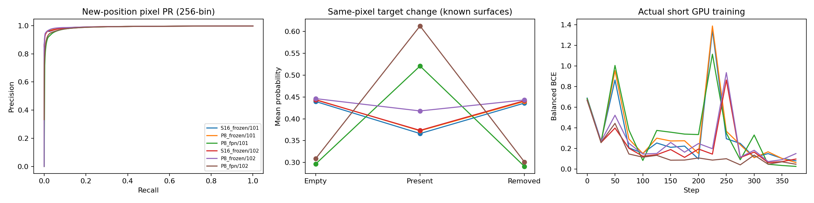
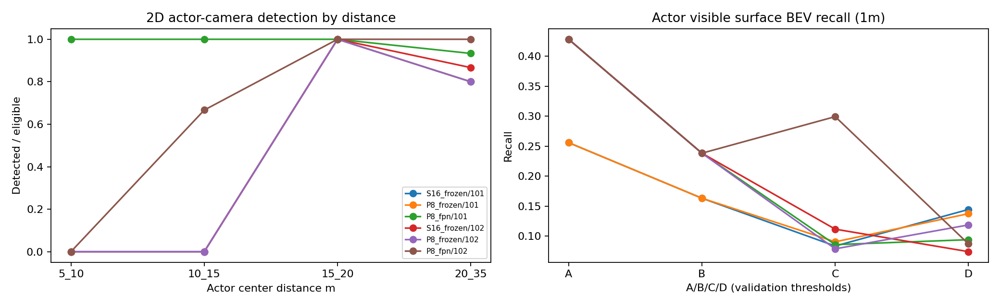
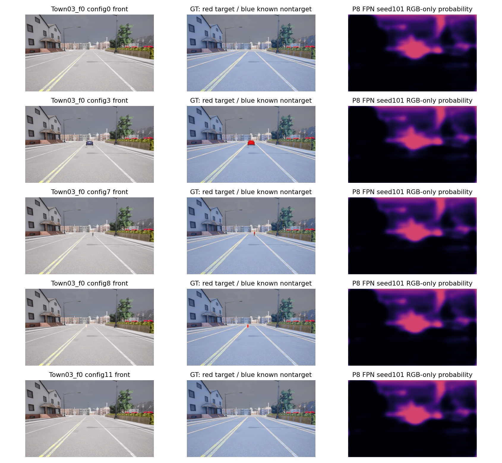
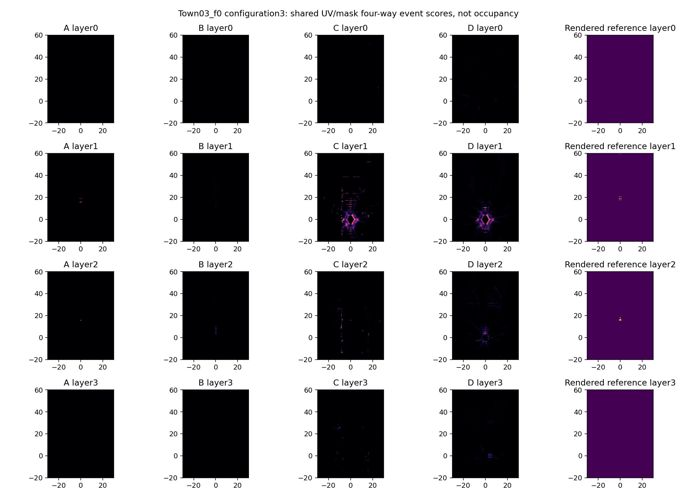

# M5-F — Image-Space Grounding & BEV Geometry Factorization

状态：**Partial**。完成真实 RTX 4090 训练、CARLA 新位置采集、封存测试、四组几何归因和 Offline Shadow；没有模型通过联合感知质量门禁，未启用视觉控制，未开启更大规模 Occupancy 训练。

基线 `bf989b4`，独立分支 `feat/m5f-image-grounding`，实现提交 `9e53a6c426951866faac3084549b82b40bd0d982`。原始 Depth Head、48 个 LID Bin、HeightSplat、Spatial Evidence V2、旧模型与默认 Runtime 不变。未合并 main。资产完整性与数据/Checkpoint/报告 SHA 见 `m5f_artifact_manifest.json`；实验规则与复现命令见 `../docs/M5F_IMPLEMENTATION.md`。所有结论仅适用于本轮有限研究配置。

## 实际执行与研究控制

- **实际 CARLA 0.9.15 采集**：Town03/04/05 各1新位置，分别距所有既往位置81.82/118.04/71.23m；每组12配置，共36六摄帧，另有36匹配ego-removed参考，共72帧记录。天气WetCloudyNoon、CloudySunset、SoftRainSunset；位置类别直道/路口/直道。不是未见地图，也没有新增坡道验收。
- **离线标签审计**：复用M5D/E训练192帧/12位置、验证96帧/6位置；旧测试不参与训练与选模。测试共91,580可靠目标像素、37,514,300确认非目标像素；有效覆盖65.93%–77.10%。逐传感器18路frame/time、同组K/T和ego pose验证通过。RGB轮廓近邻比例只是对齐代理，不是像素真值。
- **实际GPU研究训练**：S16冻结、P8冻结、P8/FPN微调，seed101/102，各400步；同seed同采样顺序、一camera/步、全六摄评测。冻结backbone缓存33.52秒；每次训练含验证6.71–8.67秒，峰值5821–5835MiB（包括常驻缓存）。Pixel Head 18,561参数；P8/FPN合计113,153可训练参数。不是六摄完整网络每步反传，也没有训练Depth。
- **CPU轻量融合**：固定100步×2种子，对照old-only重新标定；不是大型BEV训练。全部模型/阈值/源文件在`m5f_pretest_decision.json`冻结后才采新测试，测试后没有追加训练、选阈值或调整标签。
- **测试**：GPU环境全套256 passed、5 skipped；5个skip因该环境无CARLA Python。CARLA环境补跑相关14 passed，覆盖跳过用例；部分重复，不能相加为270独立用例。另有实际GPU合同检查：S16辅助特征与旧Encoder逐值一致，修改GT不改变RGB预测，六类GT键被拒绝。
- **失败保留**：新增lift测试首次fixture错误将训练manifest当BEV配置，KeyError保留在失败XML/log；修正fixture后通过。没有因此改训练、Depth或测试阈值。

## 监督定义与数据边界

新合同`hsd-m5f-visible-first-surface-v1`只回答“当前首个可见渲染表面是否属于目标Actor”。确认建筑/墙体可以是该图像分类负类，绝不是安全Free。Unknown、未确认Static/Dynamic/Other、水面、天空、自车与1像素身份/语义边界不作为负监督。车辆14–19、行人12/13与本机CARLA版本和实际标签对应；交通锥21只在可确认几何/渲染实例关联后接受，不能把所有Dynamic21设正类。

Render ID不等于Actor ID。关联使用当前表面端点与已知Actor AABB±0.1m、同身份至少3像素且90%支持、唯一候选；仅为几何代理，非精确Mesh身份。透明/反射内表面缺少独立标注，仍是限制。Boundary过滤和标签规则在Test前冻结，未靠扩大Ignore改善测试成绩。

本轮测试33个Actor配置，30个有>=3像素支持、3个完全遮挡目标零支持；跨相机33次eligible观测来自30个Actor配置。行人/交通锥各只有3个配置，分别44/101有效像素。≤32有效像素的严格小目标无测试支持。目标事件主要在前视，六摄背景统计不能代表六个方向的障碍泛化。

`m5f_evaluate`字段`ground`实际含所有确认非目标表面；Ground专门指标见`m5f_surface_strata.json`，不能把该历史字段当语义Ground。正类子集AP=1没有负例判别意义。原`empty`仅覆盖完全无目标帧；全部3位置的Empty布局FPR见`m5f_pair_scene_audit.json`，背景停放车辆不误当负例。

## 二维封存评测：真实响应存在，但不可靠

以下为完整可靠正负像素Mask上的条件指标，AP为256bin近似，阈值只依据Validation。不同种子选择不同阈值，不能把阈值差异当相同工作点。

|模型/seed|阈值|Pixel Precision|Recall|IoU|AP|Actor配置检出/30|
|---|---:|---:|---:|---:|---:|---:|
|S16_frozen/101|0.9|8.73%|10.85%|5.08%|4.09%|21/30|
|P8_frozen/101|0.9|9.02%|9.91%|4.95%|4.48%|21/30|
|P8_fpn/101|0.5|13.58%|60.41%|12.47%|18.65%|30/30|
|S16_frozen/102|0.9|6.95%|14.70%|4.95%|4.03%|21/30|
|P8_frozen/102|0.9|6.43%|10.51%|4.16%|3.05%|21/30|
|P8_fpn/102|0.9|23.54%|24.76%|13.72%|16.03%|25/30|

两个种子的P8/FPN AP与IoU都提高；冻结P8相比冻结S16没有稳定优势。全部6组逐场景联合Precision≥80%、Recall≥80%、EmptyFPR≤1%仍不可行。Actor检出只要求可见像素覆盖，不约束预测边界，大片误报也可“检出”目标，不能用30/30替代识别准确性。

同像素反事实mask为Present可靠目标且Empty/Removed确认非目标的交集，不依赖3D Gold Absence；约49,228个出现配对像素、49,227个移走配对像素。仍只有3个独立位置，不能以像素量宣称统计显著。

|P8/FPN seed|出现概率平均增加|上升方向正确|移走下降方向正确|配对同时判对|移走局部FPR|
|---|---:|---:|---:|---:|---:|
|101|0.224|68.93%|71.37%|40.29%|39.64%|
|102|0.304|82.70%|83.01%|19.11%|15.09%|

P8/FPN在全部3位置都出现正的平均变化，但移走后的平均概率仍约0.29/0.30；局部误报远高于整幅背景FPR。冻结模型平均出现概率变化反而为负（约−0.028至−0.073）。图中Empty背景已有大片高响应，目标出现/移走不足以消除该背景响应。

FPN101三位置Empty布局确认非目标FPR为0.90%/1.45%/0.74%；FPN102为0.16%/0.39%/0.12%。即使整体FPR很小，目标将出现的局部区域仍会严重误报。行人/交通锥支持太少，且无≤32像素小目标，不能宣布小目标可靠。

## 四组几何归因

A=Oracle2D+OracleDepth，B=Oracle2D+LearnedDepth，C=Learned2D+OracleDepth，D=Learned2D+LearnedDepth。每一stride内UV、Mask、K/T、范围及高度层相同。A/B/C/D是公平的**诊断**Mask，正式D/Shadow另行完全无GTMask推理。Oracle共享CARLA渲染来源，仅为自一致性参考。

原四组阈值各由Val选择，因此再补充所有模式固定事件阈值0.2的分析（未调Test）：

|P8/FPN seed|模式|Actor可见表面Exact Recall|同层1m Recall|确认表面Precision|
|---|---|---:|---:|---:|
|101|A|21.60%|42.84%|100.00%|
|101|B|10.80%|18.08%|45.10%|
|101|C|21.60%|45.07%|0.83%|
|101|D|9.04%|15.73%|0.60%|
|102|A|21.60%|42.84%|100.00%|
|102|B|10.80%|18.08%|45.10%|
|102|C|18.08%|39.44%|0.91%|
|102|D|9.04%|16.78%|0.74%|

本批852个可靠目标表面格均有Actor关联。Oracle双真值P8的1m Recall仅42.84%，S16仅25.59%，主要反映feature网格未采到大量原图表面；因此A不是100%理论检测上限。P8将目标feature射线支持从246提升至986，仍不能覆盖细边缘、小物体及所有高度格。

A→B在相同二维标签下由42.84%降至18.08%，说明Depth概率投影有独立瓶颈。C保留约39%–45% Recall，但确认表面Precision低于1%，说明2D误报也独立存在。C的Recall可能超过A，是非目标射线/宽泛预测恰好邻近目标，不能解释为优于Oracle。D约15.7%–16.8%，未解决空间障碍定位。

20–35m可靠目标射线：S16仅18条、P8仅55条，正确同层1m概率质量分别1.08%/1.53%，同Cell质量0.395%/0.081%，Expected光轴深度MAE 12.87m/10.97m，Mode MAE 19.27m/14.32m。最优Bin的XY离散化误差均值约0.27/0.29m，明显小于学习误差；本轮不修改Bin。P8仍使用原冻结Depth Head，输入分布改变也会影响结果，不能称经过训练的P8Depth性能。

固定0.2下P8 Oracle双真值→Oracle2D/LearnedDepth的体素中心最近邻GT→预测平均3D距离约2.26m→11.19m；前者有53个无候选格，后者162个，均值只针对有候选部分。它不是精确Mesh定位误差。按Val阈值的20–35m P8 D在141个Actor表面格上1m命中为0；该事实不应被高二维Actor检出掩盖。

几何参考仍只限当前可靠可见表面；Unknown高分单列，不能自动当误检或安全负例。BEV的Empty/Removed残留是原目标位置上的事件诊断，不是物理Absence FPR。分层/距离/相机/场景及完全未匹配Actor见完整JSON。

## 前景Lift、BEV融合和空间证据保留

独立Lift累加foreground×depth mass、total depth mass、ray-bin落点数，事件分数1−exp(−mass)不除微小mass，不声称物理占据概率。原HeightSplat与Context未替换。正式推理输入只含RGB与既有合法字段，GT仅生成监督或评测mask。

对照使用共同S16 UV/Depth：原M5E A阈值0.4仍有41.7%/86.4%当前目标表面Recall，但确认非目标表面FPR约37.7%/38.1%；新独立foreground固定0.2降低FPR至1.28%/1.08%，Recall也降至5.05%/3.76%，不能称全面改善。

预算匹配的old-only重新标定与轻量融合结果：

|seed|模式|表面Recall|Precision|IoU|AP|
|---|---|---:|---:|---:|---:|
|101|old_only|1.41%|0.10%|0.09%|0.47%|
|101|fusion|1.41%|0.10%|0.10%|0.47%|
|102|old_only|2.70%|1.52%|0.98%|1.16%|
|102|fusion|2.35%|1.82%|1.04%|1.58%|

融合略降误报、提高少量AP/IoU，但seed101 Recall持平、102下降，不能据此正式纳入默认BEV或扩训。该小线性融合失败也不证明所有联合学习方法无效。

`m5f_feature_retention.json`对验证集同位置Empty→Present观察Image→Context→Height→BEV变化，信号确实传播；各层不同范数单位不能转为“损失百分比”，没有证据单独断言BEV Encoder抑制是主要原因。当前更直接的证据是背景前景误报、feature采样不足和Depth概率定位失败。

## Offline Shadow 与性能

六摄单帧RGB→Pixel→原Depth→事件Lift实测完成，不向CARLA发送控制。36帧Shadow全合法无GTMask；例如P8/FPN101/102确认表面Precision仅1.07%/1.71%，Recall7.51%/3.76%。masked诊断不能替代该候选推理表现。

专门停止CARLA与其他GPU任务后，在固定录制六摄输入上5次warmup+30次重复计时；包含两个encoder副本（前景与原Depth），没有融合执行优化：

|模型/seed|P50 ms|P95 ms|Max ms|峰值 allocated MiB|
|---|---:|---:|---:|---:|
|S16_frozen/101|16.94|17.39|18.41|247.0|
|P8_frozen/101|19.36|19.77|19.85|255.5|
|P8_fpn/101|19.30|19.88|20.31|256.1|
|S16_frozen/102|16.98|17.15|17.24|254.1|
|P8_frozen/102|19.09|19.38|19.44|253.7|
|P8_fpn/102|19.24|19.43|19.45|255.2|

36帧完整Shadow时序的P95约23.9–34.7ms、Max37.5ms；专门重复实验用于分离GPU推理能力，不能覆盖在线读取、传输、CARLA渲染、tick及控制。旧Runtime Partial、617ms历史tick长尾继续保留，未重跑Runtime压力组合，也未宣称严格20Hz或纯视觉驾驶成功。

## 七个最终问题与下一步

1. **RGB能可靠识别车辆、行人、锥桶吗？尚不能。** 有真实变化响应，P8/FPN优于冻结模型，但精度低、背景残留高、种子敏感；行人/锥桶各3配置、极小目标缺支持。
2. **移走时二维预测是否下降，且不依赖3D Gold Absence？部分可以。** FPN下降方向正确约71%/83%，使用当前可见像素配对；局部残留FPR仍40%/15%，不是可靠消失识别。
3. **中远场瓶颈属于2D还是几何？两者均有，几何额外损失明确。** Oracle2D仍不能被Learned Depth正确放置，20–35m正确1m质量约1%–1.5%；同时OracleDepth也无法消除Learned2D误报。采样上限另列，不能混为单个IoU。
4. **二维监督帮助BEV存在性吗？已证明二维学习信号，未证明可靠BEV增益。** 小融合Recall未稳定提高，不能将Pixel AP增益自动计入Occupancy通过。
5. **能不明显增加误报地改善绝对Actor Recall和小目标吗？本轮没有证明。** seed101高Recall付出高局部误报；102误报较低但近场Recall下降；≤32像素小目标没有支持。
6. **辅助Head值得保留吗？值得作为可选训练监督和诊断接口。** 不替换默认Context/Splat，不将当前事件输出用于安全规划，不宣称占据概率。
7. **下一阶段重点？先用独立小预算研究更可靠的二维视觉表征。** 保留现协议回归，扩大独立位置/侧后方/极小目标覆盖；在固定Depth条件下有限解冻Image Backbone高层，与预算匹配的FPN控制组比较，优先控制背景误报和局部移走残留。并行提出但不在本轮启动P8Depth输入对齐/空间概率短实验；只有2D达到可靠工作点再评估BEV/Occupancy联合训练。当前不启动大规模Occupancy、Temporal BEV、Sparse Query或视觉闭环。

工程接口通过、研究性训练执行通过、二维泛化质量Partial、BEV空间质量Partial、Runtime继承Partial、Oracle安全未重新验收、纯视觉驾驶未验证。正式M5门禁继续开放，不降低阈值关闭。

## 结果入口

- `m5f_acceptance.json`：独立状态、证据范围、限制、源码提交。
- `m5f_pixel_label_quality.json`、`m5f_test_label_quality.json`、`m5f_semantic_version.json`：旧Train/Val和新Test质量与版本。
- `m5f_image_foreground_training.json`、`m5f_2d_presence_absence.json`、`m5f_results_digest.json`：训练、逐Actor、距离、相机、场景、天气。
- `m5f_2d_3d_factorization.json`、`m5f_geometry_supplement.json`、`m5f_depth_at_targets.json`：匹配UV诊断、共同阈值、深度概率支持。
- `m5f_bev_foreground_evidence.json`、`m5f_bev_baselines.json`：预算匹配融合与旧原Head。
- `m5f_shadow_evaluation.json`、`m5f_inference_latency.json`、`m5f_isolated_latency.json`：不控制车辆的推理与时延。
- `m5f_tests_final.xml`、`m5f_carla_contract_tests.xml`、`m5f_gpu_contract.json`、`m5f_logs/`：真实执行及失败日志。
- `m5f_artifact_manifest.json`：源码/配置/原始数据/标签/模型/预测/报告SHA；大型资产留服务器，Git提交报告、实现、图、日志。独立分支推送，未合并main。

