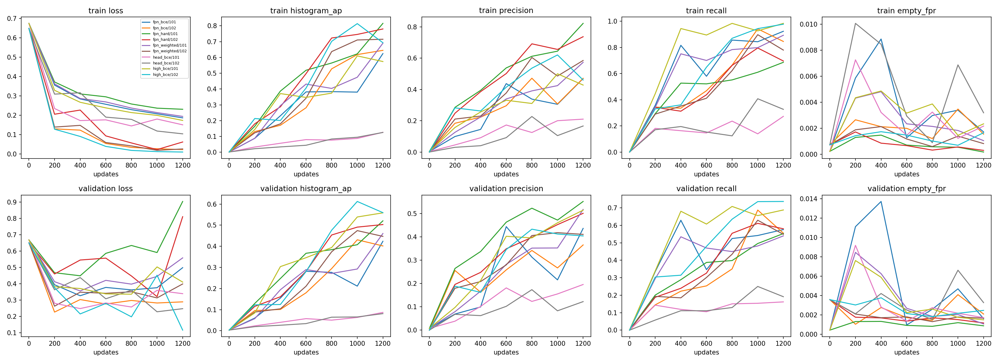
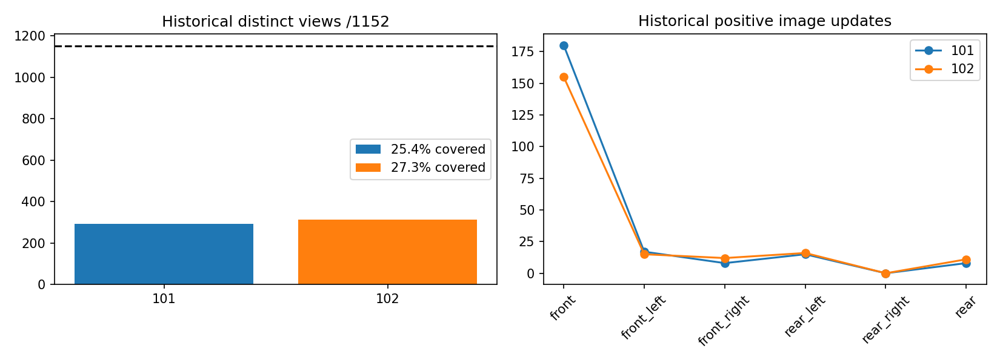
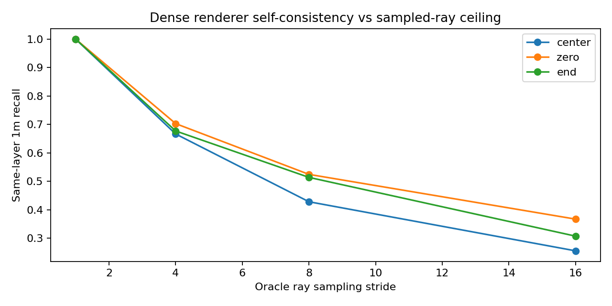
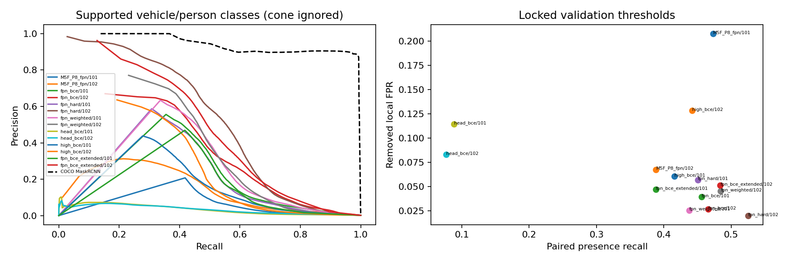
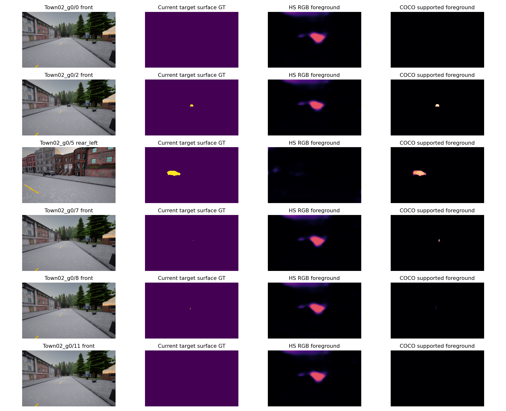
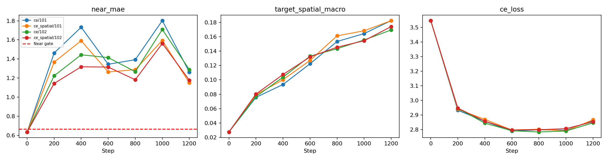
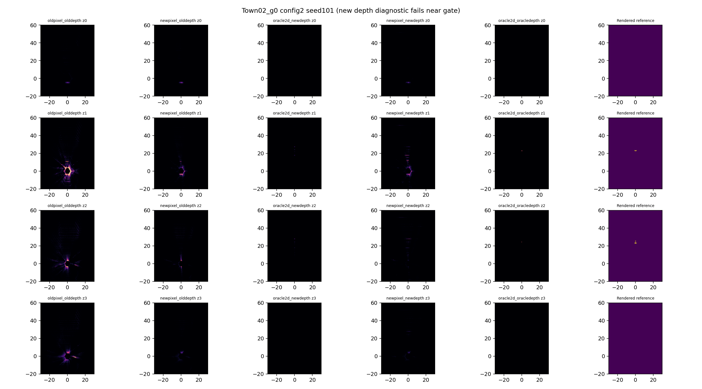

# M5-G — Visual Representation Benchmark & Depth Projection Research

总体 **Partial**。完成实际RTX4090有限训练、官方预训练实例分割参考、新CARLA封存位置、密集/稀疏Oracle采样、Depth短训练、联合Offline Shadow。没有通过正式M5/纯视觉安全门禁，没有把视觉预测用于车辆控制，没有启动大规模Occupancy训练。

基线`5e44a77`，独立分支`feat/m5g-visual-representation-depth`，实现提交`0047dea17984213982da32a62259183e2560899b`。原48 LID Bin、HeightSplat、四层160×120、默认Encoder与Oracle Runtime全部保留。未合并main。复现命令和监督定义见[实现文档](../docs/M5G_IMPLEMENTATION.md)，各资产SHA见`m5g_artifact_manifest.json`。

## 实际完成范围

- **离线审计**：M5F真实400步schedule；Train192帧/12位置、Val96帧/6位置；最近同地图跨集合位置84.11m，无相同输入SHA。相同车辆资产、布局模板重复，位置隔离不等于全新车型/布局。
- **实际GPU训练**：两seed×5组Pixel模型各1200步，Head 18,561 / FPN+Head 113,153 / layer3+4+FPN+Head 10,606,593可训练参数。预算匹配；单camera每步，缓存冻结RGB layer2及更高原始特征，全六摄评测。Head/FPN/high LR1e-3/1e-4/1e-5。每组28.5–52.8秒，峰值约5.7–6.2GiB含常驻缓存；部分作业并发影响时间，不是完整六摄网络训练吞吐。
- **实际GPU延长**：预声明Val800→1200两seed均改善且平均AP增益≥.01后，仅原fpn_bce从真实1200优化器继续至2400，另外报告，不算匹配1200结构消融。
- **实际GPU Depth训练**：原P8视觉与cameraMLP冻结，仅DepthHead，CE与CE+空间NLL，两seed各1200步，同序列/预算/优化器。全部训练候选未通过近场回归限制。
- **外部预训练推理**：官方COCO Mask R-CNN ResNet50FPNv2，零CARLA微调。权重来源/许可说明/SHA/支持类别单列，RGB-only。
- **实际CARLA0.9.15采集**：Town02/03/05各1新位置，距历史位置50.09/79.70/69.84m；每组12配置36六摄帧，另36ego-removed参考。光照ClearSunset/WetCloudySunset/CloudyNoon；含侧后车、小行人、锥桶、遮挡及Empty/Removed。
- **测试**：全套262 passed、5 skipped；CARLA环境相关14 passed覆盖缺包用例（有重叠，不相加）；M5G局部6 passed；独立GPU合同检查确认GT修改不改变输出、高层确有更新、原Depth独立输出不变、特权字段拒绝。

所有训练/标签/阈值在新测试采集前冻结，后续无追加训练。封存后仅增加1条单测；科学实现与Checkpoint SHA均保持，测试文件变化已披露。旧资产与默认行为最终SHA复核，不覆盖失败报告。

## 1. M5-F为什么Precision低：训练覆盖不足是实证因素，但不能分配精确因果百分比

|seed|400步独特视角/1152|未见视角|正图更新|纯背景更新|前摄正图更新|右后正图更新|
|---|---:|---:|---:|---:|---:|---:|
|101|293（25.43%）|859|228|172|180|0|
|102|314（27.26%）|838|209|191|155|0|

同视角重复更新107/86次；同位置布局高度相关。seed101车辆/行人/锥桶有监督更新186/31/16次，102为159/26/25次；严格小目标更新15/19次。右后训练相机本身没有正图，增加步数不能创造覆盖。

1200步同样的采样器只见627/640个独特视角，仍有525/512个从未见。正负像素极不平衡，而类均衡BCE又给予每张图少量正像素较高权重；大量外观相似的背景此前没有充分训练。不能仅以总帧数或总更新数判断训练充分。

旧M5F未记录全部历史ValLoss/TrainAP，不能重建不存在的曲线。本轮同初始状态和前400schedule匹配重跑，记录每200步Train/Val Loss、AP、Precision、Recall、EmptyFPR。fpn_bce Val宏AP从800的34.27%/37.65%升到1200的48.12%/47.08%，预算不足证据明确；2400效果仍种子敏感，不能无限加步数。

## 2. 同一封存位置上的二维对照

首可见表面像素语义、所有有效Mask、数据划分固定；建筑/墙面仅是目标Actor分类负例，不是安全Free；Unknown不参与负监督。主阈值只按Val逐场景Precision≥80%、Recall≥80%、EmptyFPR≤1%联合规则选择；不可行仍Partial。下表按各自已冻结阈值，AP为256bin近似，不把阈值变化误称同工作点。

|模型/seed|预算|Pixel P|Pixel R|AP|局部移走FPR|
|---|---:|---:|---:|---:|---:|
|M5F_P8_fpn/101|400历史|9.05%|49.97%|10.96%|20.77%|
|M5F_P8_fpn/102|400历史|24.75%|39.86%|14.81%|6.74%|
|fpn_bce/101|1200|40.48%|46.93%|30.41%|3.93%|
|fpn_bce/102|1200|36.78%|49.76%|37.11%|2.65%|
|fpn_hard/101|1200|37.80%|46.76%|30.28%|5.68%|
|fpn_hard/102|1200|53.23%|53.79%|51.74%|1.99%|
|fpn_weighted/101|1200|51.20%|44.74%|34.94%|2.54%|
|fpn_weighted/102|1200|37.00%|50.76%|39.60%|4.51%|
|head_bce/101|1200|7.29%|10.70%|3.34%|11.44%|
|head_bce/102|1200|6.00%|8.90%|3.32%|8.29%|
|high_bce/101|1200|26.19%|42.26%|21.27%|6.06%|
|high_bce/102|1200|21.10%|48.70%|28.90%|12.84%|
|fpn_bce_extended/101|2400|44.75%|43.11%|25.75%|4.69%|
|fpn_bce_extended/102|2400|45.75%|50.95%|47.72%|5.12%|

仅延长原FPN+BCE显著提高Precision/AP并降低消失残留，说明原400步不能称表征上限。但seed101 Recall从50.0%到46.9%，不满足两seed同时P/R/残留均改善。Hard负例102改善，101无稳定收益；类别权重结果也不一致。不能将所有误报归因于某个Loss或声称完全解决。

高层有限解冻在Val明显改善，但Test两个seed AP21.27%/28.90%，均低于匹配FPN的30.41%/37.11%；Precision和局部移走也没有稳定优势。它没有证明比仅FPN更有效，提示位置/背景/天气泛化风险。仅冻结全部视觉训练小Head即使1200步仍很弱，AP约3.3%。

背景审计：fpn_bce101相比历史101，确认建筑墙面FPR约1.42%→0.10%，植被2.14%→0.63%，道路设施2.09%→0.60%；102并非所有类别下降。精确车辆形状难负、玻璃反射内表面未有独立标注，不能声称全部难例覆盖。`mm5g_background_audit.json`提供逐类计数；这些类别负标签不代表物理空间空闲。

## 3. 成熟预训练参考：能力差距明确，计算成本也明显

官方Mask R-CNN ResNet50FPNv2 COCO_V1，46.36M参数，原640×384输入内部放大至短边800/长边最大1333，FP32逐六摄。实例置信度×掩膜概率聚合。COCO支持vehicle/person，**交通锥不支持并排除评价正负Mask**。HS的支持类别指标使用同一Mask，其他目标类别Ignore；不把cone混入COCO车辆成绩。

代码[BSD-3-Clause](https://github.com/pytorch/vision/blob/main/LICENSE)，[官方模型](https://docs.pytorch.org/vision/stable/models/generated/torchvision.models.detection.maskrcnn_resnet50_fpn_v2.html)及[权重使用说明](https://docs.pytorch.org/vision/stable/models.html)已核对：代码许可不自动覆盖训练数据派生条款。本轮为研究参考，不分发权重或宣称商业使用无限制。

|COCO零微调|Precision|Recall|AP|移走局部FP/有效像素|
|---|---:|---:|---:|---:|
|vehicle|89.75%|73.05%|94.23%|0/51473|
|pedestrian|100.00%|95.83%|97.96%|0/8|
|supported|89.75%|73.06%|94.22%|0/51481|

车辆/行人合并Test P89.75%、R73.06%、AP94.22%，显著高于本轮HS像素模型的观察结果；“显著”指数值差距，不是3个位置上的统计显著性证明。图中Mask R-CNN能将车辆移走区域分数降至背景，而HS仍有固定高响应团块。

仍未通过全场景联合门禁：Town02 Recall65.46%，Town05 Precision73.39%；行人只有3配置×8像素=24可靠像素，95.83% Recall不可推广到行人全面可靠。交通锥无预训练支持。预训练数据、架构、分辨率和计算量均不同，不能单变量证明只由预训练带来；但足以支持下一阶段强视觉预训练/蒸馏研究，没必要先对弱Head叠加更多复杂Loss。

## 4. 42.84%的Oracle Recall：稀疏采样损失已明确

完全同原始K/T、当前可靠Mask、四层BEV、原图参考。原M5F历史852个表面格：

|采样|原中心相位射线数|精确覆盖格|无任何射线覆盖格|Exact Recall|同层1m Recall|
|---|---:|---:|---:|---:|---:|
|全像素|64,573|852|0|100%|100%|
|Stride4|4,034|372|480|43.66%|66.67%|
|Stride8|986|184|668|21.60%|42.84%|
|Stride16|246|91|761|10.68%|25.59%|

DenseOracle自一致性100%，没有无法解释的坐标/Mask缺口。对这个诊断，P8同层1m的57.16个百分点缺口来自采样/离散覆盖，而非LearnedDepth（这里没有学习深度）。P8相位改变1m Recall约42.84%–52.46%，Stride4约66.67%–70.31%；存在aliasing，不是仅将特征插值放大就能补齐。Stride4只是采样诊断，不是已实现Stride4网络。

新封存位置717格，Dense仍100%；中心Stride4/8/16同层1m Recall为73.50%/57.74%/44.07%。不同场景表面密度影响上限。距离/Actor尺寸/相机/相位分别记录。Oracle共享同一CARLA渲染器，不是独立Mesh或真实世界精度真值。

## 5. Depth直接监督：空间质量可改善，但近场退化阻止验收

固定原M4 P8视觉/cameraMLP，只训练DepthHead，48 LID不变。可靠Mask新增3×3深度spread≤0.5m，排除深度边缘/不稳定点，光轴1.5–80m。五距离段等权，段内目标/背景等权。CE与CE+0.2空间NLL在相同训练顺序/初始化/预算比较；空间项是同层XY≤1m的概率和，无可用bin时仅保留CE。

这种距离与目标均衡使稀疏中远目标获得更多监督，但可能牺牲密集近场道路误差。Val近场原MAE0.634m，训练最终1.149–1.288m，全部远超预声明×1.05上限；因此选择规则严格保留step0原Head。**没有任何新Depth获得替换资格**。以下为单独标记的最终1200步失败诊断，非通过候选。

|Depth/seed|新Test全表面近场MAE m|20–35m目标MAE m|20–35m目标同层1m质量|
|---|---:|---:|---:|
|original/0|0.797|7.827|2.49%|
|ce/101|1.878|2.796|7.42%|
|ce_spatial/101|1.710|2.821|7.47%|
|ce/102|1.973|2.595|10.00%|
|ce_spatial/102|1.804|2.282|9.33%|

Test中远目标严格深度Mask仅13条射线，其中GT在BEV内11条；正确质量从2.49%升到7.42%–10.00%，样本很少，不能宣称远场泛化通过。全表面近场0.797m→1.710–1.973m超过两倍，验证与Test一致暴露代价。CE+空间损失并未两seed都优于CE：seed101概率小幅改善、102稍差，不作强因果结论。

固定严格DepthMask与Oracle2D，1m投影Recall原22.32%，最终CE101/空间101/CE102/空间102为21.90%/22.87%/20.22%/20.36%。局部概率质量提升没有稳定转为全目标BEV Recall。ExpectedDepth MAE、完整分布期望3D误差、GTBin质量、正确层和0.5/1/2m质量各自输出；不能用某个指标掩盖其他退化。35–80m目标支持不足时保留n=0/None，不捏造远场点。

## 6. 联合Shadow：误报降低，空间Recall仍未稳定改善

主联合对照使用P8原网格，当前可见语义Mask仅用于Oracle诊断及指标；学习推理无GTMask。新Pixel按Val规则选seed101 hard、102 high；新Depth按Val选最终失败诊断seed101 CE、102空间CE，明确exploratory，发布候选仍为原Depth。不能在Test看出high较差后改选。

|seed|组合|同层1m Recall|确认表面Precision|确认非目标表面FPR|
|---|---|---:|---:|---:|
|101|newpixel_newdepth|16.04%|1.50%|0.96%|
|101|newpixel_olddepth|14.37%|1.78%|0.83%|
|101|oldpixel_olddepth|18.69%|0.36%|5.29%|
|101|oracle2d_newdepth|37.66%|31.80%|0.09%|
|101|oracle2d_oracledepth|57.74%|100.00%|0.00%|
|102|newpixel_newdepth|19.11%|1.71%|1.21%|
|102|newpixel_olddepth|17.71%|2.30%|0.91%|
|102|oldpixel_olddepth|20.36%|0.47%|4.86%|
|102|oracle2d_newdepth|35.01%|30.82%|0.09%|
|102|oracle2d_oracledepth|57.74%|100.00%|0.00%|

换新Pixel后背景FPR明显下降，但Recall从18.69%/20.36%降到14.37%/17.71%；再换实验Depth仅恢复到16.04%/19.11%，仍未超过原组合，且Precision低。没有同时实现可靠识别、几何定位与近场回归。

Oracle2D新Depth在此较宽的像素可靠Mask上Recall35%–38%；它与前节严格深度边缘Mask的22%左右**分母和输入射线不同**，不能跨表直接宣称提升。所有主组合内部Mask一致，其他诊断的有效区域明确保留。Unknown高分单列，确认背景表面不是全体素安全空闲。Empty/Removed在旧目标体素的输出只称事件残留，不能拿未观测体素当物理负真值。

## 7. 性能、局限与安全状态

独立关闭CARLA及其他GPU作业后，同一六摄样本5次warmup+20次推理：HS Pixel P95约7.6–9.8ms；联合Pixel+Depth+前景Lift P95约18.5–18.9ms，峰值allocated约284/367MiB。Mask R-CNN六摄FP32 sequential默认800短边 P95约959ms、Max1061ms、峰值858MiB（10次计时）。它是外部能力基线，不能直接当20Hz在线方案。

计时不含磁盘、传输、渲染、tick、Controller；保持原Runtime长尾Partial，未重跑长期压力矩阵。所有实验零视觉控制指令。旧模型/数据/报告SHA复核，未合并main。

本轮36帧来自3位置，不是36独立场景；同地图、同车型资产，仅少量天气。新目标正像素分布覆盖front/front_left/rear_left/rear_right/rear，front_right仍0；Town05右后被遮挡0正支持。行人/锥桶各3个小目标，不足小目标门禁。实例对应仍依赖保守AABB/renderID代理而非Mesh真值，透明反射内部边界未独立标注。类均衡与可靠深度mask改变有效支持，所有指标须连同分母解释。

失败记录保留：Oracle采样rank维度错误修复；numpy.bool决策序列化修复；下载未完成的FileNotFound；单连接慢下载改为逐段/全SHA验证；调度重复评测触发FileExistsError而拒绝覆盖。未通过降低质量阈值或重开Test修复结果。

## 最终七问与决策

1. **低Precision有多少来自覆盖/不均衡/难负？** 400步只覆盖约四分之一视角，延长同方法使AP显著提高、局部残留下降，预算与覆盖不足是重要因素；困难负与权重收益不一致。不能从这些耦合因素给出唯一因果百分比，也不能忽略视觉表征差距。
2. **成熟预训练模型改善吗？** 在本轮3位置支持类别上明显改善，P89.75%/R73.06%/AP94.22%，局部移走FP0/51,481；但类别/结构/分辨率/算力不同，非单变量，行人支持极小，cone不支持。
3. **高层有限微调优于FPN吗？** 验证集更好，新位置两个seed都未优于匹配FPN。不能推荐直接扩大解冻训练。
4. **42.84%来自多少采样损失？** 相同Oracle源全像素100%，P8中心1m42.84%；57.16个百分点缺口可由采样/网格覆盖解释。它与LearnedDepth定位误差是独立问题。
5. **不改48Bin能改善Depth空间质量吗？** 可以提高少量中远目标概率，但近场显著退化，且Oracle2D投影Recall不稳定，因此本轮Depth质量仍Partial。
6. **二维/Depth改善能转为BEV收益吗？** 误报降低，未得到相对旧组合稳定的空间Recall改善；新Depth代价不可接受。局部任务分数提升不是BEV空间理解通过。
7. **能否扩大BEV/Occupancy研究训练？** 当前不具备本轮标准下的扩大依据。建议下一阶段先以成熟二维教师/更强预训练轻量表征建立可靠RGB存在性，严格覆盖侧后方与独立位置；Depth采用保留近场性能的训练控制（例如原任务混合/约束或蒸馏，须另预声明对照），并研究真正提高射线覆盖的空间表示。暂不自动启动大型Occupancy、Temporal、SparseQuery或视觉闭环。

工程接口通过、有限研究训练执行通过、Oracle自一致性/采样归因通过；二维泛化质量Partial、Depth质量Partial、BEV空间质量Partial、Runtime继承Partial、Oracle闭环未重新验收、纯视觉安全未验证。保持正式门禁开放。

## 交付入口

所有要求JSON均交付，主入口：`m5g_acceptance.json`、`m5g_training_exposure.json`、`m5g_pretrained_2d_baseline.json`、`m5g_pixel_precision_recall.json`、`m5g_backbone_ablation.json`、`m5g_oracle_sampling_ceiling.json`、`m5g_depth_training.json`、`m5g_depth_spatial_quality.json`、`m5g_shadow_comparison.json`。Bundle报告含原始详细报告路径与SHA；所有逐帧/相机/Actor/距离数据仍完整保留。

实现与命令：`docs/M5G_IMPLEMENTATION.md`。测试XML、失败日志、source/config/data/checkpoint/report SHA、数据质量、独立计时及全部可视化均以m5g前缀保存。大型原始数据/权重/缓存留服务器，Git交付源码、报告、图和执行日志。

