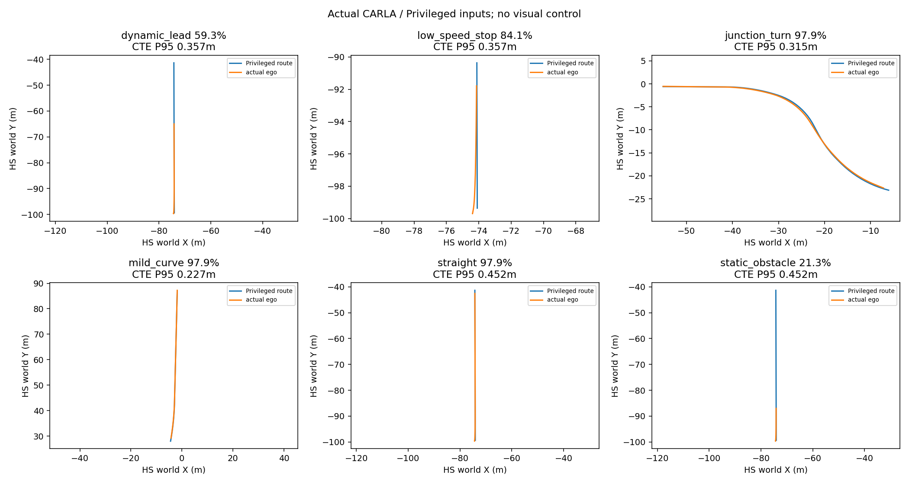
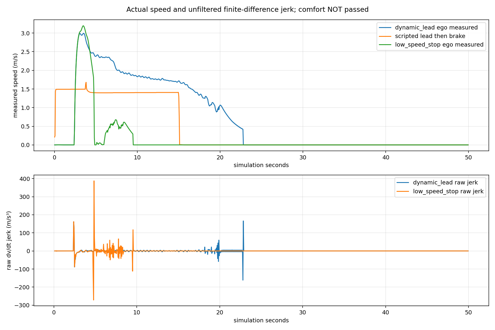
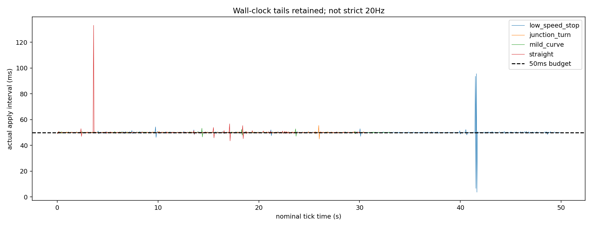

# M6-A — System Baseline Integration & 3D Perception Feasibility

**总体Partial；M5研究结题，Oracle工程继续，PETR本次P0因权重获取受阻退出。** 无新训练，无视觉控制，未修改原Runtime安全合同和默认模型。独立分支 `feat/m6a-system-baseline`，基线 `349941e`。

## 三项独立决策

|决策|状态|依据|
|---|---|---|
|A：M5研究是否可以结题|**ResearchCompleted / CandidateNoGo / SafetyNotValidated**|历史源码/数据/模型/失败记录完整保留；扩大数据后Direct仍未稳定超过Geometry Prior，独立风险校准不满足覆盖和尾部要求|
|B：Oracle工程是否可以继续|**Go限定工程，整体Partial**|13次真实CARLA运行、7286Tick、268.26m；三正常路线通过有限验收，四类故障停车有效；绕行、泊车、舒适性及严格实时未通过|
|C：成熟RGB三维框架是否继续|**本次NoGo_AssetAccess，能力Unknown**|官方原始PETR源码/许可/配置已固定；隔离Python和MMCV取得，但官方权重下载失败；官方前向、CARLA基准及迁移许可均未完成|

详见 [验收JSON](m6a_acceptance.json)、[M5结题](m6a_m5_closeout.md)、[架构决策](../docs/M6A_ARCHITECTURE_DECISION.md)。不把研究结题写成M5Passed；可靠3D、Occupancy、Temporal、Sparse Query、纯视觉安全和共享GPU严格20Hz门禁继续开放。

## Oracle真实结果（全部Privileged）

|场景|完成率|实际行驶m|横向误差P95 m|控制间隔P95/P99/Max ms|本轮判定|
|---|---:|---:|---:|---|---|
|直道|97.91%|57.14|0.452|50.40 / 51.46 / 133.16|有限路线通过；实时Partial|
|弯道|97.91%|58.10|0.227|50.36 / 50.65 / 53.32|有限路线通过；实时Partial|
|路口转向|97.88%|56.23|0.315|50.30 / 50.56 / 55.49|有限路线通过；绿灯、无交通冲突|
|脚本前车后制动|59.27%|34.73|0.357|50.44 / 50.90 / 55.97|前车后停稳；完整跟车导航Partial|
|静态障碍|21.29%|12.70|0.452|50.46 / 50.87 / 58.32|停车，无绕行能力|
|低速短路线，独立复测|84.13%|7.93|0.357|50.50 / 50.90 / 95.61|过早停车，非泊车通过|

初次低速短路线完成80.39%、Max130.78ms，部分与测试负载重叠，原记录保留。独立复测无该负载仍未完成路线，实际速度峰值约3.2m/s、原始减速度23.06m/s²、Jerk峰值387.67m/s³；低速控制和舒适性明显未通过。脚本前车不是前车动力学标定，实际运动/制动原始曲线单列。

Emergency→制动约1.17ms、Worker崩溃50.93ms、慢Worker300.47ms、坏输入200.71ms；最后都停稳。13次运行已记录碰撞0、压线0、当前道路边界0、过期计划正常控制0。路缘接触缺独立参考，状态Unknown，不能写成0；零碰撞不代表任务或安全通过。全部原始记录、车物理配置、阶段耗时和每条判据见 [Oracle回归](m6a_oracle_planner_regression.json)。

正常路线Planner P95约70.01/115.75/111.85ms，适配5Hz更新的典型预算；最大值和故障场景另外报告，不称20Hz Planner或硬实时。控制平均接近20Hz但仍有长尾；直道最坏周期的前一次CARLA tick耗时131.60ms，独立短停最坏tick93.46ms。共享视觉GPU压力矩阵本轮未重跑，继承Partial。见 [Runtime状态](m6a_runtime_status.json)。

## PETR隔离P0

来源为[官方原始PETR](https://github.com/megvii-research/PETR)，固定commit `f7525f93467a33707ef401c587a52d5e7b34de74`，选r50 DCNv2 C5，不引入时序版本。许可证Apache-2.0；独立Python3.8.20和对应MMCV1.4 wheel取得。Google Drive两端点分别不可达/超时；官方Baidu目录与提取码可用，目标`epoch_24.pth`列示435,218,261字节，但下载请求errno2，没有权重字节或SHA。

按预声明资产失败退出条件停止，Torch1.9大包下载中止；**没有证明Torch/MMCV与4090不兼容，也没有PETR显存、延迟或CARLA质量成绩**。不得用随机权重前向或论文nuScenes成绩冒充复现。P0未通过，P1数据转换、冻结CARLA推理、有限适配均NotRun。[可行性报告](m6a_perception_framework_feasibility.json)、[基准NotRun与未来合同](m6a_3d_detection_benchmark.json)完整记录。

只读M5-O Train/Val数据准备度：634+203帧、20+6位置、5022个非Ego Actor配置；六摄标定/帧时同步全数通过，OBB顶点重建最大约0.0001365m。这是CARLA参考内部一致性，不是独立Mesh或PETR adapter验证。旧版MMDetection3D的Yaw、尺寸、gravity/bottom center和坡道倾斜盒仍须实际适配后验证。

## 工程与下一阶段

新增来源Schema隔离OracleSceneState、RGBSpatialEvidence、DetectedObjectHypothesis和Unknown，所有视觉类型禁止送入Oracle消费者；保留原始时间和有效期。旧控制路径不变，视觉仍Offline Shadow。

全仓测试 **333 passed / 6 skipped**；缺CARLA的跳过项在SDK环境对应集合 **15 passed**，另异步/控制专项18通过（有重叠，不相加）。RTX4090实际算术smoke通过，不是PETR运行。5,275历史跟踪文件与50,867资产完整性见初始及最终清单。失败批次、错误测试入口及元数据更正均保留。

下一阶段可继续Oracle低速停止、独立绕行/泊车场景与控制长尾归因。感知仅在官方权重可可靠获取后另行恢复PETR P0；此时才决定是否值得进入有限CARLA迁移Pilot。当前不批准默认感知替换、正式Occupancy训练或视觉驾驶，也不自动新增自定义Head。

可复制命令、文件索引和失败记录见 [M6A_IMPLEMENTATION](../docs/M6A_IMPLEMENTATION.md)。完整新源码、实验配置、原始日志、图和SHA提交独立分支，不合并main。
