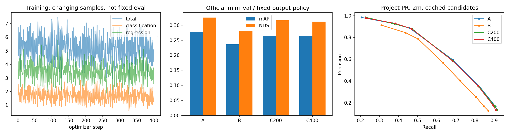

# M8-J10：等400步多场景微调对照

本轮唯一新增训练C实际执行400次optimizer.step，从A和空AdamW开始；第400步检查点独立进程恢复通过。A复用J9，B只用历史缓存补官方评测，无B前向或参数更新。工程结果与质量结论分别记录。

实际执行日期：2026-10-27 UTC；基础eb61246，训练执行提交b6627ba。最终汇总提交以Git记录为准。

## 固定训练与数据支持

官方mini_train∩full train为6场景242帧，原始11317条标注、任务过滤后8200条记录、558个独立保留instance。原八帧包含在内，其输入/监督逐数组完全一致；没有基于A/B表现删除困难样本，没有适配异常隔离。scene-0553/0796因不属于full train交集而排除。

六场景依次轮流，场景内独立固定种子洗牌、耗尽再洗牌。固定顺序、帧token和源时间戳见[manifest](m8j10_training_manifest.json)，真实曝光见[曝光统计](m8j10_exposure.json)。

|场景|池内帧数|训练GT记录|实际更新|曝光不同帧|
|---|---:|---:|---:|---:|
|scene-0061|39|3163|67|39|
|scene-0655|41|1648|67|41|
|scene-0757|41|540|67|41|
|scene-1077|41|548|67|41|
|scene-1094|40|1482|66|40|
|scene-1100|40|819|66|40|

400步覆盖全部242帧，曝光次数分布{'1': 84, '2': 158}。累计GT记录曝光C=13668、B=16750；步数相等但类别混合、目标密度和重复率不同，效果不能只归因于独立场景数量。连续帧记录不视为独立样本。

FP32/bs1/六摄512×1408/原十类，AdamW lr1e-5、betas(.9,.999)、wd0、clip35、无scheduler，与J7逐项相同。141个可训练Parameter，178个冻结Parameter和159个冻结buffer；backbone/neck eval，检测头train与原Dropout0.1。未修AMP、未换模型或解冻更多模块。

原checkpoint配置来自nuScenes full train，训练场景与其已知训练域重叠。mini_val与本次训练scene/sample均无交集，但早已用于开发比较，不是新的封存测试。原预训练逐样本账本/模型选择历史并未独立认证，沿用[J8来源限制](m8j8_pretraining_provenance.json)。

## A/B/C统一官方指标

本地nuScenes-devkit1.1.9、detection_cvpr_2019、相同81帧mini_val。Top300、score≥0.2、strict源XY范围、原类别半径、速度/属性规则不变；无NMS。官方GT3393，全部10类平均，无GT类别不删除。不是完整验证集、排行榜或论文可比成绩。

|对象|mAP|NDS|mATE m|mASE|mAOE rad|mAVE m/s|mAAE|
|---|---:|---:|---:|---:|---:|---:|---:|
|A|0.276715|0.325554|0.820901|0.458738|0.758446|0.787388|0.302567|
|B|0.236310|0.281075|0.826993|0.526305|0.750787|0.887602|0.379107|
|C200|0.263960|0.316115|0.863121|0.472654|0.766131|0.752399|0.304348|
|C400|0.264925|0.311840|0.833524|0.472118|0.781188|0.804024|0.315372|

C200仅记录；C400是预声明最终对象，未用中间结果挑最佳checkpoint。A直接引用已验证J9指标。B/C均经同一个J9薄适配层和未修改的原官方导出器/评测器。完整分数与各类TP误差见[官方对照](m8j10_official_comparison.json)。

|类别|官方GT记录 / instance|A AP|B AP|C200 AP|C400 AP|
|---|---:|---:|---:|---:|---:|
|car|1913 / 114|0.492095|0.420047|0.480541|0.478280|
|truck|95 / 4|0.332107|0.310695|0.294640|0.303365|
|construction_vehicle|0 / 0|0.000000|0.000000|0.000000|0.000000|
|bus|33 / 1|0.399041|0.346965|0.429824|0.407422|
|trailer|0 / 0|0.000000|0.000000|0.000000|0.000000|
|barrier|0 / 0|0.000000|0.000000|0.000000|0.000000|
|motorcycle|214 / 10|0.384522|0.264929|0.371322|0.377518|
|bicycle|36 / 7|0.097226|0.082978|0.083630|0.087625|
|pedestrian|1067 / 67|0.484889|0.409990|0.475225|0.467409|
|traffic_cone|35 / 8|0.577273|0.527492|0.504424|0.527629|

无GT三类的AP=0与部分TP error=1是devkit汇总行为，不表示实测质量。cone/barrier不适用TP项在原始官方文件保持NaN，聚合副本明确为null；不当作0误差。bus只有一个独立实例等支持限制仍保留。

## 固定项目诊断

score≥0.2，同类一对一XY<2m，GT3559；官方3393分母不得混用。全部未匹配与重复预测保留。误差统计以已匹配目标为条件，同时报告召回与误检。

|对象|TP|FP|FN|重复|Precision|Recall|XY均值 m|XY P95 m|abs Δz均值 m|abs Δh均值 m|
|---|---:|---:|---:|---:|---:|---:|---:|---:|---:|---:|
|A|2947|5698|612|1116|0.340891|0.828042|0.842245|1.778423|0.111376|0.112393|
|B|2564|3759|995|562|0.405504|0.720427|0.880625|1.809315|0.116430|0.121885|
|C200|2929|5614|630|1051|0.342854|0.822984|0.873878|1.831463|0.109902|0.110941|
|C400|2904|5261|655|986|0.355664|0.815960|0.880157|1.844349|0.109822|0.112926|

整体/逐类别/分场景/0.5m与1m/固定PR、竖直与尺寸尾部、z/h异常计数见[项目对照](m8j10_project_comparison.json)。A/B历史项目统计已核对精确一致，没有改旧工作点。

|场景|对象|TP|FP|FN|Precision|Recall|XY均值 m|
|---|---|---:|---:|---:|---:|---:|---:|
|scene-0103|A|1353|3476|268|0.280182|0.834670|0.845176|
|scene-0103|B|1166|2419|455|0.325244|0.719309|0.917720|
|scene-0103|C200|1345|3456|276|0.280150|0.829735|0.882399|
|scene-0103|C400|1332|3214|289|0.293005|0.821715|0.885624|
|scene-0916|A|1594|2222|344|0.417715|0.822497|0.839756|
|scene-0916|B|1398|1340|540|0.510592|0.721362|0.849687|
|scene-0916|C200|1584|2158|354|0.423303|0.817337|0.866642|
|scene-0916|C400|1572|2047|366|0.434374|0.811146|0.875526|

共同GT的配对比较避免把匹配集合变化误当定位改善。字段`*_A`表示相应参考A或B，`*_B`表示C400，仅为复用统计函数命名，不是再次训练B。

|比较|共同GT记录|参考独有|C独有|共同XY参考均值|共同XY C均值|平均差 C−参考|
|---|---:|---:|---:|---:|---:|---:|
|C400_vs_A|2843|104|61|0.825483|0.865863|0.040380|
|C400_vs_B|2465|99|439|0.860083|0.820621|-0.039463|

## 工程验证与权重

真实更新恰好400次，逐步凭据完整；学习率唯一值[1e-05]。冻结参数与buffer变化为0，141参数每步有有效梯度驱动更新，wd=0，不能以衰减充当学习。峰值每步分配1.172GiB、reserved 1.654GiB；完整训练进程977.9s，包括两次81帧评估/检查点保存。显存口径不含驱动及其他进程。

400步检查点在独立进程重建并校验模型、buffer、优化器、共享别名、RNG和固定eval输出；无额外更新。200/400都保留，不覆盖原始模型。

|对象|权重标识 / SHA256|
|---|---|
|A safe tensor|`cf33dccb1d549c425a89cf346d6f05401c49f6cccbd5a579cb7d8937b5a6d591`|
|A原官方pth|`16d8a4875c36e7d1cba75b357901ff031b18d9d9374f12780b9b72cc621cefad`|
|B400|`3351116c5c4d4dd5b75cc2a45a73f21d12ee3f40ef7fac43c836712b06c7ed78`|
|C200|`1ce1ce15127fe2cb72e173039b8b829f879a4ac18482104dfb6878137cbd9252`|
|C400|`ac16503f1928c157453e9001b91ad6dcf299f5e8f33861953de75041ec4a82d0`|

完整参数/恢复证据见[学习与冻结](m8j10_learning_and_freeze.json)，历史资产核验见[验收核验](m8j10_verification.json)。训练曲线是不同样本的逐步Loss，不据此宣称固定集合收敛；C200/C400固定开发集eval Loss单独记录。新增与复用runtime测试43项通过；主环境选帧/指标33项通过。初次环境变量缺失的skip保留记录，后续补齐环境检查全通过。

## 结束决策

工程：Passed。效果分类：`MitigatedRelativeToB_AReferenceRetained`。整体官方mAP/NDS优于B、低于A，定位与误检仍有代价。完整分析见[收益与结束决策](m8j10_decision.md)。

C400相对B：召回提高约9.55个百分点，共同GT的XY平均误差改善3.95cm，但FP增加1502、Precision下降约4.98个百分点，truck AP、官方mATE和mAOE退化。C400相对A：TP少43条，FP少437条，共同GT的XY平均误差退化4.04cm；两场景均是精度略升、召回下降。A继续作为参考，不将C的工程通过解释为质量全面通过。

本轮到400步结束，不追加训练、不调阈值、不改模型、不启动CARLA。单种子、两个高度相关开发场景不支持统计性或安全结论。即使出现退化，也不能证明更大数据或PETR架构无效。

下一步只建议一个限定实验：在保持C样本池、400步预算与配置不变的前提下，另行批准第二个固定种子重复，以检验本轮方向是否稳定；本轮不执行。A继续保留为参考，C400作为独立候选研究资产。

复现命令、固定协议和隐私边界见[实现说明](../docs/M8J10_IMPLEMENTATION.md)。未上传原图、逐对象输出、标签或权重，未合并main。
