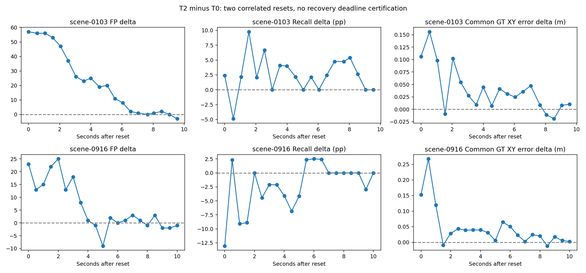

# M8-J11A：冻结StreamPETR时序敏感性实验

**干预实现通过，三个实验全部完成；观测到历史依赖和稀疏历史退化，不认证时序鲁棒性或驾驶安全。** 单一分支 `feat/streampetr-temporal-sensitivity`；基础main `1d7472dea3941132a0e5946dc7f80feddc26b4f6` 与执行前远程一致。PETR-A继续参考，默认运行模式不变。

任务客户端日期与实际执行日志的UTC日期均为2026-11-01；精确时间保留在原始阶段记录中。GPU执行源码 `6e36963b96b76e1cb68b84ff445eabed3a3ee6a6`；评测源码与命令逐阶段记录于 `m8j11a_sources`。

## 固定输入与预算

唯一权重SHA `e6323ae5c31adf1eedd46d6dd4fd3c73d95aa26f18cc8aa23c196494b7de3451`，官方源码 `95f64702306ccdb7a78889578b2a55b5deb35b2a`，已验证非Flash FP32后端，bs1，256×704×6，TF32关闭。与T0相同的resolved config SHA `7d28a79387a745dda53fd713c769d229b08869102f29be3fe60bce90fc8ba3c3`。全部77个固定文件、81个T0缓存和输入manifest按哈希验证；没有PETR-A/B/C缓存混入T0。

清单先于任何前向冻结：scene-0103为40帧、scene-0916为41帧，按真实时间排序。T2各scene零基20重置，即全局20/60；T3保留0,2,4,…，20+21=41帧。配置记录完整sample/scene/索引/时间间隔及run_id，不按GT或预测选样。新前向按T2→T1→T3执行81+81+41=203，预热0、额外诊断0，未使用剩余40次预算。每次simple_test前持久化预约，失败尝试也计数；无optimizer/backward。

自车位姿来自nuScenes标定及ego_pose，沿用LIDAR_TOP参考坐标到global变换，不是视觉里程计。纯视觉分支只读取既有RGB/标定/真实时间/位姿缓存；GT在独立CPU评测进程加载，点云/Radar载荷未进入推理。真实相机时间戳及位姿未经修改。

## 重置与状态证据

官方 `simple_test_pts` 会覆盖外部prev_exists，因此干预使用 `prev_scene_token=None` 加官方 `reset_memory()`，随后由官方入口处理真实scene token。只设置输入prev_exists=0不能替代该过程。适配器默认normal，不修改官方模型和历史runner。

实际状态包括检测器prev_scene_token/test_flag/single_test，以及memory_embedding/reference_point/timestamp/egopose/velo。五类记忆一起清空；cold路径合法添加256个pseudo-reference及单位位姿，不把非零初始参考点误判为旧历史。无独立逐槽可见性标记，实际有效性依赖prev_exists及已写入历史；padding不计观测。每帧读1024槽、写入256个提议，写完保存1280槽。

memory_timestamp在post-update后保存负的来源秒数；下一帧加当前时间变为相对年龄。检查器按实际写入时间逐槽核验，没有将相对年龄当绝对时间比较。历史scene和时间、跳帧未参与、头入口prev_exists、参数/注册buffer均核验。官方实现只按scene变化自动清空，没有时间间隔触发清空的规则，本轮T3也未观测到该类重置。

46个缓存配对检查全部逐数组相同（最大差0，仍保留原atol=rtol=1e-5）：T2重置前40帧、T1/T3各两场景首帧、T2两次重置与T1同帧。40+4+2=46个检查（T2首帧已含在40帧中）。参数/固定buffer初末指纹均为 `b4a9e08d2db06e0dbafd8ae45633ef8e249e8b2545425b916e31b2a01edaedef`。没有跨场景、跨实验或未来观测进入记忆。

## 官方完整81帧评价

nuScenes-devkit1.1.9 / detection_cvpr_2019，官方GT3393；固定Top300、0.2阈值、范围和属性/速度导出，没有NMS或阈值搜索。T0直接读取精确旧指标；T1/T2为人为干预，不是自然运行或排行榜成绩。

|条件|mAP|NDS|mATE m|mASE|mAOE rad|mAVE m/s|mAAE|
|---|---:|---:|---:|---:|---:|---:|---:|
|T0|0.425015|0.479316|0.605804|0.437132|0.579822|0.429424|0.279739|
|T1|0.318711|0.384921|0.703555|0.443834|0.634660|0.665107|0.297185|
|T2|0.419676|0.472071|0.629730|0.443317|0.583915|0.435265|0.285448|

|类别|官方GT记录 / 独立instance|T0 AP|T1 AP|T2 AP|
|---|---:|---:|---:|---:|
|car|1913 / 114|0.7195|0.5281|0.7115|
|truck|95 / 4|0.8024|0.4494|0.7589|
|construction_vehicle|0 / 0|0.0000|0.0000|0.0000|
|bus|33 / 1|0.6061|0.5915|0.7046|
|trailer|0 / 0|0.0000|0.0000|0.0000|
|barrier|0 / 0|0.0000|0.0000|0.0000|
|motorcycle|214 / 10|0.5607|0.3845|0.4436|
|bicycle|36 / 7|0.2680|0.1886|0.2793|
|pedestrian|1067 / 67|0.5694|0.4712|0.5789|
|traffic_cone|35 / 8|0.7240|0.5738|0.7200|

零支持类保留官方平均行为，N/A误差在官方原文件保留NaN，聚合JSON用null；公交仅一个独立实例。T3未更改官方split、未补空预测，只做41帧项目共同子集诊断。

## 固定工作点与匹配集合变化

同类一对一XY<2m；完整项目GT3559，稀疏共同子集GT1795，与官方3393不混用。误差统计只针对各自匹配目标，配对统计另列。GT记录含同一实例连续帧，不能当作独立物体。

|条件|GT|TP|FP|FN|重复|Precision|Recall|XY均值m|XY P95m|absΔz均值m|absΔh均值m|
|---|---:|---:|---:|---:|---:|---:|---:|---:|---:|---:|---:|
|T0全81|3559|3135|3277|424|793|48.89%|88.09%|0.5824|1.6058|0.0894|0.1000|
|T1全81|3559|2932|6005|627|1757|32.81%|82.38%|0.7865|1.8177|0.1012|0.1032|
|T2全81|3559|3135|3850|424|899|44.88%|88.09%|0.6123|1.6423|0.0895|0.1010|
|T0共同41|1795|1572|1668|223|407|48.52%|87.58%|0.5815|1.5995|0.0897|0.0979|
|T3共同41|1795|1546|4460|249|2272|25.74%|86.13%|0.6950|1.7449|0.0996|0.1063|

|干预相对同帧T0|共同匹配|仅T0|仅干预|两者未匹配|共同GT平均XY误差变化m|
|---|---:|---:|---:|---:|---:|
|T1|2755|380|177|247|+0.2004|
|T2|3065|70|70|354|+0.0195|
|T3|1475|97|71|152|+0.1202|

T1：两个场景召回均下降，汽车/行人贡献大部分新增FP；共同GT平均XY误差+0.2004m。支持“该时序权重正常运行依赖历史”的有限结论，不能当作时序模型与公平重训单帧模型的优劣结论。

T2：整体TP相同，但70条T0-only与70条T2-only互相抵消，新增573条FP、106个重复。scene-0103召回86.80%→88.16%，scene-0916召回89.16%→88.03%；公交召回提高、摩托车召回下降。整体召回相同不表示每个对象或重置后行为相同。

T3：相同41帧上FP1668→4460、重复407→2272，TP净减少26。scene-0103召回下降，scene-0916召回提高但误检显著增加；增加FP主要来自汽车和行人。共同目标XY误差+0.1202m。直接证据是稀疏输入导致预测集合、重复和位置变化；“过旧特征、传播Query竞争”等具体内部原因尚未单独隔离，不能断言。实际输入间隔中位数0.499881→0.999768秒；T2正常历史读取的最老年龄中位数约1.999503秒，T3约3.999175秒。固定容量下观测间隔和历史时间跨度同时扩大，不是固定时间窗消融。

## 两次重置的局部影响

|场景|重置后偏移帧|实际经过秒|TP T0→T2|FP T0→T2|共同GT平均XY误差变化m|
|---|---:|---:|---:|---:|---:|
|scene-0103|0|0.000000|28→29|32→89|+0.1060|
|scene-0103|1|0.550202|31→29|34→90|+0.1559|
|scene-0103|2|1.052144|30→31|31→87|+0.0980|
|scene-0103|4|2.050377|38→39|30→77|+0.1021|
|scene-0916|0|0.000000|42→36|32→55|+0.1522|
|scene-0916|1|0.499887|39→40|35→48|+0.2674|
|scene-0916|2|1.000308|40→36|31→46|+0.1191|
|scene-0916|4|2.000802|35→35|25→50|+0.0286|

重置后第4帧约2秒时，两个场景FP仍分别30→77、25→50；不能宣称四帧内稳定恢复。后段scene-0103在约7.65–9.55秒的最后5帧FP差为0、+1、+2、0、−3；scene-0916在约8.00–10.00秒为−1、+3、−2、−2、−1，差异缩小但不单调。全部剩余20/21帧趋势保留在JSON和下图；单帧超过T0不被当成恢复认证。

## 资源与验证

|条件|新前向|仪器化GPU区间P50 ms|P95 ms|峰值allocated GiB|峰值reserved GiB|
|---|---:|---:|---:|---:|---:|
|T1|81|26.93|29.53|0.431|0.676|
|T2|81|27.38|28.81|0.431|0.676|
|T3|41|27.82|33.72|0.431|0.676|

CUDA事件区间包含状态审计中的同步和CPU检查空隙；每帧wall还包含缓存读取、H2D、输出、完整冻结检查和落盘。实际本轮GPU P95约29–34ms，与历史J11约160ms并不接近；除边界不同外，跨运行环境负载/时钟等差异尚未归因，不宣称这里获得了加速。T2首帧仪器化区间约2784ms的长尾也保留。本轮未为计时增跑，不能与J11原始图像完整路径或无仪器化GPU P95直接比较，也不能据此升级实时门禁。

24项有限测试通过（含官方pre_update_memory小张量冷初始化与历史合同回归），1项已有CUDA Attention测试跳过；203次真实RTX4090 FP32前向单独记录。没有训练、CARLA、依赖升级、架构/解码/默认后端修改，旧来源及报告哈希保持不变。

6组私有对照按运行前固定索引生成：T1/10、T2/19/20/59/60、T3/70。私有入口 `/root/gpufree-data/hs-drive-private/m8j11a-temporal-20261101/visuals/index.html`。助手实际查看T2_20六摄与T3_70 BEV，仅作解释；其他生成内容不称人工复核，未要求或伪造签核。

## 结案与分支处理

A InterventionImplementation：通过。B ExperimentCoverage：203/203完成。C TemporalSensitivity：历史移除和稀疏历史出现明确损失，中途重置影响局部明显且场景/类别混合；不作鲁棒性全面通过或架构无效结论。

代码具备合并条件：默认关闭、历史源码不变、相关回归和真实状态检查通过。建议用户一次确认后，将本功能分支最终提交快进main（若main前进则先检查兼容性），核验远程main包含后，以准确预期tip保护删除远程和本地 `feat/streampetr-temporal-sensitivity`。不新增实验分支或tag，不因性能下降长期保留分支。本轮不自动合并或删除。

本实验线到此结束，不用剩余预算追加修复训练。下一步转向另行限定范围的SparseDriveV2 Bench2Drive分支接入评估；本轮未执行该接入，不以消除全部时序敏感性为前置条件。PETR-A和默认运行模式继续不变。

[验收](m8j11a_acceptance.json) · [完整聚合统计](m8j11a_comparison.json) · [交叉验证及资源](m8j11a_validation.json) · [实现与复现](../docs/M8J11A_IMPLEMENTATION.md)
