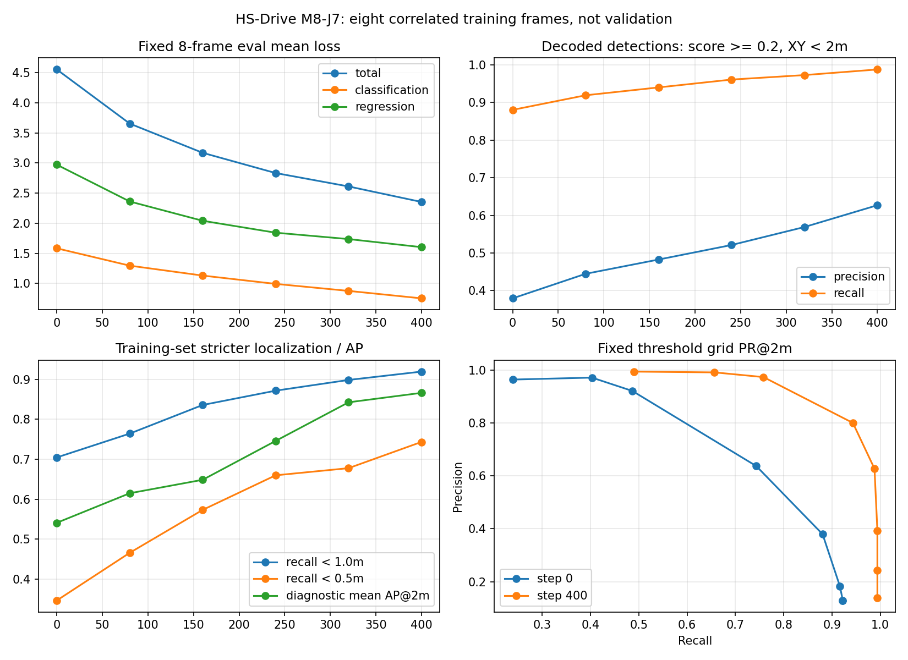
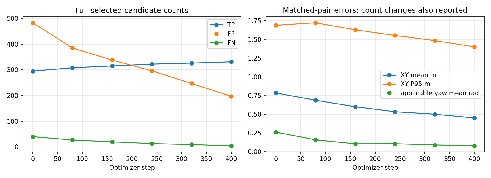

# M8-J7 固定八帧 FP32：400步及学习效果诊断

日期：2026-10-27；基础f4e44f9，独立分支feat/m8j7-eight-frame-fp32-overfit。
实际执行源码：87b7707ba107adbddb0b19566c263bd85588e576；run_id：m8j7_20261027_132740。最终交付另附汇总代码，不改执行源码。

**有限训练稳定完成：400/400次更新；最终新进程加载通过。结果仅属于固定八帧训练集，不是nuScenes验证成绩或泛化验收。**

## 配置与边界

从Smoke相同原始checkpoint及空AdamW开始，未使用Smoke第3步权重/动量。八帧0–7固定循环50次，全部335条训练GT保持不变，未删除困难目标或扩数据。两个训练场景与官方预训练full train有已知重叠，连续帧也相关，335条记录不是335个独立物体。
FP32、bs1、六摄512×1408、十类、900 Query、六层；AdamW lr1e-5、betas(0.9,0.999)、wd0、clip35、常数学习率、无scheduler，seed875606。Head Dropout保持0.1，Backbone/Neck eval和no_grad。AMP/TF32关闭，无GradScaler，不更换模型结构、图像增强、监督规则。
完整配置/token/SHA在 [冻结协议](../configs/m8j7_protocol.json)。初始权重SHA256：16d8a4875c36e7d1cba75b357901ff031b18d9d9374f12780b9b72cc621cefad。

## 全部固定评估点

正常head.get_bboxes解码：原NMSFree top300 query-class pairs，独立XY任务区域过滤，主score≥0.2、同类一对一XY距离<2m。GT不参与预测筛选。重复和未匹配预测保留为FP；任务范围外预测另报。评测GT与训练GT同为335，未再过滤；某些物理目标可能因官方点数/任务范围规则不在GT中，因此FP是任务定义下的未匹配，不自动等同物理虚假物体。
Loss为同一eval模式下八帧平均，各层和各帧完整记录均保留；不把随机训练单步Loss当整体进步。评估恢复原随机状态与训练模式。

|步数|分类Loss|回归Loss|总Loss|TP|FP|FN|Precision|Recall|1m TP|0.5m TP|诊断mAP@2m|
|---:|---:|---:|---:|---:|---:|---:|---:|---:|---:|---:|---:|
|0|1.5827|2.9725|4.5552|295|483|40|37.92%|88.06%|236|116|0.5408|
|80|1.2944|2.3609|3.6554|308|385|27|44.44%|91.94%|256|156|0.6148|
|160|1.1295|2.0403|3.1698|315|338|20|48.24%|94.03%|280|192|0.6485|
|240|0.9915|1.8422|2.8337|322|296|13|52.10%|96.12%|292|221|0.7458|
|320|0.8748|1.7362|2.6110|326|247|9|56.89%|97.31%|301|227|0.8425|
|400|0.7511|1.6020|2.3530|331|197|4|62.69%|98.81%|308|249|0.8662|

AP是本协议101点插值、有GT类别均值，不是官方nuScenes mAP/NDS。没有根据结果挑“最佳”检查点；第400步为最终结果。所有PR阈值、未匹配与重复预测计数见逐点评估原始JSON。

## 逐帧训练前后

|帧|GT|Loss 0→400|TP 0→400|FP 0→400|FN 0→400|
|---:|---:|---|---|---|---|
|0|50|5.0589 → 2.4772|43 → 49|75 → 26|7 → 1|
|1|51|5.3245 → 2.5980|44 → 51|99 → 43|7 → 0|
|2|56|5.4428 → 2.7737|48 → 54|86 → 33|8 → 2|
|3|61|5.3536 → 2.8344|49 → 60|74 → 37|12 → 1|
|4|28|4.1532 → 2.1083|25 → 28|29 → 8|3 → 0|
|5|28|3.4112 → 1.6119|27 → 28|35 → 13|1 → 0|
|6|29|4.0135 → 2.2065|27 → 29|40 → 18|2 → 0|
|7|32|3.6836 → 2.2144|32 → 32|45 → 19|0 → 0|

## 分类别与剩余问题

|类别|GT|TP 0→400|FP 0→400|FN 0→400|XY均值m 0→400|适用Yaw均值rad 0→400|
|---|---:|---|---|---|---|---|
|car|112|102 → 110|134 → 60|10 → 2|0.7478 → 0.4031|0.2512 → 0.0979|
|truck|28|27 → 28|29 → 7|1 → 0|0.8256 → 0.4846|0.0447 → 0.0232|
|construction_vehicle|0|0 → 0|1 → 0|0 → 0|N/A → N/A|N/A → N/A|
|bus|0|0 → 0|0 → 0|0 → 0|N/A → N/A|N/A → N/A|
|trailer|0|0 → 0|0 → 0|0 → 0|N/A → N/A|N/A → N/A|
|barrier|97|94 → 96|78 → 31|3 → 1|0.7366 → 0.5003|0.0305 → 0.0242|
|motorcycle|1|0 → 1|4 → 3|1 → 0|N/A → 0.0672|N/A → 0.0102|
|bicycle|1|0 → 1|1 → 0|1 → 0|N/A → 0.5534|N/A → 0.1009|
|pedestrian|87|64 → 86|215 → 86|23 → 1|0.8980 → 0.4483|0.7032 → 0.1222|
|traffic_cone|9|8 → 9|21 → 10|1 → 0|0.7286 → 0.3787|N/A → N/A|

bus/trailer/construction_vehicle无GT，不赋予AP/Recall高分；仍统计其误检。motorcycle和bicycle各仅1条GT，不支持类别泛化结论。traffic_cone不评价Yaw；barrier按π周期，其余适用类按2π。

|匹配误差|第0步均值|第400步均值|第0步P95|第400步P95|
|---|---:|---:|---:|---:|
|xy_m|0.7834|0.4487|1.6894|1.4023|
|z_center_m|0.0675|0.0591|0.1892|0.1488|
|dimension_abs_mean_m|0.1249|0.0773|0.2847|0.2010|
|aligned_size_iou_error|0.1895|0.1187|0.3983|0.2492|
|yaw_rad|0.2603|0.0757|2.5026|0.2562|

成功匹配集合随训练变化。额外固定两端都匹配的294条GT记录，按同一GT比较误差，见 [残差诊断](m8j7_residual_diagnostics.json)。该分析只解释结果，不修改匹配/训练/阈值。

最终漏检原因（仅基于已固定正常解码和匹配的事后诊断）：

- barrier：{"NearbyPredictionConsumedByOneToOneAssignment": 1}
- car：{"Within2mButBelowFixedScoreThreshold": 1, "NoSameClassCandidateWithin2m": 1}
- pedestrian：{"NoSameClassCandidateWithin2m": 1}

NoSameClassCandidateWithin2m不能单独证明几何模块失效，也可能涉及分类、top300截断或特征；本轮未进行这些归因干预。

## 冻结、梯度、资源与恢复

400步Loss/梯度均有限，每步均存在分类及回归有效梯度和实际参数更新，wd=0。每步变化参数对象最少141、最多141，不能仅用权重衰减解释更新。
141个训练Parameter对象、221个训练state别名，178个冻结Parameter对象及159个buffer共337项冻结state始终精确不变。每步优化器参数去重、训练/冻结互斥及别名一致性检查均通过。全参数连续状态hash、Adam状态、LR和step连续。
每步峰值allocated 1,257,673,216 bytes（1.171 GiB），reserved 1,776,287,744 bytes（1.654 GiB）。这是冻结骨干、Head反向的PyTorch allocator口径，不含驱动/其他进程，不是全网训练显存。
训练进程墙钟909.24秒，单步中位2.014秒、P95 2.064秒；包含读取/前后向/更新/校验，不是纯推理或实时驾驶性能。
0/80/160/240/320/400检查点全保留。最终独立进程恢复模型、buffer、优化器、模式、RNG和共享别名，固定eval输出容差预先为atol1e-6/rtol1e-5。
最终检查点SHA256：3351116c5c4d4dd5b75cc2a45a73f21d12ee3f40ef7fac43c836712b06c7ed78；最终验证0次更新，误差：{"all_cls_scores": {"max_abs_error": 0.0, "relative_l2": 0.0, "bitwise_equal": true, "passed": true}, "all_bbox_preds": {"max_abs_error": 0.0, "relative_l2": 0.0, "bitwise_equal": true, "passed": true}}。
没有连续训练逐位等价对照，不作扩大声明。具体资源/加载证据见 [资源与冻结报告](m8j7_resource_and_freeze.json)。

## 失败记录、测试与复现

首个run m8j7_20261027_131635在第0步绘图失败，实际optimizer.step=0。官方PETR extract_img_feat对bs1调用squeeze_()；新绘图器误按五维索引。修复仅使绘图接受4D/5D同一内容，并加入回归测试，完整失败日志及私有failure checkpoint保留。独立修复后run从原始权重/空优化器开始；没有扩展400步预算、调整数据/模型或通过重跑筛选结果。
原50项测试继续通过，新增13项匹配/AP/距离/类别/重复/空预测/图像维度测试通过，共63项。执行代码、冻结协议与预检在训练前提交。后处理汇总另行保存，不改执行证据。所有历史M8-J6文件、原始权重和16个输入/监督包SHA不变。
命令及实现说明见 [M8J7_IMPLEMENTATION](../docs/M8J7_IMPLEMENTATION.md)。私有前后对照：/root/gpufree-data/hs-drive-private/m8j7_20261027_132740/comparison.html；包含全部八帧六摄和BEV，未公开图像、逐对象标签/预测或模型。实际查看记录单独保存，未查看项不宣称人工确认。

## 决策范围

1. 有限训练稳定性：400步和最终重载通过；没有第401步。
2. 学习效果：依据同一eval协议的Loss、全候选TP/FP/FN、严格距离和PR曲线分别判断，不能替代独立场景评测。
3. 改善与退化：以上表格完整列出，包括无GT/弱支持类别与误差尾部；不因总体Loss下降忽略局部退化。
4. 下一步只提出限定实验，不在本轮执行。独立场景测试与最小定位诊断的最终建议见本文附加解读。

保留AMP未通过、Occupancy/视觉驾驶未验证状态。未启动CARLA、未更换模型或新增OCC/时序、未合并main。

## 最终解读与最小下一步

**1. 稳定性：通过本轮400步范围。** 400次更新、六个固定评估点和最终独立重载均完成，冻结参数及buffer变化为0；前置绘图失败消耗0步，未混入本次学习曲线。

**2. 八帧学习效果有证据支持。** 平均总Loss下降48.34%；同一2m/0.2协议下TP 295→331、FP 483→197，Precision 37.92%→62.69%、Recall 88.06%→98.81%。更严格的0.5m匹配116→249，固定两端共同匹配294条GT的XY均值0.7836→0.4286m，支持实际定位改善，不仅是匹配数量变化。

**3. 存在局部退化与未解决错误。** 最终仍有197个任务定义下FP，其中56个为同类别2m内重复（基线重复89个）。4个漏检包括2辆车、1名行人和1个barrier；3个位于20m以上，1个是近场密集barrier一对一分配竞争。barrier TP从第240/320步97退到最终96，必须保留最终退化，不用中间最好点替换。

所有已匹配行人的重心Z平均误差0.0746→0.0956m，最大值0.3090→1.2019m；最严重3例在帧2、1、3。它们XY误差较小，说明2m XY匹配不能认证完整3D框。对前后共同匹配的64条行人GT，Z均值反而0.0746→0.0596m，最大值0.3090→0.1977m；总体上升主要与新增匹配集合有关，仍需定位高度异常来源，不能借共同子集的改善忽略实际大错。锥桶XY最大误差1.2083→1.6986m，行人XY最大误差1.8791→1.9180m，尾部没有随均值全面改善。朝向均值/P95整体改善，但少量接近π的错误仍存在，未认证每个方向可靠。

**4. 建议先做一次限定的离线定位诊断，再进入独立场景评价。** 已具备开展独立场景评估的工程和学习证据，当前不需要追加数千步或更换结构。但在解释“可靠3D拟合”前，优先限定为现有缓存中的3例高Z误差行人和4个漏检：

- 不更新参数、不重新挑选训练数据；使用本轮已保存step0/400正常解码、原GT和六摄投影。
- 检查这3例的bottom/gravity center、尺寸与二维投影，以及近邻GT/重复预测造成的XY匹配关联歧义；区分模型高度误差、匹配身份歧义和适配问题，不先假定结论。
- 对4个漏检核对固定阈值下的score不足、2m外定位和一对一竞争，保留现有阈值，不为提高Recall调整测试定义。
- 完成这项有限检查后，可预声明一个小型、与本轮两个训练场景不同的固定评价集；冻结原始模型与最终400步模型，同协议一次对比，不再据结果选择检查点。需单独披露这些场景是否已用于官方预训练，不能把“未参与本轮更新”自动称为全新盲测。

上述下一步本轮均未启动。预算内尚未拟合到100%不支持PETR架构无效，也不支持扩大训练自动获批。
