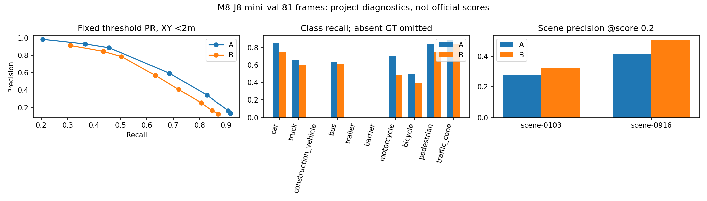

# M8-J8：残差归因与独立场景 A/B 评估

实际执行日期：2026-10-27 UTC。基础 `f50aead`，独立分支 `feat/m8j8-residual-independent-eval`。GPU执行源码 `38fd0dfb248801df038292293dcdca0b61bd0d06`，run_id `m8j8_20261027_ab`。后处理源码及产物SHA见release manifest。

**完成两个mini_val场景全部81关键帧的固定A/B评估，参数更新0次。B减少了误检和重复，但两个场景的召回均下降，共同匹配目标的几何误差也总体变差。M8-J7八帧学习证据保留，独立场景迁移改善未获支持。下一轮优先保留A作为参考。**

## 固定对照、支持量和证据范围

A是M8-J7原始起点，B是最终400步权重，没有选中间最优检查点。路径、文件大小、SHA和模型fingerprint见[冻结协议](../configs/m8j8_protocol.json)。A原始pth SHA为`16d8a4875c36e7d1cba75b357901ff031b18d9d9374f12780b9b72cc621cefad`；实际加载的安全tensor归档SHA为`cf33dccb1d549c425a89cf346d6f05401c49f6cccbd5a579cb7d8937b5a6d591`。B SHA为`3351116c5c4d4dd5b75cc2a45a73f21d12ee3f40ef7fac43c836712b06c7ed78`。

维持FP32、eval、bs1、十类、六摄512×1408、900 Query、官方NMSFree top300 query-class pairs；score≥0.2、严格XY范围±51.2m、同类按分数排序的一对一XY<2m匹配，辅以1m和0.5m以及原PR阈值列表。没有增加NMS、裁剪尺寸、调整阈值或用GT挑预测。

[固定清单](m8j8_evaluation_manifest.json)在前向前提交：scene-0103 40帧，scene-0916 41帧，和八帧微调scene/sample交集为0。共4514条原始标注，原任务规则保留3559条，涉及213个独立instance；不是3559个独立物体或81个独立场景。XY范围、零点数支持、非任务类别分别触发416、658、73次，原因可以重叠。逐条来源和过滤记录仅私有保存。GT/预测均沿用官方LIDAR_TOP参考坐标，未将该坐标字段当作点云感知输入。

官方checkpoint静态元数据记录`nuscenes_infos_train.pkl`、独立val配置、24epoch和ResNet起点；这两个mini_val场景属于full val，不属于full train。支持按记录配置未参与检测预训练，但缺少实际完整训练sample账本，不能认证上游骨干数据历史或排除val模型选择暴露。本次微调未见由实际清单验证。详细来源见[预训练证据](m8j8_pretraining_provenance.json)。本次用过的mini_val现为开发评价集，不能以后再称封存最终测试集。

协议直接复制J7的evaluation字典，`gt=Exactly335...`、`scope=TrainingSetDiagnostic...`和旧`steps`文字仍描述旧八帧残差部分；实际mini_val范围由独立固定manifest及全部输出明确为81帧/3559GT。这是沿用说明字段的局限，未据此筛选mini_val或执行训练；保留执行时协议原文，不追溯改写。

## 已知残差：没有发现需要修正A/B比较的转换错误

复用了旧缓存；为取得缺失的原始decoder输出及query来源，对旧八帧各补A/B只读前向。正常解码与J7旧缓存全部在预定atol1e-6/rtol1e-5内一致。三条高度异常使用当前冻结官方normalize_bbox、denormalize_bbox和LiDARInstance3DBoxes重新核对，编码/解码/角点最大差异1.20e-7，未发现中心与底面中心、尺寸顺序、单位或exp(log h)错误。

|旧八帧索引|中心Δz（预测−GT，m）|框高Δh（m）|XY误差（m）|
|---:|---:|---:|---:|
|2|-1.20190|+0.22460|0.38929|
|1|-1.08024|+0.37620|0.15961|
|3|-1.00888|+0.30235|0.04934|

这三条是**同一名行人**的连续观测。原图中该行人处于货车抬高的货厢位置，转换后的GT也保持抬高位置；B预测中心明显偏低。实际查看原图与固定裁剪图，裁剪可见范围及路面高度先验可能影响预测，但没有因果干预，不能据此确认具体网络模块原因。错误主要来自预测中心，不能用框高误差或半高度偏移解释。

原始GT全值、训练中心/完整尺寸/编码、网络cz/logh、解码中心/高度、框对象底面及显示上下界的数值链全部保存在私有`residual_object_audit.json`及`residual_comparison.html`，避免公开逐对象标签。[公开残差报告](m8j8_residual_attribution.json)只保留误差和归因统计。

四条漏检（四个不同instance）没有被GT过滤：

|帧/类别|证据|结论边界|
|---|---|---|
|0 / barrier|2m内有足够分数预测，但已被另一GT匹配；最近raw query类别分数0.17936|密集目标一对一竞争，不能简单称整个物体没有响应|
|2 / car|同类解码位置距GT约0.5545m，分数0.14338<0.2|固定分数筛选漏检，不调整阈值|
|2 / pedestrian|900个raw query最近中心距2.55715m；对应行人分数0.01282，最高类为barrier|中心支持不足并伴随分类弱，未隔离特征与投影原因|
|3 / car|最近raw中心距2.00520m，car分数0.45503|刚超固定2m标准，保留为漏检，不放宽距离|

56个同类重复预测分属55个frame×GT组、41个instance，类别为barrier17、pedestrian27、car7、truck2、cone3。全部由不同Query产生；20个在2m内有多个同类GT，存在关联歧义。另有10组同Query多类别输出，单独统计，不混为56个同类重复。Query只代表一次前向中的索引，不是物体身份。高度、漏检、重复的instance并集为45；高度目标也进入重复集合，不重复声称新物体。

## 独立场景固定指标

以下均为**项目诊断**，不是官方mAP、NDS或mATE，也不是完整nuScenes val成绩。FP表示此任务协议下未匹配预测，不自动等于物理上不存在的目标；点数/类别/范围过滤也会影响分母。所有已匹配误差是条件统计，必须和FN一起看。

|指标|A 原始|B 第400步|
|---|---:|---:|
|GT|3559|3559|
|TP / FP / FN|2947 / 5698 / 612|2564 / 3759 / 995|
|Precision|34.09%|40.55%|
|Recall|82.80%|72.04%|
|重复预测|1116|562|
|0.5m / 1m TP|1122 / 2155|834 / 1728|
|固定协议101点AP，有GT类均值|0.5993|0.5456|
|全部匹配XY均值 / P95（m）|0.8422 / 1.7784|0.8806 / 1.8093|
|全部匹配中心Z绝对误差均值 / P95（m）|0.1114 / 0.3092|0.1164 / 0.3232|
|全部匹配框高绝对误差均值 / P95（m）|0.1124 / 0.3390|0.1219 / 0.3486|
|全部匹配宽 / 长绝对误差均值（m）|0.0986 / 0.2657|0.1357 / 0.3058|

Z绝对误差最大值1.0516→0.8814m有所改善，但均值/P95退化。XY最大值接近2m是匹配条件造成的截断，不代表所有预测误差≤2m；更大的错位计入FP/FN。A匹配XY最差记录为frame51 car 1.99803m；B为frame40 pedestrian 1.99932m。其余尾部及逐对象对应关系私有保存，公开摘要见[补充诊断](m8j8_diagnostic_supplement.json)。

|场景|GT|TP A→B|FP A→B|Recall A→B|Precision A→B|
|---|---:|---|---|---|---|
|scene-0103|1621|1353→1166|3476→2419|83.47%→71.93%|28.02%→32.52%|
|scene-0916|1938|1594→1398|2222→1340|82.25%→72.14%|41.77%→51.06%|

|类别|GT记录 / 独立instance|TP A→B|FP A→B|Recall A→B|
|---|---:|---|---|---|
|car|1938 / 114|1647→1448|2678→1616|84.98%→74.72%|
|truck|100 / 4|66→60|95→40|66.00%→60.00%|
|bus|36 / 1|23→22|21→12|63.89%→61.11%|
|motorcycle|227 / 10|159→109|148→95|70.04%→48.02%|
|bicycle|38 / 7|19→15|71→52|50.00%→39.47%|
|pedestrian|1183 / 69|1000→879|2584→1881|84.53%→74.30%|
|traffic_cone|37 / 8|33→31|101→63|89.19%→83.78%|

construction_vehicle、trailer、barrier无有效GT；Recall/AP为N/A，主阈值FP两者均为0，不赋予100%成绩。bus只有1个instance，truck4个；这些类别无法支持稳定的类别泛化判断。其余类别也只有两个场景、时间相关观测，不给出假设独立样本的置信区间。

两端共同检测2483条GT；A检测而B漏掉464条，A漏掉而B检测81条，两者均漏531条。对应的instance状态可跨帧改变，不能把记录数当独立物体数。共同目标配对结果：

|误差均值|A|B|B−A|
|---|---:|---:|---:|
|XY（m）|0.78430|0.86243|+0.07812|
|中心Z绝对误差（m）|0.10651|0.11460|+0.00809|
|三维尺寸平均绝对误差（m）|0.15865|0.18796|+0.02931|
|框高绝对误差（m）|0.11039|0.12140|+0.01101|
|适用朝向绝对误差（rad，2454条）|0.58029|0.60965|+0.02936|

共同目标XY：car0.7462→0.8402m，pedestrian0.8379→0.9036m，bicycle0.8403→1.0229m，motorcycle0.8248→0.8655m；truck0.8569→0.8501m、bus0.9280→0.9087m略改善但支持很少。cone在各自匹配集合中XY均值降低，共同集合反而0.6281→0.6336m，说明不能忽略匹配集合变化。朝向均值退化而P95略改善，完整统计保留，不只挑改善项。

[A/B全量聚合及每场景统计](m8j8_ab_statistics.json)、[逐帧聚合](m8j8_per_frame.json)和[分类配对误差](m8j8_diagnostic_supplement.json)含全部匹配目标、PR和方向计数。

## 执行、测试及私有产物

实际服务器RTX4090；PyTorch2.0.0+cu118、CUDA11.8、MMCV1.7.2、MMDetection2.24.1、MMDetection3D0.17.1。FP32、TF32/AMP关闭，所有模块eval，每帧及末尾参数和buffer独立快照精确不变，共享别名一致、grad均None，optimizer/backward次数均0；GT/点云输入canary均被拒绝。

两份模型分别执行89帧（旧8+新81），进程内部总耗时77.54/77.24秒；supervisor含启动等待为82.90/82.52秒。最大PyTorch allocated均1,131,236,864 bytes（约1.054GiB）；不含驱动及其他进程，不是实时系统预算或纯模型吞吐。prepare耗时68.32秒。全部三个进程exit0，无自动重试，无CARLA。

推理前19项原匹配与新增坐标/重复测试通过；后处理增加配对统计及NumPy JSON保护回归，最终22项通过。保留两个非模型失败记录：首次聚合因NumPy int64序列化失败，保留部分文件并修复序列化后仅离线重聚合；后处理测试首次误加载主项目Python≥3.9的conftest，在隔离Python3.8环境收集失败，按既有隔离测试方式`--noconftest`执行通过。两次均未触发GPU重跑、训练或改变指标规则。

私有目录`/root/gpufree-data/hs-drive-private/m8j8_20261027_ab`：

- `comparison.html`：两个场景预先固定首/中/末帧A/B六摄及BEV。
- `residual_comparison.html`：旧帧0–3对照及三条高度完整数值链。
- `residual_object_audit.json`、`mini_val_object_comparison.json`、`mini_val_xy_tails.json`：逐对象证据及追溯。

实际AI查看范围和结论单独记录，不宣称人工签核或查看了全部图像。未上传原图、逐对象标签/预测或权重；公开仅聚合图表、标识manifest、代码、运行日志和SHA。

## 决策与下一步

1. **残差主要归于模型预测与有限匹配关联。** 高Z链路一致，56重复源于不同Query；密集barrier有评价关联歧义。没有发现需修改GT/解码/指标的系统转换错误。模型内部具体成因未由干预证实。
2. **八帧改善没有转化为本次独立场景的整体改善。** 精度提升伴随召回、严格匹配、诊断AP及共同几何误差退化；保留八帧学习验证通过，同时标记`TransferBenefitNotSupported`。不据此否定PETR架构。
3. **两个场景及所有有GT类别的召回都下降。** 摩托车下降突出；少量类别的个别误差改善受支持量和匹配集合限制。
4. **A保留为下一轮参考；B完整保留为八帧拟合研究资产。** 本轮不批准模型替换、追加训练、Occupancy或视觉驾驶。
5. **最小下一步提案，未执行：** 仅用现有A/B缓存，对464条A-only与81条B-only记录按固定0.2分数、top300、同类中心距离及一对一竞争分解损失/收益来源；按scene名、instance token、timestamp固定排序，每场景最多6个不同instance（总≤12）做定向投影查看。无参数更新、不扫阈值、不新增数据。先区分置信度转移与实际几何/分类退化，再单独决定下一项训练实验；不得以同一mini_val继续调参后声称新盲测。

本轮状态为`ReadOnlyEvaluationCompleted / ResidualAttributionSupportedWithinScope / TransferBenefitNotSupported / SafetyNotValidated`。官方nuScenes评估未运行（现成入口仍需独立输出格式/attribute/范围适配），AMP状态和此前所有安全门禁保持原样，不合并main。
